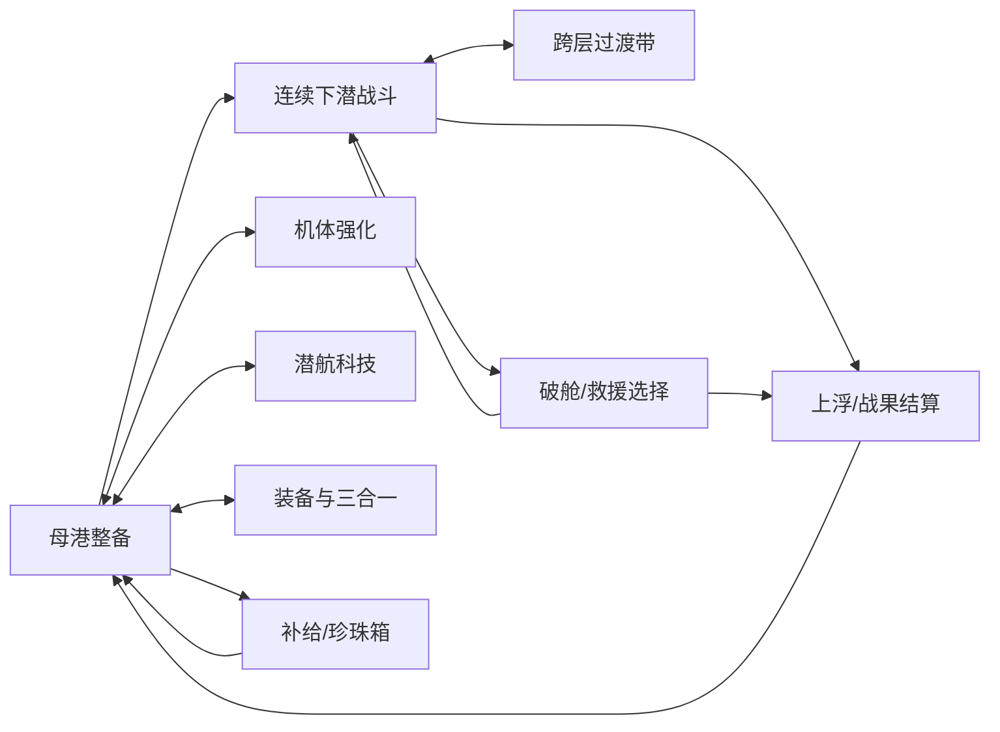

# 潜渊猎手 · LOO-70 体验优化设计方案

2026-11-12｜LOO-71 阶段 1｜设计交付，待产品评审；不含游戏实现、最终新素材与真机性能结论。

## 0. 方向、依据与交付边界

目标用户是单次游玩 2–5 分钟的休闲玩家。核心场景是持续下潜、走位避怪、自动攻击、平安上浮卸货。此次围绕“看得清、躲得开、不断流、像游戏、敌人活起来”改善五项体验。正式产品仍是 Cocos Creator 3.8 微信小游戏/浏览器游戏；所有尺寸使用源图 px、375 宽逻辑画布及世界单位，不使用 WXML 或 rpx。

视觉方向：**荧光深海 × 铆接潜航装备**。保留既有亲和手绘海洋生物、橙白潜航器和青紫水体；增加厚边、倒角、嵌槽与暖铜连接件，不切换成写实军工或太空霓虹。

依据：`docs/潜渊猎手-PRD.md` §4/5、原交互说明、`docs/撞鬼了-竞品分析报告.md` §2.2/三、`fx-review-r9.png`、`ui-review-r6.png`、`game/sea-assets.json`、`Battle.ts`、`WorldProjection.ts`、`SeaWorldView.ts`、`SeaBundleLease.ts`。已搜索 output/docs 的图片与竞品相关文件，仅找到报告，未找到竞品原始截图；不声称复刻竞品具体画面。方案从报告提炼装备可视化、养成直达和风险收益清晰的原则，布局为本项目设计。本轮未实测线上试玩，现状判断来自代码与仓库评审图。

交付目录 `output/deliverables/loo-70-design/`：

- `index.html`：离线可打开的七屏设计板，切换母港/战斗/强化/科技/装备/珍珠箱/结算，含加载/空/错误状态和过渡重放。
- `design-board.png`：关键界面截图拼版；仅设计稿，不是运行中的 Cocos 截图。
- `asset-list.csv`：24 条素材/实现项，沿用原索引 id、类别、用途、宽高、动画、风格约定、资源包口径；扩展实现方式、锚点、混合模式、备注。
- `direction-audit.csv`：全部 36 身份的朝向处理表；缩略图逐一核对，重点检查精英剑鱼和四个 boss。不是全帧动画质量认证。

### 信息架构与关键流转

保留原经济、广告授权与 boss 裂隙规则。设计稿数值均为 Mock，不构成平衡调整；不增加付费入口。

## 1. 战斗视觉：从普通几何弹体到可辨认的荧光武器

### 现状与决策

r9 敌方泪滴弹和空心危险圈已有可用轮廓，但友方四类武器缺少独立节奏与识别。采用“小弹芯＋单尾片＋短命中爆点”；华丽来自分层节奏、形状与成长可视化，禁止整屏 Bloom、屏幕模糊、全场白闪。

| 武器/对象 | 弹体与运动 | 拖尾与命中 | 成长可视化（只映射已有等级，不改伤害） |
|---|---|---|---|
| 声波炮 | 青白空心声呐环，360ms从0扩至实际AOE直径 | 刻度轮转；命中取共用爆点，中心持续透明 | 低阶单环，高阶第二道延迟80ms的浅环；最多2环 |
| 鱼雷 | 青白机械鳍弹芯，头朝速度方向 | 1枚气泡尾片随速度拉长，命中167ms裂片 | 弹芯保持24×12逻辑px，尾片亮度稍增；多弹只跟随原实际弹数 |
| 电弧链 | 冰蓝分形段，起终点绑定实际命中目标 | 100ms闪连；每链≤6段，20ms轻微折点抖动 | 实际链数/射程驱动可见长度，不造假链 |
| 诱饵浮雷 | 薄荷荧囊、三瓣刺、28×28逻辑px | 末200ms琥珀脉冲；爆炸绿环+最多8泡 | 触发范围与实际伤害半径一致；不以视觉膨胀暗改范围 |
| 普通敌弹 | 珊瑚橙尖菱，12×12逻辑px，暗色描边 | 可复用尾片但alpha≤0.25；不与友方同色同形 | 扇形条数按实际弹幕；中心危险弹芯永不降级隐藏 |
| 渊主弹 | 复用r9紫泪滴，保留外轮廓，代码橙描边 | 尾迹更短，碰撞中心清楚 | 继续使用既有16/32/64 LOD，不新增大型弹图 |

每项源图尺寸、帧数、色值、混合模式、锚点见 CSV。默认 Alpha；只有尾片、电弧和小爆点使用 Additive，统一材质，切勿每弹创建独立材质。PNG 透明外缘不能带黑底；源图有2px扩色与图集间隔，图集边≤2048，所有帧等大、中心对齐，不自动裁帧造成闪动。Additive 素材的亮核只占中心小面积，不把透明矩形全部涂白。

### 素材需求与验收

必出 7 张源 PNG：声呐、鱼雷、电弧、浮雷、尾片、四帧命中条、敌方尖菱。已有泡泡、危险圈与渊主泪滴复用，不重画。颜色变化、旋转、缩放、衰减与尾片拉长均由代码完成。新增 FX 源 RGBA 约0.21MiB，打图集后仍以实测为准。

验收：暂停截图仍能靠形状区分四武器和敌弹；特效不遮玩家、危险预警、boss血条；同一命中不叠加四个白爆点。命中特效最多24、飘字最多20组、尾片最多200、场景微粒24、过渡微粒12。超过上限先合并/丢装饰，不丢伤害弹芯、碰撞和预警。80怪+200实际弹体压测要求见 §6。

## 2. 横向移动：选择 A，去除实体岩壁并统一世界边界

### 现状与决策

`WORLD_BOUNDS` 为[-360,+360]，宽720；玩家半径12、默认速度120世界单位/秒。`WorldProjection` 以1世界单位=1逻辑px投影，横向跟随死区±48。`SeaWorldView.buildScene` 的岩壁却固定在屏幕中心±150、宽110，未随世界横向移动，因此看起来既挡路又能穿墙。**不能只改 min/max 后宣称消除了空段。**

选择 A：移除三层 `scene.left/right` 岩壁条带，复用远景、低密度微粒与不阻挡的远处植物。新增声呐浮标边界，必须绑定世界坐标。扩大边界平面至 **x=-540 / +540，宽1080（+50%）**，玩家中心限制为 **[-528,+528]**（各扣12碰撞半径）。怪物中心也按自身半径限制在边界内，边界外刷怪先投到合法位置，避免怪嵌边。

### 数值、镜头与视觉约束

- 375逻辑宽时，镜头横向中心限制 **[-352.5,+352.5]**，即±(540−187.5)。先按现有±48死区追随玩家，再 clamp 镜头；到两侧末段玩家继续靠边走，最终中心在屏幕x=12/363，碰撞外缘正好到0/375。潜艇60逻辑px装饰可轻裁边，禁止以透明图框再扣30px造成“空段”。若要外观完整，需另评碰撞轮廓而不是偷偷留白。
- 全世界物体（敌、弹、掉落、实际障碍、边界标记）使用同一投影；HUD固定屏幕。横向背景只做0.18倍视差，不拿它当物理坐标。
- 边界标记画在x=±540：1逻辑px青灰虚线，alpha0.25；外侧16逻辑px深色渐变。当玩家中心距边界≤48时亮至0.55，触限一次轻提示“已到航区边缘”，1秒去重；不做红色伤害圈，不播放撞墙受击。
- 边界提示在镜头以外可不可见；只在实际接近世界边时出现，不在每屏两侧画假墙。无新整屏背景需求，旧左右岩壁留库但不再参与战场显示。
- 保留世界纵向0–2400与boss门槛；不把新增横宽当成解锁新关卡。邻边刷怪密度需开发检查：玩家到边时不能让新怪贴脸生成，生成点与玩家至少120单位，且不在相机可见区域突现。

### 验收

沿左/右边走、斜向贴边、摇杆/键盘/自动三种输入一致；同时核对碰撞圆与画面位置。0→边界单程528单位约4.4秒（默认速度120，持续输入且无障碍）；末段仍有可见位移，不出现居中潜艇停在空海面。左右各留至少两条可绕行路线作为关卡布怪目标，但不承诺所有包围都可无伤脱身。375×667/750/812与窄屏安全区均测试；实物障碍仍可挡路，远景植物不可挡路。

## 3. 换层：连续纵深、相邻层驻留与1.2秒水体交融

### 现状与决策

当前不是必然“重建整个游戏”：`SeaWorldView.prepare` 在资源未ready时加 assets 暂停锁，`render` 更换背景；`SeaBundleLease.select` 仅保留“当前+运动方向相邻”，反向就可能释放刚经过的层，再次往返需重新解码/载入。设计优先修改此租约和双背景合成，**不切换 Scene、不重建 Battle、不做假进度页**。

选“连续纵深＋过渡带”，不新增场景大图。围绕800m/1600m设置±60m视觉带（740–860、1540–1660）。背景混合权重按真实深度线性计算，反向时原路回退；水体色温连续变化。逻辑海层仍按原800/1600划分，boss存活时gate保持有效，不能靠视觉带穿过未解锁裂隙。

### 正常过渡分镜（演示1.2秒，≤2秒）

| 相对时间 | 镜头/玩家 | 画面与HUD | 逻辑 |
|---|---|---|---|
| 0–0.2s | 持续移动，镜头速度不变 | 进入薄絮流，远景下层色加入10% | 已预备两套背景与敌人贴图 |
| 0.2–0.6s | 玩家/怪/弹不断位 | 上层逐淡，下层渐明；微粒向上掠过 | 碰撞、氧耗、掉落继续原tick |
| 0.6–1.0s | 同一世界坐标 | “暮光层 · 800m”小铭牌淡入，非居中遮罩 | 已打开裂隙才切逻辑层；既有怪保留至死亡或合法清理 |
| 1.0–1.2s | 持续走位 | 微粒恢复常态，铭牌退场 | 不重置敌人/武器冷却/当前掉落 |

1.2秒是设计稿按100m/s示意跨120m的演出；正式过渡长度跟真实纵速，停在带内则停在该混合比例，不能用计时强制传送。铭牌最多1.2秒，来回抖动不重复播；离开带≥80m后才允许下一次同层铭牌。

### 资源与流量策略

现索引日光 PNG 1,583,962B/预算2MiB，暮光1,506,174B/预算4MiB，深渊1,521,388B/预算4MiB；RGBA约7.02/7.02/8.11MiB，每海层纹理上限12MiB；dive下载预算1MiB、纹理1MiB。此为索引资源，不含实际Bundle配置、网络/解码开销，发布时重算。

- 初潜只载dive+日光。深度≥500m首次触发暮光下载，深度≥1300m首次触发深渊；同一版本/hash只发一次在途请求，不能随输入方向取消重发。当前已预载相邻的策略需改为阈值策略，避免刚入日光就拉暮光。
- 移速升高时采用 `到边界预计时间≤10s` 提前触发（与500/1300m取先到者）；下降到阈值后往回走也不取消已发请求。
- 下载完成不等于ready：在进入视觉带前完成纹理解码、帧切片与小批量预热，跨帧准备每帧目标≤2ms；不能把loadBundle成功当做贴图就绪。若当前架构loadDir一次解码导致卡顿，由开发分批改造。
- 在740–860m附近固定保留日光+暮光，在1540–1660m固定保留暮光+深渊，**不按玩家朝向驱逐**。离开带120m后才允许驱逐更远层GPU引用；压缩下载缓存继续保留。本轮最多2海层纹理resident＋公共dive，不预热三层。
- 深入深渊后返回暮光时预载暮光；返日光预计≤10s时预载日光。若深渊和暮光仍resident且需日光，先保留当前暮光再释放更远深渊，避免三层同时解码。资源引用随旧怪/弹的呈现租约释放；旧层怪需存活时不得强删节点，只替换为公共低成本轮廓或延后释放至清场，并记录峰值预算。
- 网络慢：到视觉带入口仍未ready时，保留当前场景，显示底部非遮挡“前方海流探测中… 可继续本层战斗或上浮”。在740/1540m设**有可见浮标的临时纵向安全线**，允许水平移动与反向退出，不冻结全局。此为降级，不能计作正常无缝通过；战斗与氧耗仍按原规则，不利用加载刷免伤。
- 失败3秒后显示“探测失败，重试 / 继续本层”；不循环自动强制弹窗，重试不重置本局。禁止承诺弱网加载≤2秒；≤2秒只约束ready后演出。重试就绪移除临时线；不跨越boss门。

### 素材需求与验收

仅必出256×128透明絮流片；双背景、色渐变、泡泡复用。正常双向往返800/1600各10次：无整页加载、无重建战斗、深度与氧气连续、掉落不消失、boss门仍有效。在断网/慢网/快速往返中记录各层下载次数、resident集合和暂停锁，不能因已缓存仍显示整页加载。

## 4. UI 游戏化：从终端卡片变为潜航仪表与装备台

### 现状与决策

原“科考终端”大量圆角纯色卡片，评审图的按钮与物品框仍偏平。目标改为厚薄分层：外框铆接金属、内层哑光深蓝、可点击面珐琅高光。框体只占周边，不侵占移动战场。采用共享九宫格，禁止每屏生成整张UI背景或把文字烘焙进素材。

| 令牌 | 目标值/规则 |
|---|---|
| 深海背景/面板 | #061C2B / #103345；内槽#071923；表面高光仅上缘 |
| 金属/铜连接 | #7894A2 / #A36B35；边框内暗外亮两道，铆钉限四角 |
| 主行动/友军/收益 | #F5B74F琥珀按钮 / #73FFF0 / #FFD184 |
| 危险/稀有 | #FF8667；史诗#B799FF，传说#FFC25B；品质仍用原五档命名 |
| 字体 | 中文沿用本地黑体；标题22–26逻辑px粗体+2px深描边；正文14–16；辅助≥12；战斗数据16–20，深度28；关键文字对比度目标≥4.5:1 |
| 按钮/间距 | 可见高度44，触区至少44×44逻辑px；主次行动间12；屏幕边距16；安全区另计；局内右上预留微信胶囊 |
| 九宫格 | CSV逐项给L/T/R/B不可拉伸内距；角/铆钉不缩放；中间平涂区可双轴拉伸，金属斜纹不能铺在伸缩中段 |
| 图标 | 复用现有手绘装备/货币/功能图标；32逻辑px图形+中文名，禁止emoji充正式图标；品质靠文字+框形，不只靠颜色 |
| 反馈 | 按下0.97缩放80ms并暗化15%，松开100ms；面板140ms由下8px入场；升级金色短飘字350ms，收益600ms；提供关闭动效选项 |

### 七屏布局与交互规范

| 屏幕 | 主次视觉与关键操作 | 现状→目标 |
|---|---|---|
| 母港 | 上方资源铭牌；中央潜艇维修架；今日目标窄条；底部单一“出发下潜”；四个金属底座入口（母港/装备/强化/科技），补给和档案收于两侧 | 卡片菜单→可感知整备场；首屏≤7入口，红点只标可领取与真实空闲免费次数 |
| 局内HUD | 顶部两条薄仪表：O₂青色/舱容琥珀，显示数值；右侧深度尺与层名；左下摇杆，右下上浮，底部四挂载槽 | 屏幕岩壁+悬浮卡→开阔战场+压边仪表；暂停44触区靠左，避胶囊 |
| 强化 | 左机体剪影，右六属性列表；每行当前→下级/消耗/升级；余额常驻 | 大圆角属性卡→铆接属性铭牌；一次升级250ms反馈，连续点击先锁请求，结果失败不扣模拟以外真实余额 |
| 科技 | 五分支钢质标签；中央连线节点；下方固定所选节点效果与材料 | 普通列表→通电线路图；未解锁有锁和前置文字，连线只点亮已解锁部分 |
| 装备合成 | 上方四挂载槽，中央潜艇挂载展示，下方3×N物品仓；三件输入→一件输出在同面板 | 普通格子→凹槽装备台；确认明示消耗3件/产出1件，锁定已装备物品，失败可保留选择 |
| 珍珠箱 | 银/金箱两座底台；当前珍珠、实际保底/次数文案；珍珠与可选视频按钮分离 | 商店卡→战利品开启台；不伪造折扣/现金购买；动画≤800ms可跳过，奖励结果先确认再播 |
| 结算/弹窗 | 铜色翼形战果铭牌；最大深度+实得入账，破舱则清楚标“本局未卸货损失”；主按钮回母港，次按钮只在合法救援阶段出现 | 数字报表→战果铭牌；沉没与安全返航不能共享“全额到账”标题 |

低氧≤20%时仪表加入断续刻度与“氧气不足”文字，不只变红；舱容≥90%显示“接近满舱”，满舱显示无法拾取原因。死亡救援必须展示实际次数与可选视频标识，拒绝与失败路径都能返回；广告授权与结算服务口径沿用原逻辑。面板打开暂停战斗的行为延续现有规则，不能仅遮画面却继续耗氧。

### 状态规范（所有界面均适用）

默认显示真实数据；加载保留面板壳与上次已确认数据（标“更新中”），操作按钮禁用；空态给具体行动（无装备→去探索，无可合成→选3件同类同品质，科技满级→查看已解锁）；错误保留选择/本局快照并给重试，不能把失败显示为0余额。结算未确认显示“卸货确认中”，禁止先播放入账成功；错误时不允许重复发奖。设计板状态按钮是评审工具，正式游戏不显示。

### 素材与验收

必出7张UI皮肤：通用框、HUD框、金按钮、钢青按钮、槽位、标题翼牌、科技节点。使用原图标/品质框/进度填充/潜艇立绘。每屏在375×667仍可操作，长中文按钮不溢出，科技与强化滚动区不压住底部行动，UI不可将敌弹藏于不透明大面板后。九宫格在最小/2倍/长条拉伸下铆钉无畸变；小字不烘图。设计稿的CSS材质仅示意层次，Cocos以源PNG+代码状态实现，不要求实时滤镜。

## 5. 怪物朝向：按真实水平速度翻转，前视物种保留前视

### 现状与决策

`SeaWorldView.render` 仅玩家有水平facing，敌人节点无对应处理。逐一查看36身份缩略图：24普通、8精英、4boss。头部朝右的鱼鳗虾蟹等使用镜像；月光/虹栉/幽光/冠冕水母、荧管虫、链灯水母、星足海蛛、深海星、琉璃海绵等放射/前视体保留前视，移动轻倾≤8°。完整身份映射见 `direction-audit.csv`，不靠命名运行时猜策略。

- 普通追逐/巡游以**实际水平速度vx**确定朝向：vx>6单位/s朝右，vx<−6朝左；阈内保持上次；新生成时用目标水平差，|dx|≤12时用素材默认向右。使用实际位移而非输入，避免撞墙原地翻转。
- 阈值需持续80ms，翻转最小间隔120ms；竖向追逐不抖动。翻转瞬时切镜像（不把scaleX插值过0），允许80ms轻微倾斜回正；不新增翻身动画帧。
- boss蓄力/攻击锁朝向至该次攻击结束，之后按移动；固定朝向射击怪可在攻击前按索敌水平差转向，攻击过程中不倒弹道。表现朝向不能反过来改碰撞或弹道计算。
- 只镜像美术容器（主体/鳍/触须/socket），血条、伤害字、名字位于独立未镜像节点；boss socket x及局部角随根变换，不重复二次镜像。潜航器现有facing逻辑保留。

### 新图判定与条件规格

**本轮0个必须重绘身份。** 剑鱼游侠现图是右向长吻鱼，而非有不可互换的持械手，镜像足够。四boss有不对称轮廓但无必须固定左右侧的文字/伤口/外置武器；使用整体镜像即可，不因“看起来不对称”直接加倍制作量。重点验证鮟鱇灯、守望者触须socket、巨鱿鳍与巨鲸鳍不脱位。

若后续美术/玩法明确固定侧武器或弱点，才启用CSV条件项：剑鱼左向96×96/帧、横排4帧共384×96、6fps，idle取首帧；右向复用。boss左向主体256×256/1帧、fin与触须各128×128/1帧，锚点沿原rig、socket在元数据中按方向登记；四boss分别审批，不把四者拼成一张通用图。本轮不下发这些备选图生产。

### 验收

36种在左追/右追/垂直追/贴边/停走各观察；侧视怪不得尾部领先持续接近；前视怪不能因玩家左右抖动抽搐。四boss左右向攻击各一次，挂点、受击框、实际弹道、血条文字方向均正确；镜像不改变攻击范围和掉落位置。

## 6. 素材交接、性能与实施验收门槛

本轮必出 **15张PNG：7 FX+7 UI+1过渡**；其余复用或代码实现，2项条件朝向规格暂不制作。源图不含中文/数字/按钮文案，不给整屏游戏截图作为单张可用素材。CSV是阶段2执行清单，id用loo70前缀避免覆盖v1；源文件另存下一版，不直接覆盖 `asset-index-final.csv` 与现有hash。新增纹理必须并入发布预算并重建索引，不能把CSV当已完成导入。

所有新PNG：透明RGBA、sRGB、无水印、无棋盘背景、无额外阴影矩形；图集padding/extrude各2px；PNG无损源交付，发布压缩由工程验证。每张分别交文件与深/浅底预览；九宫格另交3种拉伸评审。粒子与新增纹理公共部分挂dive；meta只在母港/面板载入，不把养成框拉入首潜。FX默认中心锚0.5,0.5，弧段例外为0,0.5，详见CSV。

### 建议预算（设计约束，非已测结果）

- dive新增纹理目标≤0.75MiB（含图集空隙）；公共FX小图统一图集，避免一弹一draw call。meta新UI源RGBA约0.47MiB，实际打包空隙另算。
- 双海层纹理按现有12MiB/层预算最多24MiB，加公共dive≤1MiB；过渡双背景只在带内渲染，不用整屏离屏纹理。下载维持原每bundle上限，不把main借作大图仓库。
- 节点/特效池化，不每帧创建数组材质或销毁重建Sprite；装饰层不得参与物理/索敌；正常额外draw calls目标≤8，装饰透明过绘目标≤屏幕1.5倍（过渡双背景单列记录）。

### 阶段3/4可执行验收

1. 在同一台中端Android手机（记录机型、系统、浏览器/微信版本、分辨率、画质、温度、构建hash）对比改前/后，80实际怪+200实际弹，四武器全启，连续3分钟、三层各一轮。目标稳定60fps；帧时间p95≤16.7ms、p99≤33.3ms、>50ms尖峰不得比基线多。未过则继续优化，不能用降低到30fps当本任务通过。
2. 相同伤害/弹数/敌数下，比对GPU/CPU/内存、draw calls、GC、驻留海层与下载记录；不能删真实敌弹/禁武器来获得性能数字。先去装饰微粒→缩尾片→合并爆点与飘字→去第二声波环，核心预警和弹芯保留。
3. 左右走满并录屏，屏幕外缘与±540边界同位，中心±528；镜头限位±352.5。边界不得与岩壁残影冲突；实际障碍继续有正确轮廓。
4. 日光↔暮光↔深渊双向各10次；快进快退、停在带中、断网、缓存命中与失败重试均覆盖；统计下载去重、内存峰值，确认没有assets全局暂停遮罩复发。
5. 七屏默认/加载/空/错误、低氧/满舱/余额不足/锁槽/合成失败/珍珠不足/视频失败/结算待确认均能读懂且可退出；复核原经济/广告/救援契约不改。
6. 36怪朝向与四boss挂点验收。截图至少含四武器同屏、两个实际世界边缘、跨层中间帧、七屏UI与左右boss。

本阶段完成标准是设计决策、清单、示意可评审；60fps、无缝加载和正式UI效果均由后续实现与独立验收确认。
