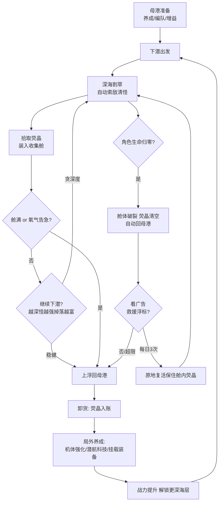

# 微信小游戏 PRD：《潜渊猎手》（暂定名）

| 项目 | 内容 |
|---|---|
| 产品名称 | 潜渊猎手（暂定名，候选：《深渊清道夫》《潜渊纪》） |
| 平台 | 微信小游戏 |
| 品类 | 幸存者like 割草 × 局外数值养成 × 纯 IAA |
| 题材/美术 | 深海巨渊探索，生物发光冷色调手绘风 |
| 文档版本 | v1.0 |
| 日期 | 2026-11-09 |
| 输入依据 | 《撞鬼了-竞品分析报告》（本仓库 `docs/`）及玩法录像/截图素材 |
| 关联 | 父需求 LOO-42「微信小游戏需求探索」；承接子任务 LOO-43 |

---

## 一、背景与目标

### 1.1 业务背景

- 2025 年国内小游戏市场收入 535.35 亿元（同比 +34.4%），IAA 小游戏月活约 4 亿，幸存者like 是长期在榜的热门品类（《弹壳特攻队》《行侠仗义》等）。
- 品类头部固化，中小团队的验证打法是「**大盘验证玩法 × 差异化题材/美术**」的空隙组合——《撞鬼了》正是该打法的典型样本（志怪题材 × 水墨暗黑美术）。
- 竞品已实证的完整模型：「玩法产进度、广告喂加速」的纯 IAA 变现结构 +「钱袋-上缴-死亡清袋-广告复活」风险回报循环。玩法骨架风险低，可直接借用其结构；但题材必须全面区隔，避免同质竞争与买量素材撞车。

### 1.2 用户痛点 / 市场空隙

- 幸存者like 大盘题材集中在丧尸末日（弹壳系）、武侠水墨（行侠仗义系）、志怪冥府（撞鬼了系），**深海题材在幸存者like 小游戏头部产品中处于空白**（基于公开榜单认知的分析判断）。
- 竞品实证的短板即我们的机会：无社交排行、图鉴只计数不可用、主界面入口过载、单压力（仅容量）决策偏单薄。

### 1.3 预期目标（可量化）

| 维度 | 指标 | 目标值 |
|---|---|---|
| 激活 | 首次完整下潜循环完成率（D0） | ≥ 85% |
| 激活 | D0 完成 ≥3 次下潜的用户占比 | ≥ 60% |
| 留存 | 次日留存 / 7 日留存 | ≥ 35% / ≥ 15% |
| 变现 | 广告渗透率（当日看过 ≥1 次激励视频） | ≥ 70% |
| 变现 | 人均激励视频完成次数 / 日 | ≥ 4 次 |
| 传播 | 分享率（分享行为用户占比）/ 分享新增占比 | ≥ 8% / ≥ 10% |

**北极星指标**：人均激励视频完成次数 × 次日留存（IAA 模型下收入 = DAU × 人均广告次数 × eCPM，留存决定 LTV 基座）。

---

## 二、题材与美术选型（核心决策）

### 2.1 候选方向评估

按任务要求评估妖怪、末日丧尸、虫兽三个指定方向，另提出深海巨渊方向一并比较。评分 1-5，总分越高越优：

| 评估维度 | 妖怪 | 末日丧尸 | 虫兽 | **深海巨渊（选定）** |
|---|---|---|---|---|
| 与竞品题材区隔（竞品已含大量妖怪/僵尸元素） | 2 | 2 | 5 | **5** |
| 与大盘头部区隔（弹壳系=丧尸末日） | 4 | 1 | 5 | **5** |
| 买量素材冲击力（前三秒画面） | 4 | 3 | 3 | **5** |
| 大众审美接受度 | 4 | 4 | 2.5（虫类形象两极分化） | **4.5** |
| 玩法耦合差异化潜力 | 3 | 3 | 4 | **5** |
| 微信审核合规风险（越低越好） | 3（志怪迷信擦边） | 2（血腥恐怖限流风险） | 5 | **5** |
| 美术成本可控性 | 3（精细妖怪造型人力高） | 3 | 4 | **4**（剪影+发光+粒子，吃引擎效果不吃人力细节） |
| **合计** | 23 | 18 | 27.5 | **33.5** |

### 2.2 落选理由

- **妖怪**：竞品「撞鬼了」的图鉴本身就是妖怪体系（金蝉、千年树妖、蟾大仙、牛头马面罗刹……），题材空间重叠约四成，区隔只能靠美术风格单腿支撑，正中任务「明显区隔」要求的下限。
- **末日丧尸**：双重撞车——竞品主力怪是僵尸王系，品类头部《弹壳特攻队》就是丧尸末日；且血腥恐怖向内容在微信审核与买量审核两侧均有降权风险。**最不可选**。
- **虫兽**：区隔与合规均优，是可行的次选；但虫类形象大众接受度两极分化，萌系化又损失「巨物压迫感」的素材冲击力。其「异形生物群像」美学可部分融入深渊生物设计，作为风格备胎保留。

### 2.3 选定方向：深海巨渊

**一句话定位**：驾驶猎手潜入无光深渊，割草清怪、填满收集舱、在氧气耗尽前带着收获上浮——「越深越富、越深越险」的垂直冒险。

**选定理由**：

1. **三重区隔全绿**：与竞品（中式志怪/暖褐水墨/冥府横向地图）、与品类头部（丧尸末日）、与妖怪/虫兽方向均无重叠，题材空间独占性强。
2. **玩法天然耦合差异化机制**（详见第四节）：深度即难度即收益的**垂直推进结构**、**氧气 × 舱容双压力决策**，都是只有海洋题材才讲得通的设计，竞品照搬不了。
3. **买量素材即卖点**：黑暗深渊中一片生物发光的画面，冷艳、辨识度高，在暖色 Q 版扎堆的信息流里点击竞争力强；「你能潜到多少米」是天然的挑战式素材钩子。
4. **审核零风险**：无血腥（怪物破碎为荧光粒子与气泡）、无迷信、无恐怖元素，规避了志怪/丧尸题材的平台审核与限流不确定性。
5. **美术成本可控**：2D 手绘剪影 + 发光特效 + 粒子海洋生物，质感主要来自光影而非造型细节，中小团队可承载；「奇丽」而非「恐怖」的美术基调同时规避巨物恐惧症的劝退面。

**美术基调**：冷色蓝绿主调 + 生物荧光点缀（青、紫、橙），场景随深度分层变色（日光层亮蓝 → 暮光层墨蓝 → 深渊层黑底荧光）；角色与潜艇采用微 Q 比例（头身比约 1:2.5）兼顾亲和力与素材质感。

---

## 三、目标用户

### 3.1 用户画像

- **主画像**：微信小游戏 IAA 休闲玩家，25-40 岁，通勤/午休/睡前碎片时间游玩，单次会话 3-8 分钟，日均 2-3 次会话；无付费习惯，接受看广告换便利。
- **次画像**：幸存者like 品类迁移用户（弹壳/撞鬼了玩家），对「新题材的同类玩法」有尝鲜意愿，是买量与自然流量的高转化层。

### 3.2 核心使用场景

- 碎片时间「来一潜」：单次下潜 2-5 分钟自成一个完整决策循环，随时可退出（上浮卸货即存档点）。
- 蹭微信社交链：「好友谁潜得深」的攀比与打卡分享。

---

## 四、核心玩法

### 4.1 玩法公式

> **竞品已验证的骨架**（借用）：摇杆移动 + 全自动索敌割草 + 局内资源有上限 + 死亡有惩罚 + 广告可救援 + 局外多线养成推进地图。
> **本产品的差异化**（不照搬的三处结构性改动）：横向推图 → **垂直下潜**；单压力（钱袋容量）→ **舱容 × 氧气双压力**；图鉴纯计数 → **深海生物图鉴 + 共生体收集可用化**（P1）。

### 4.2 核心玩法循环



### 4.3 三大差异化机制详述

#### 机制一：垂直下潜推进结构

- 每张地图是**垂直深度带**（海层），下潜越深怪物越强、荧晶掉落越富；主界面与局内常驻**深度计**（右侧垂直标尺），回城方向永远是「向上找光」。
- 与竞品的横向推图相比：深度是玩家可感知、可谈论、可攀比的连续标量——「我今天潜到了 2347 米」天然构成打卡分享与好友攀比的素材，也是买量挑战式素材的直接钩子。
- 结构上每 100 米为一个「深度带」（数值单位），每 800-1000 米为一个「海层」（大版本内容单元）。

#### 机制二：氧气 × 舱容 双压力决策

- 竞品唯一压力是钱袋容量（经济风险）；本产品增加**氧气条**作为时间压力：氧气随时间消耗，**深度越深消耗越快**（深度系数），归零后不即死、转为持续掉血——留给玩家「冲刺回家」的窗口。
- 由此形成两层递进的贪心决策：
  1. 舱容决策（同竞品）：装满了是回去卸货还是再贪两只精英？
  2. 氧气决策（新增）：氧气还够再深 300 米吗？深处的精英群 vs 上浮保平安？
- 氧气与深度耦合后，「地图推进」获得物理逻辑自洽的解释，且天然约束单局时长（2-5 分钟），与小游戏碎片化会话习惯吻合，也制造了「应急供氧」这一情境广告点位（见第七节）。

#### 机制三：图鉴可用化——共生体系统（P1，MVP 后第一迭代）

- 竞品图鉴是纯击杀计数。本产品在图鉴之上叠加**共生体**：击败特定深海生物后概率驯服为伙伴，每只提供一个战斗/便利增益（灯笼鮟鱇=照明与索敌半径、小水母=周期护盾、寄居蟹=拾取磁铁、发电鳗=电弧连锁……首发 8 只）。
- 收集行为从「进度条」升级为「可用战力 + 图鉴点亮」双重反馈，是长线留存与「刷怪即收集」体验的放大器；捕捉完全由玩法产出，不与抽卡商业化混线。

### 4.4 局内操作与战斗

- 左下虚拟摇杆移动，武器全自动索敌攻击（竞品同款骨架，用户零学习成本）；挂载武器悬浮展示在角色/潜航器周身，战力成长可视化。
- 手动操作保留收益上限：走位躲弹幕、贴近精英集火、抢先吃荧光掉落——避免「激活自动后局内纯放置、玩法空洞」的竞品风险。
- 同屏怪物目标 40-80 只，性能预算见第十三节。

### 4.5 目标系统

- 主界面轮换任务条（同竞品形态）：「角色等级达到 50 级」「击杀任意渊主 3 次」「累计下潜 1000 米」。
- 深度里程碑：每 500 米一个深度纪录打卡，刷新纪录时弹出可分享的「深度海报」（小程序码 + 深度数字 + 沿途生物剪影）。

---

## 五、玩法系统

### 5.1 系统总览与解锁节奏

| 系统 | 优先级 | 解锁/开放时机 | 说明 |
|---|---|---|---|
| 下潜战斗（局内） | Must | 默认开放 | 核心循环 |
| 收集舱 + 卸货 | Must | 教学引导内 | 核心经济闭环 |
| 氧气系统 | Must | 教学引导内 | 第二压力轴 |
| 机体强化（属性直购） | Must | 首次卸货后 | 养成线 1 |
| 潜航科技（百分比/功能节点） | Must | 母港默认开放 | 养成线 2 |
| 挂载装备（4 槽 + 合成） | Must | 玩家 8 级 | 养成线 3 |
| 应急供氧 / 救援浮标（广告） | Must | 首次触发情境 | 情境广告点位 |
| 深海馈赠 / 洋流祝福 / 声呐协击 / 珍珠箱 / 战令（广告） | Must | 玩家 5-10 级陆续亮出 | 常驻广告点位 |
| 百科图鉴 | P1 | MVP 后第一迭代 | 击杀计数 + 一键领奖 |
| 共生体收集 | P1 | 紧随图鉴 | 图鉴可用化 |
| 好友深度榜（开放数据域） | P1 | 紧随其后 | 零后端社交 |
| 每日深渊挑战（限时高收益层） | P2 | 留存成熟期 | 日活钩子 |
| 洋流事件（限时浮游怪群） | P2 | 内容扩充期 | 局内随机惊喜 |

### 5.2 海层与怪物

- 首发 3 个海层：**日光层（0-800m）→ 暮光层（800-1600m）→ 深渊层（1600-2400m）**，后续版本每次 +1 层（+800m）。
- 怪物三档（同竞品结构）：普通（蓝框）→ 精英（紫框）→ 渊主（红框），未解锁怪物以「黑暗剪影+一双发光眼」留悬念（替代竞品的灰色剪影，贴合深海黑暗设定）。
- 首发怪物约 36 种（普通 24 / 精英 8 / 渊主 4），如：灯笼鮟鱇、水母群、电鳗、巨型章鱼、剑鱼游侠、深海鮟鱇王、渊底巨鲸（渊主）、发光巨鱿（渊主）……题材统一、设计量与竞品（40+）相当。
- 每海层终端设 **渊主驻守**：击杀掉落珍珠与渊核（稀有养成材料），并点亮通往下一海层的「深渊裂隙」。

### 5.3 局外养成三层（对标竞品四层的精简版）

1. **机体强化**（荧晶直购属性）：生命 / 攻击 / 攻速 / 移速 / **舱容** / **氧效** 六条属性，等级上限 1000 级，特定等级节点消耗渊核——长线数值坑。
2. **潜航科技**（节点树）：五系（攻击 / 生存 / 氧气 / 舱容 / 特殊），每系 20 节点，节点给百分比属性与功能性奖励（自动战斗时长 +、卸货距离 +、捕捉概率 +），消耗荧晶 + 渊核——对标竞品「经脉 + 经书」合并精简。
3. **挂载装备**（暗黑like）：主武器 2 槽 + 辅件 2 槽（第 4 槽 40 级解锁）；武器 4 类起步（声波炮=环形 AOE、鱼雷巢=直线穿透、电弧链=连锁弹射、诱饵浮雷=范围引爆），辅件 4 类（探照灯、潜流鳍、装甲片、拾取磁铁）；品质五档（破损/标准/精良/史诗/传说），三合一合成升阶（弹壳验证过的合成玩法），装备等级消耗深海髓。

> 与竞品的刻意差异：四层养成并为三层（科技树吞掉经书线），货币从 6+1 精简为 4+1（见第六节）——落实竞品报告「入口过载、货币过量」的反面教训。

### 5.4 主界面布局（低保真描述，入口 ≤7）

```
┌──────────────────────────────────────┐
│ Lv.48  ◇荧晶4.93K  ○珍珠128  ●深海髓17 │ 顶部：等级+三货币栏
│                    [轮换任务条........] │ 右上：任务条
│ [深海馈赠]                 [声呐协击]   │ 左右两列各2个功能入口
│ [洋流祝福]   （母港潜艇场景+角色） [出发下潜]│   「出发」为最大主按钮
│                                      │
│ [百科图鉴]                            │ 左下：图鉴
│ [装备] [强化] [科技] [战令]            │ 底栏4入口
└──────────────────────────────────────┘
```

- 常驻入口合计 7 个（馈赠/祝福/协击/出发/图鉴 + 底栏 4 中合并展示），红点只挂「今日必做」（每日任务、免费次数未用完），避免竞品 9+ 入口全红点的麻木效应。
- 局内 HUD：顶部氧气条 + 舱容量条；右侧垂直深度计；左下摇杆；死亡结算面板含「救援浮标（广告）」按钮。

### 5.5 社交与传播（竞品缺失的超车点）

- **好友深度榜**（P1）：微信开放数据域实现好友间「最深纪录 / 本周下潜」双榜，零后端成本（平台特性红利，竞品完全没有）。
- **深度海报分享**：刷新个人纪录时的自然分享时刻 + 可主动发起；海报带小程序码，构成裂变入口。
- 不做公会/多人实时（与「用完即走」的轻量定位冲突，成本高）。

---

## 六、数值框架

### 6.1 货币体系（4 货币 + 1 道具，分层隔离产出与消耗）

| 货币/道具 | 产出 | 消耗 |
|---|---|---|
| **荧晶**（主货币） | 局内割草掉落（经收集舱卸货入账） | 机体强化、潜航科技 |
| **珍珠**（中转货币） | 渊主掉落、图鉴进度（P1）、广告点位奖励 | 珍珠箱抽装备（白银 50/次、500 十连；黄金 100/次、1K 十连，黄金箱 10 连保底史诗） |
| **深海髓**（装备材料） | 精英怪必掉、局内少量掉落 | 装备升级、（后期）装备重铸 |
| **渊核**（稀有进阶，青/绯两阶） | 精英概率掉落（青）、渊主必掉（绯）、广告随机奖励 | 潜航科技高阶节点、机体强化特定等级门槛 |
| 装备升级券（道具） | 珍珠箱开出 | 装备升级 |

- 珍珠闭环对标竞品元宝闭环：**图鉴/广告/渊主 → 珍珠 → 抽装备箱**，广告与装备线在「免费抽」处交汇；白银箱拉频次、黄金箱配保底卡稀有度节奏。
- 精简理由：每种货币都必须有稳定可感知的产出场景（竞品报告教训），4+1 已覆盖「主产出/中转/装备材料/稀有门槛」四个职能。

### 6.2 基础属性与成长曲线（首版锚点，供原型调参）

| 项 | 初值（1 级角色） | 成长方式 |
|---|---|---|
| 生命 | 200 | 机体强化 +5%/级，线性累乘 |
| 攻击 | 20 | 同上 |
| 攻速 | 1.0 次/秒 | 装备/科技为主 |
| 移速 | 3.0 m/s | 同上 |
| 收集舱容量 | 500 荧晶 | 机体强化「舱容」+ 洋流祝福 buff |
| 氧气储量 | 120 秒当量 | 机体强化「氧效」降低消耗系数 |

- **机体强化消耗曲线**：升到 lv+1 消耗 = 80 × 1.16^lv（荧晶）；前期每分钟局内收入可升 2 级左右，随进度放缓——典型长线坑曲线。
- **怪物强度曲线**：深度带 n（每 100m 一带）普通怪 HP = 50 × 1.18^(n-1)，攻击 = 8 × 1.16^(n-1)；精英 ×8 HP / ×2.5 攻，渊主 ×40 HP / ×4 攻。
- **掉落曲线**：普通怪掉荧晶 = 10 × 1.18^(n-1)（±30% 浮动）；**收益增速与怪力增速同阶**，玩家靠养成与装备双线追赶，形成「推不动 → 回浅层速刷 → 攒养成 → 再推深」的标准节奏。

### 6.3 氧气与往返经济学（双压力的数值咬合）

- 氧气消耗 = 1/s × 深度系数（每 +500m 系数 +0.2，即 2500m 处 1.8/s）；氧气归零后每秒损失 2% 生命（不即死）。
- 收益梯度设计目标：第 3 带（200-300m）单位时间收益 ≈ 第 1 带的 1.5-1.7 倍，抵消更长的往返时间后仍有约 20% 净溢价——**深潜值得冒险，但必须扛住双压力**，决策两侧始终成立。
- 单次下潜目标时长 2-5 分钟（氧气与舱容共同约束），单日核心用户 5-8 次下潜，总时长 20-30 分钟。

### 6.4 死亡与救援定价

- 死亡惩罚：收集舱破裂，舱内荧晶 100% 清空，自动回母港（同竞品「死亡清袋」）。
- 广告救援浮标：原地复活（50% 生命）+ 舱内荧晶保留；**每日 3 次**上限（防无限白嫖导致惩罚失效；具体次数随首测数据调参）。
- 惩罚-救援平衡原则（竞品报告结论复用）：救援太贵则弃疗、太廉价则惩罚失效；首测关键观测指标为「死亡后看救援广告的比例」与「死亡后当日流失率」。

### 6.5 数值验证节奏

- M0 原型期：纸面数值表（本节）→ 可玩灰盒 → 用「首潜完成率 / 单局时长 / 死亡频率 / 卸货频率」四个行为指标回归校准。
- 每次扩层（+800m）前重跑曲线，保证「上一海层毕业战力 ≈ 新海层入门 survival 底线」。

---

## 七、商业化方案

### 7.1 模式：纯 IAA（无 IAP）

- 对齐竞品验证的模型：**玩法产进度、广告喂加速**——核心货币主动产出全部在局内玩法，广告覆盖养成全链条，定位「高覆盖度的可选加速」，不做「不看广告就卡死」的进度墙。
- 平台侧理由：纯 IAA 小游戏无需版号（仅需软著 + 备案 + 实名认证），上线周期与合规成本大幅低于 IAP 产品——对中小团队是决定性的启动优势。
- 唯一收益为微信流量主激励视频分成；按 eCPM 30-80 元（微信小游戏大盘常见区间）、人均 4-6 次/日测算，1 万 DAU 的日收入量级约 1.2k-4.8k 元，盈亏平衡点取决于买量成本（首测期以自然流量与分享裂变为主，不依赖买量）。

### 7.2 激励视频点位全景（5 常驻 + 2 情境 = 7）

| 点位 | 位置/触发 | 机制 | 喂养对象 | 类型 |
|---|---|---|---|---|
| 深海馈赠 | 主界面 | 看广告 → 随机奖励（荧晶/珍珠/深海髓/渊核） | 全养成线补充渠道 | 增益型 |
| 洋流祝福 | 主界面 | 看广告 → 三选一增益 20 分钟（收益+10% / 氧气+20% / 舱容+20%），每日 2 次 | 局内效率 | 增益型 |
| 声呐协击 | 主界面 | 看广告 → **15 分钟**自动战斗（限时授权非永久；比竞品 10 分钟略长，覆盖典型单次会话） | 解放双手 | 便利型 |
| 珍珠箱免费抽 | 主界面 | 白银箱 3 次/日 + 黄金箱 2 次/日广告免费抽，与珍珠抽取并行 | 装备获取 + 珍珠消耗端 | 增益+消耗 |
| 战令加领 | 战令页 | 每级奖励可看广告加领一份（含珍珠） | 留存 | 增益型 |
| **救援浮标**（情境） | 死亡结算 | 看广告 → 原地复活、舱内荧晶不清空（每日 3 次） | 止损（保住本局收益） | 止损型 |
| **应急供氧**（情境） | 氧气告警 | 氧气 <15% 弹出（可关闭不强制）：看广告 → 立即回满，每日 3 次 | 止损（保住深处进度） | 止损型 |

### 7.3 点位密度与差异

- 竞品：主界面 5 个直接广告入口、7 常驻 + 1 情境 = 8。本产品：**主界面 4 个直接广告入口、5 常驻 + 2 情境 = 7**——总量略降、情境位多一档（应急供氧耦合新机制），落实「入口过载」反面教训的同时保持人均广告次数基本盘（增益 3 + 便利 1 + 情境 2 的结构下，活跃用户单日 8-12 次激励视频自然可达）。
- 情境位设计原则：**可关闭、不阻断**——应急供氧弹窗带「坚持上浮」选项，避免竞品式「广告淹没」的反噬（竞品已出现第三方免广告搬运版，即高频广告的反噬实证）。

### 7.4 未成年人合规

- 微信平台对未成年用户不展示激励广告：所有广告点位对未成年用户**降级为直接发放（奖励减半）或不可用**，保证体验公平与合规双达标；开发上通过平台实名状态接口分流。

---

## 八、微信小游戏平台技术可行性约束

| 约束项 | 平台限制 / 方案 | 对本产品的影响与对策 |
|---|---|---|
| 包体积 | 小游戏主包 ≤4MB、整包 ≤20MB（以微信官方最新文档为准）；开放数据域独立包 | 2D 剪影美术 + 图集合批可控；首包仅含日光层资源，暮光/深渊层资源走远程 CDN 按需加载，首屏启动目标 <3s |
| 引擎选型 | Cocos Creator 3.x（2D 割草适配好、微信链路成熟、包体小）；Unity WebGL 转化包体偏大不采用 | 主包压到 4MB 内无压力 |
| 性能 | 中低端安卓机 30fps 底线、目标 60fps | 同屏怪物对象池（上限 80）、割草掉落合并拾取、粒子特效分级（低端机关闭海水悬浮物） |
| 登录/存档 | 微信一键登录（免注册）；本地存档 + 微信云开发双写（云开发免费额度足够单产品存档量），冲突取高进度 | 零注册摩擦（小游戏基本盘），防丢档 |
| 社交 | 开放数据域：好友关系链 + 排行榜，无需自建后端 | 好友深度榜零后端成本，补竞品社交短板 |
| 广告 | 微信流量主激励视频组件；需注意填充率波动与未成年不展示 | 每个点位内置「广告拉取失败重试 1 次后直接发放」降级逻辑 |
| 审核 | 纯 IAA 需软著 + 小游戏备案 + 实名认证，无需版号；题材无血腥/迷信/恐怖要素 | 审核风险面最小化（题材选型即为此设计） |
| 分享/裂变 | 分享卡片、深度海报带小程序码；严禁「诱导分享」（不设「分享才能领奖」强制路径） | 分享全部走「自然炫耀时刻」，规避平台运营红线 |
| 触达 | 订阅消息（一次性）：深渊渊主刷新、深度纪录被好友超越时提醒（用户主动订阅） | 拉回访，频次克制避免骚扰投诉 |

---

## 九、与竞品《撞鬼了》异同对照

| 维度 | 撞鬼了 | 潜渊猎手（本产品） | 异/同 |
|---|---|---|---|
| 品类骨架 | 幸存者like 割草 + 局外养成 + 纯 IAA | 同 | **同**（验证过的骨架直接借用） |
| 题材美术 | 中式志怪（僵尸/道士/黑白无常），暗色水墨手绘，暖褐灰 | 深海巨渊生物，生物发光冷色调，蓝绿黑 | **异**（全面区隔） |
| 地图推进 | 横向推进（乱葬岗→封门村→……5 图） | **垂直下潜**（深度带 → 海层，0-2400m 首发） | **异**（结构性差异点 1） |
| 局内压力轴 | 单压力：钱袋容量 | **双压力：舱容 × 氧气**（氧耗随深度加速） | **异**（结构性差异点 2） |
| 风险回报循环 | 钱袋上限 → 落袋决策 → 死亡清袋 → 广告复活 | 舱容+氧气 → 落袋决策 → 死亡清舱 → 救援浮标/应急供氧 | 半同（四件套结构同源，压力轴扩展） |
| 收集系统 | 图鉴击杀纯计数，领元宝 | 百科图鉴 + **共生体驯服可用化**（战斗增益） | **异**（结构性差异点 3） |
| 局外养成 | 四层：锻体/经脉经书/装备/图鉴 | 三层：机体强化/潜航科技/挂载装备（图鉴独立成 P1 系统） | 半同（结构精简） |
| 货币体系 | 6 货币 + 1 道具 | 4 货币 + 1 道具 | 半同（更精简） |
| 装备合成 | 4+2 槽，灰/绿/紫，合成玩法 | 2+2 槽起步，五档品质，三合一合成 | 半同 |
| 社交/排行 | 无 | 好友深度榜（开放数据域）+ 深度海报分享 | **异**（超车点） |
| 广告点位 | 主界面 5 直接入场；7 常驻 + 1 情境 = 8 | 主界面 4 直接入场；5 常驻 + 2 情境 = 7 | 半同（更克制，情境位多一档） |
| 自动战斗 | 广告解锁 10 分钟 | 广告解锁 15 分钟（覆盖单次会话） | 半同 |
| 会话结构 | 无时间压力 | 氧气天然约束单局 2-5 分钟 | **异** |
| 审核风险面 | 志怪迷信擦边（平台容忍内） | 无血腥/迷信/恐怖 | **异**（更安全） |

**一句话总结**：骨架同源（已被竞品验证），题材、推进结构、压力机制、收集深度、社交五个维度全部差异化——「像的不是脸，是身材；而脸完全换了」。

---

## 十、数据埋点与指标

### 10.1 关键漏斗

启动 → 完成首潜 → 首次卸货（aha 时刻）→ D0 完成 3 潜 → 次留 → 7 留 → 看首次广告 → 稳定广告用户（日均 ≥4 次）。

### 10.2 埋点事件表（首发版）

| 事件名 | 触发时机 | 关键参数 |
|---|---|---|
| `dive_start` | 每次下潜出发 | sea_layer, cargo_free, oxygen_max, power |
| `dive_end` | 每次下潜结束 | end_reason(deposit/death/oxygen_exit/manual), max_depth, cargo_amount, duration_s |
| `deposit_done` | 卸货入账 | amount, is_first(首次卸货) |
| `death_occurred` | 角色死亡 | depth_band, cargo_lost, rescued(是否看广告救援) |
| `rescue_ad_view` | 救援浮标广告完成 | daily_count |
| `oxygen_refill_ad` | 应急供氧广告完成 | depth, daily_count |
| `ad_show` | 激励视频完成 | slot_id, scene, is_reward_granted |
| `equip_change` / `equip_synthesize` | 穿戴/合成 | slot, quality, from_quality |
| `tech_unlock` | 科技节点点亮 | tree, node_id |
| `depth_record` | 深度纪录刷新 | new_depth, is_shared |
| `tutorial_step` | 新手引导每步 | step_id, cost_s, drop_off |
| `session_end` | 退出前台超 30s | session_len, dive_count_today |

### 10.3 首测调参看板（M0-M1 必看）

首潜完成率、单局时长分布、死亡频率（次/局）、卸货频率（次/局）、氧气告急但成功返航率、死亡后救援广告转化率、死亡后当日流失率、人均广告次数。

---

## 十一、新手流程与异常处理

### 11.1 新手引导（前 3 分钟完成完整循环 = 激活）

1. 0-10s：**开场即战斗**（跳过一切剧情，直接落入日光层，怪物送上门）；
2. 10-30s：摇杆移动教学 → 首次击杀 → 拾取教学；
3. 30-60s：舱容量条亮起 → 氧气条亮起（两压力轴一次讲清，各一句话）；
4. 60-90s：引导上浮卸货 → **首次入账爽点**（数字滚动 + 强化红点）；
5. 90-120s：引导强化 1 次（首选槽给「舱容」或「氧效」）→ 再次出发，此后完全自由；
6. 首日目标：完成 ≥3 次完整下潜循环（进度任务引导）。

### 11.2 异常与边界处理

| 场景 | 处理 |
|---|---|
| 断线重连 | 30s 内重连：原地恢复现场（舱内荧晶保留）；超时：判定「安全回城」，不清舱（对玩家友好的容错，防网络波动引发清舱差评） |
| 切后台 / 来电 | 自动暂停，氧气与怪物行为冻结；回前台 3s 倒计时恢复 |
| 存档冲突 | 本地 + 云开发双写，进度取高值；卸货即存档 |
| 广告拉取失败 | 重试 1 次 → 仍失败则直接发放奖励并上报（未成年与填充低谷双兜底） |
| 氧气耗尽瞬间接电话 | 暂停冻结保护，不判死亡 |
| 版本更新中断 | 分包热更断点续传；强制更版本保留旧存档兼容层 |

---

## 十二、MVP 范围与里程碑

### 12.1 MoSCoW

- **Must（MVP）**：核心循环（下潜/割草/舱容/氧气/卸货/死亡清舱）、3 海层至 1600m、养成三层、装备合成、5 常驻 + 2 情境广告点位、新手引导、轮换任务、本地+云存档、埋点 v1。
- **Should（MVP 后第一迭代）**：百科图鉴、共生体（8 只）、好友深度榜、战令、深度海报分享。
- **Could（内容期）**：每日深渊挑战、洋流事件、光照/视野玩法（黑暗层视野机制深化）、第 4 海层。
- **Won't（本期不做）**：IAP 内购、公会、多人实时、App 版。

### 12.2 里程碑（假设 2-3 人团队：1 程序 / 1 策划兼数值 / 美术部分外包）

| 里程碑 | 周期 | 交付 | 验收口径 |
|---|---|---|---|
| M0 核心原型 | 第 1-2 周 | 灰盒：单海层核心循环全通（移动/割草/舱/氧/卸/死/救） | 单局 2-5 分钟、循环自洽；内部可玩 |
| M1 可玩版 | 第 3-6 周 | 3 海层、养成三层、装备合成、7 广告点位、新手引导、埋点、存档 | 体验版小流量：首潜完成率 ≥85% |
| M2 内容与留存 | 第 7-9 周 | 怪物 36 种、图鉴+共生体+好友榜+战令、云开发存档 | 删档内测：次留 ≥30% 灰线 |
| M3 调优上线 | 第 10-11 周 | 数值调参、性能优化、备案审核材料、灰度发布 | 指标达标全量（见 1.3） |

---

## 十三、非功能需求

- **性能**：中端安卓（骁龙 6 系）30fps 底线；启动到可玩 <3s（首屏仅日光层）；崩溃率 <0.5%。
- **安全**：仅微信官方登录；云开发安全规则限制写权限；客户端数值仅做展示校验、服务端（云函数）校验广告奖励发放，防改内存刷货币。
- **兼容**：iOS 13+ / Android 8+，微信 8.0+；异形屏安全区适配。
- **可配置**：广告点位开关与每日次数、数值曲线、活动开关全部走远程配置（云开发），支持不发版调参与急停。

---

## 十四、上线计划

### 14.1 上线路径

软著 + 小游戏备案 + 实名认证（纯 IAA 无需版号）→ 体验版定向内测（20-50 人，验数据看板）→ 提审发布 → 灰度（微信发布后以自然流量 + 分享裂变起步，视 CPM 与留存数据决定是否买量）→ 全量。

### 14.2 灰度与回滚

- 远程配置控制广告点位与活动，**异常点位可秒级关闭**（如某点位填充率或投诉异常）。
- 版本回退：保留上一审核通过版本，微信后台可即时回退；存档结构带版本兼容层。
- 风险预案：数值事故（如刷荧晶漏洞）→ 云端封禁异常账号 + 热修数值表；差评集中（广告过频/氧气压迫感）→ 远程配置下调频次与氧气曲线。

---

## 十五、风险与预案

| 风险 | 等级 | 预案 |
|---|---|---|
| 氧气压迫感过强导致流失 | 高 | 归零不即死（持续掉血）已留缓冲；首测盯「氧气告急后退游率」，曲线参数走远程配置可随时放软 |
| 数值失衡（深层收益碾压浅层，浅层废弃） | 高 | 往返经济学锚点（6.3）进 M0 验证；扩层前强制重跑曲线 |
| 深海题材巨物恐惧症劝退部分用户 | 中 | 美术基调「奇丽不恐怖」，渊主压迫感控制在精英挑战尺度 |
| 广告频次引发反感（竞品已现免广告搬运版反噬） | 中 | 点位总量低于竞品、情境位可关闭、未成年降级机制 |
| 头部跟进同题材 | 低 | 玩法迭代速度（双周一次内容版本）+ 深度系统长线壁垒 |
| 纯 IAA 收入天花板 | 中 | 首测验证人均广告次数 ≥4 再决定扩量；预留 IAP（珍珠直购）为后续版本开关，但需版号，本期不做 |

---

## 附：本 PRD 满足验收标准的自检

- **题材方向选定有明确理由**：第二节四方向评分矩阵 + 落选理由 + 五条选定理由。
- **核心玩法循环清晰**：4.2 循环图 + 4.3 三大差异化机制（垂直下潜 / 氧气×舱容双压力 / 图鉴可用化）。
- **可作为原型与排期输入**：第六节数值首版锚点可直接进 M0 灰盒调参；第十二节 MoSCoW + 里程碑直接排期。
