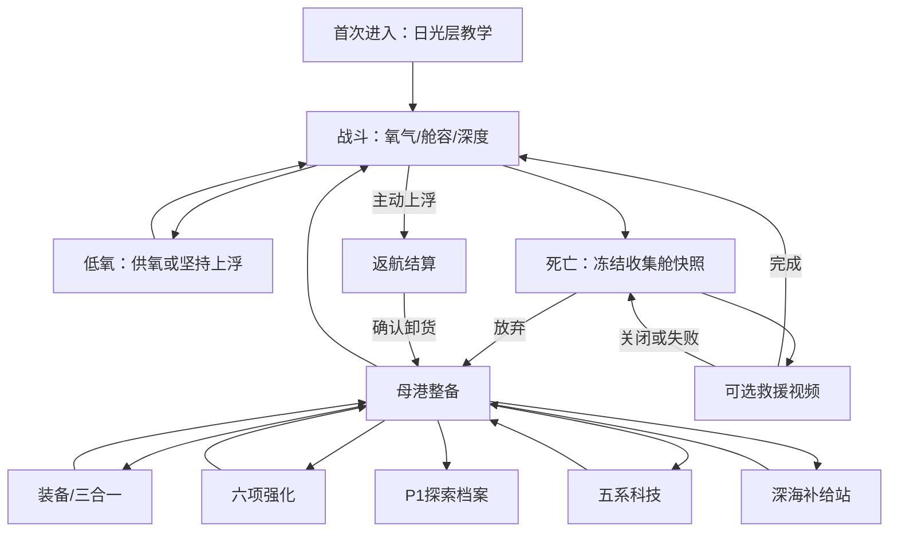

# 潜渊猎手 · 原型设计与交互说明 v1

日期：2026-11-09。对应 LOO-45 的原型与素材清单阶段。依据 `docs/潜渊猎手-PRD.md`、`docs/潜渊猎手-技术选型报告.md` 和 `output/imagegen/abyss-hunter-v1/` 的三张概念稿。未改动源需求，未生成新素材图。

## 1. 交付范围与运行

原型目录：`output/abyss-hunter-prototype/`。直接打开 `index.html` 即可离线使用，不必安装依赖。左侧切换场景，画布内点击操作，右侧可重放教学、触发死亡、断网、加载/空/错误状态，切换 375×667、375×750、375×812。

同目录提供 `app.json`、`pages/prototype/index.wxml/.wxss/.js` 的原生小程序 Canvas 预览壳，八个逻辑页面共享绘制代码。导入该目录后，应将 `project.config.json` 的 `appid` 改为有权使用的小程序测试 AppID。默认游客值便于分发，部分开发工具接口不接受此值。此壳不上传、不发布、不接入生产 CloudBase。

**正式产品仍为 Cocos Creator 3.8 + 微信小游戏 + CloudBase。** 本交付是设计评审工具，并非 Cocos 游戏成品。不会将战斗实施为 WXML 业务页面；界面结构迁移方式见第 8 节。

互动覆盖母港、两类战场、三条养成线、补给、P1 档案；弹窗覆盖低氧、暂停、救援、结算、激励视频及失败。战斗复用整张概念稿；摇杆仅显示输入反馈，不移动图内潜航器，没有敌人 AI/碰撞/实际击杀。演示时按有效时间增加深度和舱内荧晶，便于评估 HUD 与风险反馈，不代表数值平衡。

## 2. 用户、任务与导航

目标用户沿用 PRD 的碎片时间休闲玩家。每个核心页面围绕一个任务：战斗作风险选择、母港准备下次出发、养成花费资源、补给选择可选增益。第一次直接进入日光层教学，熟悉用户从母港进入。

母港的一级可点击入口为 7 个：出发、补给、档案、母港/装备/强化/科技四格底栏。每日任务是信息条，避免广告与活动散落占满场景。补给内整合馈赠、祝福、协击与珍珠箱，战令归 P1。母港底栏包含当前母港入口，因此实际外跳入口为 6 个。

## 3. 页面设计

| 页面/优先级 | 内容与视觉层次 | 主要交互与反馈 |
|---|---|---|
| 首潜/日光层 P0 | 顶部氧气、舱容两条独立色条；机体血量；右侧米数；中间战场；底部摇杆、挂载、上浮 | 摇杆输入反馈；暂停冻结；上浮到结算；首次提示说明“先学会平安返航” |
| 母港 P0 | 明亮青蓝海面与暖橙维护结构；H-01作为主体；顶部三货币；左任务；下方主要行动 | 出发重置本局；强化/装备/科技底栏直达；补给和档案次级按钮 |
| 深渊渊主战 P0 | 暗靛蓝底、青紫巨鱿；血条置于双压力条下；低氧警示；上浮强对比 | 12%氧气、90%舱容的评审样例；供氧不遮上浮；警示兼用文字和图形 |
| 机体强化 P0 | 六行固定属性；当前/下一等级与价格同列；荧晶统一在顶栏 | 实际扣模拟余额；不足时轻提示；舱容每级 +50，其他属性描述为样例+5% |
| 潜航科技 P0 | 五个分支标签；三个可视节点和前置连线；材料与操作集中下部 | 切分支展示不同节点；首节点扣240荧晶和1渊核；其他节点展示锁定关系 |
| 挂载装备 P0 | 四个槽位、六格收纳样例；蓝青/紫品质区分；合成按钮说明消耗 | 装配反馈；第4槽Lv.40提示；三合一将总件数减2，展示精良结果 |
| 补给站 P0 | 三张便利/增益卡；白银和黄金箱独立消费/免费按钮 | 可选视频、祝福三选一、珍珠购买、广告次数上限；不含现金购买 |
| 探索档案 P1 | 图鉴3/36、八共生体说明、虚构好友样例、海报入口均标P1 | 点击说明未开放；不申请授权，不拉取真实好友，暂不发图鉴/战令奖励 |

样例为 Lv.12、1280荧晶、128珍珠、17深海髓、3渊核。初次战斗舱容500，舱内160，氧气78%，深度260m。允许原型右侧直接跳转用于评审，正式游戏不显示该工具栏。

## 4. 设计令牌与组件

采用“海洋科考终端”视觉：海军蓝半透明面板、细青蓝边线、青色行动、琥珀色收益、蓝紫深渊。沿用原图的亲和圆润手绘风；不替换成写实潜艇、扁平太空机甲或恐怖触手。

| 令牌 | 值 | 使用 |
|---|---|---|
| 背景 | `#041B2A` | 局外与遮罩基底 |
| 面板 | `#082D40` | 卡片、弹窗、次按钮 |
| 描边 | `#246073` | 面板1逻辑像素描边 |
| 主文字 | `#EAFAFF` | 主标题、核心数据 |
| 次文字 | `#94BCCB` | 解释、辅助单位 |
| 主行动/氧气 | `#54EEE2` | 出发、上浮、确认、正常氧气 |
| 收益/舱容 | `#FFCA7A` | 舱容、珍珠、可选补给 |
| 渊主/史诗 | `#BB9DF4` | 巨鱿状态、稀有信息 |
| 告警 | `#FF8973` | 低氧、放弃清舱 |
| 字体 | PingFang SC / Microsoft YaHei / 系统无衬线 | 中文不带外部字体下载；正式数字用BMFont |
| 标题/区标题 | 40–50rpx / 34rpx | 画布20–25 / 17逻辑像素 |
| 正文/说明 | 28rpx / 22–24rpx | 正文14 / 说明11–12逻辑像素 |
| 数值强调 | 80rpx | 结算收益40逻辑像素 |
| 间距/圆角 | 16/24/32/48rpx；24rpx卡片、40rpx弹窗 | 375逻辑像素对应750rpx；布局token统一 |

可复用组件：资源栏、IconLabel、压力进度条、深度尺、主/次/文字按钮、BottomNav、升级行、科技节点、装备槽、锁定提示、奖励卡、Modal、Toast、状态页、虚拟摇杆。

正常按钮按压通过输入事件触发；浏览器提供可见焦点和hover描边。正式 Cocos 建议按下缩放0.97持续80ms、松开100ms恢复，关闭系统减少动态效果时直接切换。面板建议淡入160ms，战斗输入反馈即时，数字入账建议250ms。当前原型按即时切换交付，未实现上述过渡动画。

## 5. 状态与关键交互

| 状态 | 原型行为 | 正式接入要求 |
|---|---|---|
| 低氧 <15% | 常驻警告与可选供氧按钮，玩家主动打开选择 | 非阻断；不强制播放视频 |
| 氧气归零 | 每有效秒掉2%生命，可继续上浮 | 暂停期间不计时；不直接判死 |
| 暂停/切后台 | 冻结氧气、货物增长与生命变化 | 多原因暂停集合；回前台3秒倒计时，本原型即时恢复 |
| 死亡 | `rescue`保存舱内货物；完成救援恢复50%生命；放弃才清空 | 沿用同一diveId；每日最多3次 |
| 救援/供氧次数用尽 | 轻提示今日用完；保留原页面与选择 | 次数以服务端为准 |
| 广告完整观看 | 演示按钮明确写“模拟完整观看”；一次性奖励 | 真实产品服务端token/账本确认；不可用按钮点击代替观看完成 |
| 广告提前关闭 | 不发奖，返回原选择 | 不当完成、不重新生成令牌发奖 |
| 广告加载失败 | 显示失败页，可重试一次；再次失败只能返回 | 如提供补偿，由服务端限额并单独记录fallback；不直接发奖 |
| 上浮卸货 | 结算面板展示荧晶，确认后入账与回港；重复确认无效 | `opId`幂等入账 |
| 断网卸货 | 待确认收益与余额分离；恢复连接后仅确认一次 | 不把本地待确认资产当权威余额 |
| 金额不足 | 保留当前属性和按钮上下文，提示先收集卸货 | 不强推广告，不允许负余额 |
| 锁定/空内容 | 装备锁标注Lv.40；P1明确未开放 | 不制造可领取假红点 |

补给中“20分钟祝福”“15分钟自动战斗”为产品规则展示；当前样例只点亮状态，不实施完整计时、自动走位或收益平衡。装备采用同类声波炮的代表性样例，未模拟8种装备背包与全部品质算法；科技只演示各分支首节点，完整100节点配置后续研发实现。

## 6. 默认、加载、空、错误四态

每个逻辑页面都可用网页右侧的状态选择器切到共享状态页，切回默认保留样例数据。微信预览壳可通过运行时数据操作调用同一模型；玩家页面不显示开发工具切换器。

| 页面 | 默认 | 加载目标 | 空态语义 | 错误恢复 |
|---|---|---|---|---|
| 母港 | 场景与资源 | 港口meta资源 | 无待卸货货物 | 返回已加载首潜/重试 |
| 战斗/渊主 | 双压力HUD | 海层分包预取 | 尚未收集荧晶 | 现场保留、安全返航 |
| 强化 | 六行属性 | 权威养成状态 | 无可用荧晶 | 保持原余额、重试 |
| 科技 | 五分支 | 节点配置 | 无可解锁节点 | 不扣费，重试 |
| 装备 | 槽与背包 | 图集/背包 | 收纳舱无装备 | 保持已装配，不消失 |
| 补给 | 卡片与箱子 | 广告/次数 | 免费次数耗尽 | 返回原选择 |
| P1档案 | 样例档案 | 后续资源/好友摘要 | 未发现/无授权 | 本人成绩与重试 |

原型的共享状态页统一采用“潜航终端”标题和示例文案；上表给出正式每页文案与恢复语义，未声称逐页服务端异常已实现。加载页可返回，空态可下潜，错误页有重试/安全回港。战斗画面已有内容不应因资源失败被清空。

## 7. 适配与触达

主基准750rpx / 375逻辑像素。网页提供667/750/812高度，Canvas根据尺寸等比采样美术，圆舷窗不拉伸。局外短屏纵向收拢内容以确保底栏不遮最后一项。原生壳按设备宽度与DPR绘制，剔除状态栏与底部safeArea；顶部预留微信胶囊。

主要出发、上浮、确认和底栏触区≥44逻辑像素；分支标签和图形按钮较紧凑，正式 Cocos 需给至少44px扩展热区，避免只按小图标尺寸判定。次级按钮最低24px仅见箱子双行信息样例，研发需扩展热区并真机检查误触。轻提示置于190px高度，避免覆盖底部上浮/确认。

颜色外另配图标、文字、百分比与计量单位。网页用真实透明HTML按钮覆盖Canvas点击区域以支持键盘/读屏，具备aria-label与焦点；微信Canvas壳是视觉交互预览，不能据此宣称已通过完整无障碍验收。

## 8. Cocos 场景、Prefab 与云端边界

| 逻辑层 | Cocos 结构建议 | 原型对应 | 资源归属 |
|---|---|---|---|
| `Boot.scene` | 首包、平台适配、UIRoot、PauseManager | 首次进入battle | main最小日光层 |
| `Dive.scene` | WorldRoot/Backdrop/Actors/Projectiles/Loot/Fx；Canvas/HUD/DepthRuler/Joystick/ReturnButton；OverlayRoot | battle/abyss | main+按层Bundle |
| `Harbor.scene` | HarborRoot/SubDisplay；Canvas/Wallet/Task/Launch/BottomNav | harbor | meta |
| `UpgradePanel.prefab` | 六个UpgradeRow与余额绑定 | upgrade | meta |
| `TechPanel.prefab` | TabGroup/NodeTree/CostButton | tech | meta |
| `EquipmentPanel.prefab` | Slots/VirtualGrid/MergeButton | equipment | meta |
| `SupplyPanel.prefab` | RewardCards/ChestRows | rewards | meta |
| `OxygenModal/RescueModal/SettlementModal` | 通用遮罩、焦点、关闭策略、数据快照 | model.panel | main最小+meta结算 |
| `AdModal.prefab` | Loading/Failed/Claiming独立状态；原生视频由wx播放 | 本地ad模拟器 | main适配代码 |
| `ArchivePanel/FriendRank/Poster` | ScrollView/虚拟列表；开放数据域共享Canvas | codex P1 | social/symbiont |

Widget锚定安全区；Layout控制行列；Button绑定统一动作；ProgressBar承载氧气/舱容；Sprite/SpriteFrame承载素材；静态数字图集承载计量；弹窗在OverlayRoot集中调度。Cocos层级建议和资源键另见 `output/abyss-hunter-prototype/cocos-ui-map.json`。

原型状态模型对应未来 `DiveSession`、`EconomyService`、`AdService` 的展示契约，不作为服务端安全实现。广告、卸货、强化、合成的经济变更使用云函数和事务账本；低频云请求不得进入逐帧战斗；离线待确认单列。好友榜必须在开放数据域，主域不读取真实好友列表。

## 9. 范围口径与后续

三海层按技术报告建议的0–800/800–1600/1600–2400m展示，技术报告指出的PRD“三层至1600m”冲突仍待产品确认。战令及加领、图鉴、共生体、好友榜、海报在本原型均属P1；不自动改变PRD Must定义。

素材清单给出36种敌人与8共生体的逐文件交付约定。PRD未逐项命名的物种由本轮补足为设计建议，待产品审核；四渊主中三个守海层端点，巨鲸是深渊同层额外渊主的素材提案，不新增第四海层。所有完整时间、平衡、后端、真实广告、性能指标与发布验收属于后续研发。

验证证据与局限见 `output/abyss-hunter-prototype/VALIDATION.md`；图片助手应先读 `docs/潜渊猎手-素材制作交接.md`，再按CSV执行。
