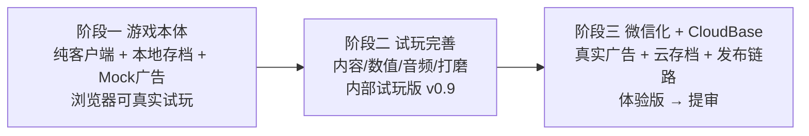

# 《潜渊猎手》开发计划

版本：v1.0｜日期：2026-11-10｜关联：LOO-48「开发计划制定」｜输入：docs/ 全部七份文档 + 素材交付现状 + LOO-47

## 一、现状盘点（计划基准）

| 资产 | 状态 | 对本计划的用途 |
|---|---|---|
| PRD v1.0（LOO-43） | ✅ 已入库 | 玩法/数值/埋点/里程碑基准 |
| 技术选型报告 v1.0（LOO-44） | ✅ 已入库 | Cocos Creator 3.8 LTS + TS + CloudBase 拍板不变 |
| 技术方案 v1.1（LOO-46） | ✅ 已入库 | 架构/模块边界/服务端契约/M1 任务表（从零 30–46.5 人日） |
| 交互原型 + Canvas 状态模型（LOO-45） | ✅ 已入库 | 页面结构/状态规则/Cocos 节点映射直接迁移 |
| 美术素材 MVP 167/167 | ✅ 已交付（r9） | 24 普通 + 8 精英 + 4 渊主 + UI + 三海层场景；P1 18 项缓后 |
| 竞品分析报告 | ✅ 已入库 | 已被 PRD 消化 |
| Cocos 正式工程 | ❌ 未开始 | 本计划阶段一产出 |
| 云函数工程 | ❌ 未开始 | 本计划阶段三产出 |
| 音频（3 BGM + 8 SFX） | ❌ 未制作 | 阶段二补齐（资源缺口见第七节） |
| LOO-47 产品决策 | ⏳ in_review | 9 项待拍板，多数涉及云经济/广告，与阶段三时序正好匹配 |

## 二、总体策略（响应 LOO-48 要求）

按「游戏主体先行、云开发后置、先真实可玩、再微信化+云化」重排技术方案 M1 时序，分三阶段推进：

核心思想：**架构不推翻，只重排时序。** 技术方案的模块边界（battle 纯数据、PlatformAdapter、shared 纯函数）本来就将平台与云依赖隔离在外，因此把 M1 中云/服务端任务（M1-01/04/05/06b/07a/10b/11a-c/12）整体后移到阶段三，阶段一专注客户端游戏性，阶段三接入时不需要返工。

与技术方案 M1 单阶段直通（30–46.5 人日至体验版）相比，三阶段合计约 40–61 人日，增量 +10~14 人日来自：本地存档/广告 Mock 脚手架（阶段三会被真实实现替换）与分阶段重复验证。**代价换来：第 3–5 周即有可真实试玩的游戏本体，玩法风险最早暴露，云开发与平台风险后置。**

## 三、阶段一：游戏本体开发（可真实试玩）

**周期**：2026-11-11 ~ 2026-12-04（目标）/ 12-11（上限），约 15–24 人日，1 开发串行为主
**目标**：Cocos Creator 3.8 客户端完整核心循环——母港养成 → 下潜割草 → 双压力决策 → 卸货/死亡/救援 → 变强 → 更深。浏览器与微信开发者工具内可完整真实试玩。
**验收标准**：

- 教学首潜 ≤3 分钟走通；单局 2–5 分钟；三海层 0–2400m 可达
- 36 怪 + 三养成线（强化/科技/装备合成）+ 珍珠箱可用（本地经济，四货币齐全）
- 7 广告点位以 Mock 接入：直接发奖但每日次数/触发逻辑真实
- 本地存档可靠（重开/刷新不丢档）；80 怪 + 200 弹体 + 100 掉落压力场景浏览器基线流畅
- 代码通过架构保障检查（第六节）；battle 模块零平台依赖

### 任务列表

| # | 任务 | 内容 | 负责角色 | 优先级 | 估时 | 前置 |
|---|---|---|---|---|---|---|
| P1-01 | 工程奠基 | Cocos 3.8.8 工程、目录（技术方案 §2.1 布局）、shared/ + PlatformAdapter（浏览器实现）、Web 构建跑通；**工具链可用性门槛** | 微信小程序开发专家 | P0 | 1–2日 | — |
| P1-02 | 战斗核心 | 30Hz 纯数据战斗：移动/刷怪/索敌/四武器/碰撞/对象池；80 怪压测夹具 | 微信小程序开发专家 | P0 | 2–3日 | P1-01 |
| P1-03 | 局内状态与 HUD | 深度计/氧气/舱容、死亡状态机（冻结→救援→清舱）、PauseManager、安全区适配 | 微信小程序开发专家 | P0 | 1.5–2日 | P1-02 |
| P1-04 | 本地经济+存档+广告 Mock | 数值算法库（六属性/科技前置/合成/保底，shared 纯函数+配置表）、双槽本地存档（schemaVersion 预留 cloudRev）、AdService 状态机+Mock 发奖 | 微信小程序开发专家 | P0 | 2–3日 | P1-01；LOO-47 第 1 项结论或按默认口径 |
| P1-05 | 母港与养成 UI | 七入口布局、强化/科技/装备/补给面板、通用四态组件；按原型节点映射迁移 | 微信小程序开发专家 | P0 | 2.5–4日 | P1-04 |
| P1-06 | 声呐与情境点位 | 声呐自动移动（15 分钟）、救援浮标、应急供氧（Mock） | 微信小程序开发专家 | P0 | 1–2日 | P1-03/05 |
| P1-07 | 三海层内容集成 | 0–2400m、36 怪配置键、4 渊主、掉落曲线（PRD §6）；素材 167 项入引擎 | 微信小程序开发专家 | P0 | 1.5–2.5日 | P1-02/03 |
| P1-08 | 教学与任务 | 首潜教学、轮换任务（本地）、深度纪录/海报（本地生成）、埋点 v1（本地事件总线+telemetry 契约预留） | 微信小程序开发专家 | P0 | 1.5–2.5日 | P1-05/07 |
| P1-09 | 试玩验证与打磨 | 端到端循环验收、性能检查、缺陷缓冲 | 开发 + 测试专家 | P0 | 2–3日 | 全部 |

## 四、阶段二：试玩完善

**周期**：2026-12-01 ~ 2026-12-11（P2-01 音频可提前并行；开发净 4.5–7 人日 + 音频 2–3 人日）
**目标**：从「能玩」到「好玩」，形成内部试玩版 v0.9。
**验收标准**：内部 3–5 人完整试玩；四行为指标（首潜完成率 / 单局时长 / 死亡频率 / 卸货频率，PRD §6.5）达目标区间；试玩修改清单关闭。

| # | 任务 | 内容 | 负责角色 | 优先级 | 估时 | 前置 |
|---|---|---|---|---|---|---|
| P2-01 | 音频制作 | 3 BGM + 8 SFX（交接文档 §7 清单） | 待定（见风险） | P1 | 2–3日（并行） | — |
| P2-02 | 数值调参 | 氧耗/掉落/怪物曲线校准；深度收益梯度验证（第 3 带 ≈ 第 1 带 1.5–1.7 倍） | 开发 + 产品经理 | P0 | 1.5–2日 | P1-09 |
| P2-03 | 表现打磨 | 荧光/粒子/打击感/受击反馈；低端降级档 | 微信小程序开发专家 | P1 | 1.5–2日 | P1-09 |
| P2-04 | 试玩验收 | 内部试玩组织、反馈收集、修复闭环 | 测试专家主导 | P0 | 1–2日 | P2-02/03 |
| P2-05 | 微信化冒烟预检 | 最小工程过微信开发者工具 + 真机预览：包体/80 怪/触控基线——提前暴露引擎级风险，不做完整微信化 | 微信小程序开发专家 | P0 | 0.5–1日 | P1-09 |

## 五、阶段三：微信小游戏化 + CloudBase 接入

**周期**：2026-12-14 ~ 2027-01-16（约 18.5–27 人日，含集中验证与缓冲）
**目标**：试玩版导入微信小游戏工程 + 接入 CloudBase，形成可提审体验版。
**前置门槛**：

1. LOO-47 九项产品决策全部关闭（多数涉及云经济/广告契约，时序正好匹配）
2. 架构师复核云接入方案 vs 技术方案 v1.1（Mock→真实替换面清单）
3. loongwind 提供正式 AppID、广告权限、CloudBase 环境

**验收标准**：技术方案 §10.1 G1–G6 验证通过；主包 ≤4MB（工程预算 ≤3.5MiB）；体验版 20–50 人试玩，首潜完成率 ≥85% 观测口径。

| # | 任务 | 内容 | 负责角色 | 优先级 | 估时 | 对应技术方案 |
|---|---|---|---|---|---|---|
| W3-01 | 微信工程化 | AppID、微信构建链路、包体治理、真机基线复测 | 开发 + 架构师 | P0 | 2–3日 | M1-01 / M1-08 部分 |
| W3-02 | 平台适配 | wx 生命周期/分享/触控/安全区真机适配 | 微信小程序开发专家 | P0 | 1.5–2.5日 | M1-08 剩余 |
| W3-03 | CloudBase 后端 | 环境、game-api 云函数、集合/索引/权限、可信身份、经济账本 | 微信云开发后台专家 | P0 | 2.5–3.5日 | M1-04 |
| W3-04 | 权威同步与结算 | dive.begin/settle、双端快照、断网矩阵、多设备接管 | 云专家 + 开发 | P0 | 2–3日 | M1-05 |
| W3-05 | 经济服务端化 | 强化/科技/合成/抽箱命令事务、随机服务端化 | 微信云开发后台专家 | P0 | 1.5–2日 | M1-06b |
| W3-06 | 真实广告接入 | AdService 微信实现、reward prepare/claim、点位配置 | 微信小程序开发专家 | P0 | 2–3日 | M1-07a |
| W3-07 | 发布链路与集中验证 | 分包/远程 Bundle、maintenance 对账、G1–G6 真机验证、体验版 | 开发 + 测试专家 | P0 | 5–7日 | M1-10b / 11a-c |
| W3-08 | 缺陷缓冲 | 阻塞修复与受影响链路复测 | 微信小程序开发专家 | P0 | 2–3日 | M1-12 |

之后：M2 内容期（图鉴/共生体/好友榜/战令，P1 18 项素材）与 M3 调优上线按技术方案 §10.3 顺延，不在本计划展开。

## 六、架构保障（阶段一必须做对，避免阶段三返工）

1. **battle 纯数据零平台依赖**：不引用 wx/数据库/UI 节点（技术方案 §2.1 原约束），30Hz 逻辑与渲染解耦
2. **PlatformAdapter day 1 建立**：browser 实现 + wechat 实现空槽；Mock 实现带显式标记，不进 release 构建
3. **AdService 状态机**：Mock 直接发奖但保留完整状态流转（Loading→Showing→Completed）与埋点，阶段三仅替换实现类
4. **SaveService 接口化**：本地双槽实现，snapshot 字段预留 `schemaVersion/cloudRev/sessionEpoch`，阶段三云端实现直接插拔
5. **经济操作命令化**：dispatch(action) 统一入口，阶段三改为路由服务端事务，UI 与算法层零改动
6. **shared/ 纯 TS**：数值公式、协议 DTO、错误码——阶段三服务端直接复用
7. **数值全配置表化**（JSON + schema 校验）：LOO-47 结论落地只改表不改逻辑

## 七、依赖、风险与资源缺口

| 风险/依赖 | 影响 | 对策 |
|---|---|---|
| AppID/广告权限/云环境未就绪 | 阶段三启动 | 阶段一/二不依赖；阶段三启动前由 loongwind 提供 |
| LOO-47 决策延迟 | P1-04 起需口径 | 最迟 P1-04 前关闭第 1 项（死亡材料）；其余按技术方案默认口径 + 配置表化，结论后改表 |
| **音频无对应角色**（squad 无音频技能） | 阶段二 P2-01 | 选项：AI 音频工具生成 / 外包 / loongwind 提供；不阻塞主体试玩，请拍板 |
| Cocos 编辑器/CLI 在执行环境可用性未验证 | P1-01 当日 | P1-01 设工具链门槛，不通过当日上报 loongwind 决策（装环境 or 替代方案），不带病推进 |
| 浏览器性能 ≠ 真机性能 | 引擎风险发现推迟 | P2-05 冒烟预检提前暴露；阶段三 W3-01 复测兜底 |
| 同一工程目录并行冲突 | 多角色协作 | 开发串行为主；并行仅限评审类/素材类/音频类任务 |
| 单人串行日历较长 | 交付周期 | 已按可并行项（音频/素材/评审）压缩；里程碑缓冲含在区间上限 |

## 八、执行方式与下一步

1. **请 loongwind 确认本计划**（重点：三阶段顺序、阶段一范围、音频缺口处理方式）
2. 确认后：创建阶段一子任务（P1-01~09）并派工，微信小程序开发专家启动 P1-01；产品经理尽快关闭 LOO-47 第 1 项（死亡材料口径）
3. 每个任务在原 issue 评论交付证据；项目经理按阶段跟踪进度与风险，阶段门评审后进入下一阶段
4. 全部开发在 GameFirst 仓库进行（`game/` 按技术方案 §2.1 布局），按任务限定范围提交
