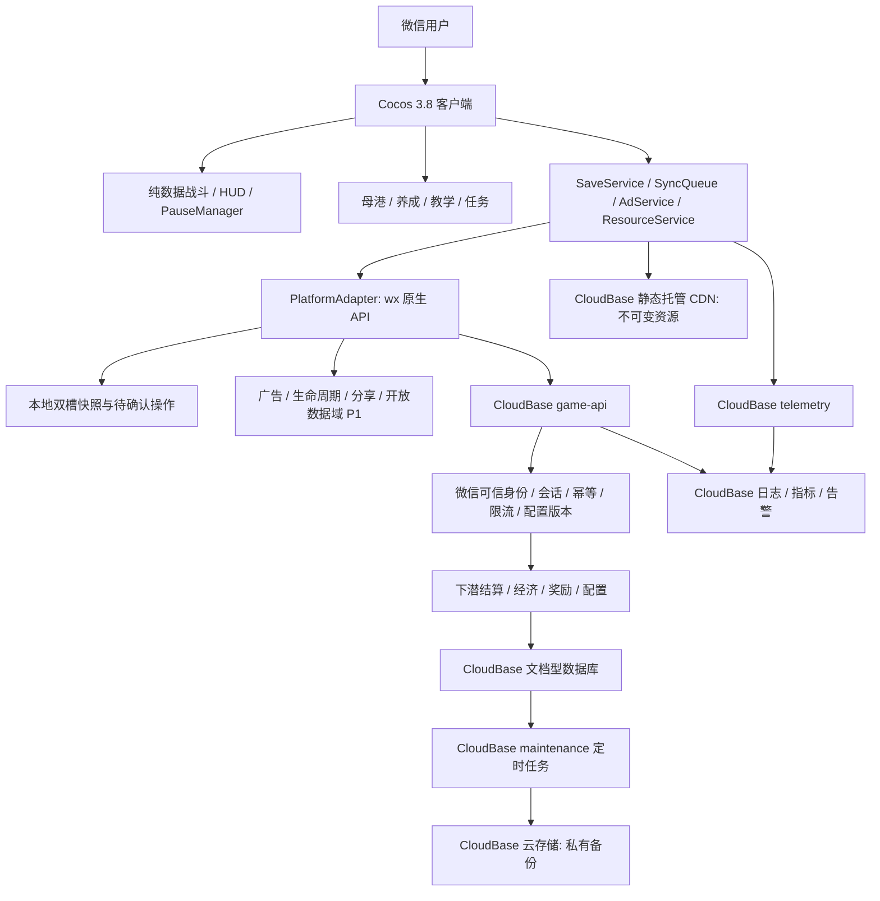
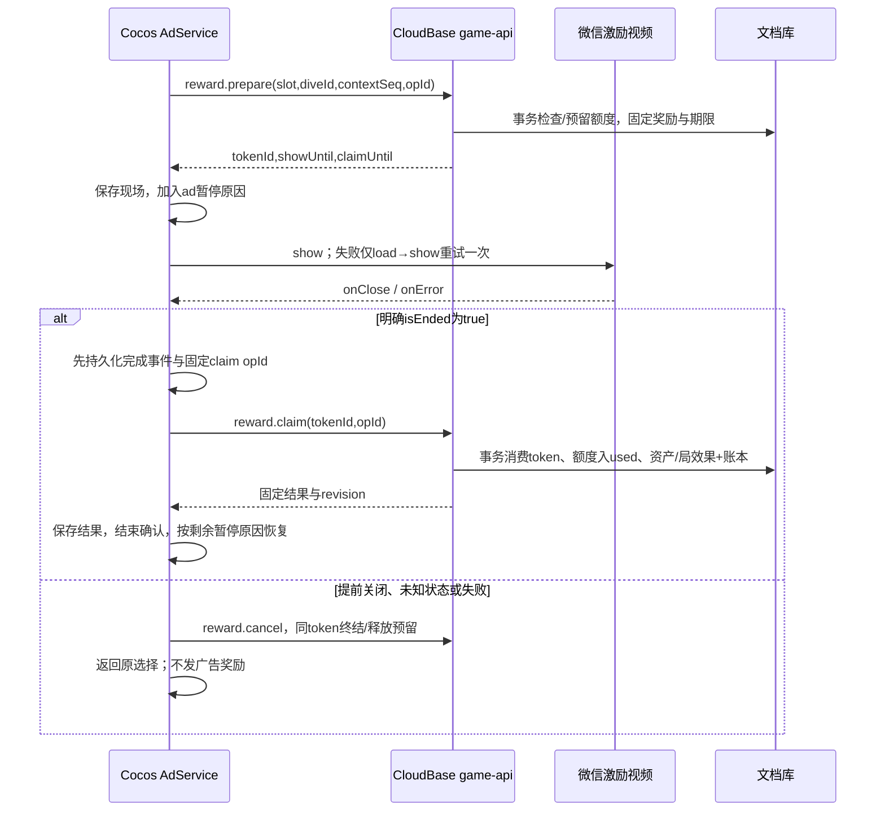

# 《潜渊猎手》微信小游戏技术方案

版本：v1.0｜日期：2026-11-10｜关联：LOO-46「技术方案」｜状态：技术评审稿

## 一、项目概述与输入边界

本方案把已有产品、选型和原型文档转为 **1 名程序可执行的 M1 起步方案**。正式产品为竖屏 2D 幸存者like 微信小游戏：下潜割草、氧气与舱容双压力、返航卸货、死亡清舱、三条局外养成、纯 IAA。局内战斗在客户端运行；持久资产、次数、抽箱和结算由 CloudBase 管理。

### 1.1 输入与技术决策继承

本次通读 `docs/` 已有的七个文件，以下文件共同构成输入，不另写一份引擎选型论证：

| 输入 | 本方案使用方式 |
|---|---|
| [PRD v1.0](潜渊猎手-PRD.md) | 第四至七节玩法/经济/广告，第十至十三节埋点/异常/MVP/性能作为需求来源 |
| [技术选型报告 v1.0](潜渊猎手-技术选型报告.md) | 第一、四、五节为技术决策；第六至十节为资源、权威存档和验证约束 |
| [原型设计与交互说明 v1](潜渊猎手-原型设计与交互说明.md) | 七入口母港、补给整合、页面四态、安全区、死亡冻结快照及 Cocos 节点映射 |
| [原型实施计划](潜渊猎手-原型实施计划.md) | 确认 Canvas/WXML 壳只用于交互评审；已有检查不等于正式小游戏验证 |
| [素材制作交接 v1](潜渊猎手-素材制作交接.md) | 独立透明素材、图集、命名、动画、压缩与主包预算 |
| [完整素材清单 CSV](潜渊猎手-完整素材清单.csv) | 185 文件（MVP 167 / P1 18），36 敌人与 8 共生体的资源键、海层与 Bundle 归属 |
| [竞品分析报告](撞鬼了-竞品分析报告.md) | 复用已观察的风险回报与可选广告加速结构；不推断竞品实现、性能或收入 |

直接沿用选型报告第一节结论：

> 采用 Cocos Creator 3.8 LTS + TypeScript + Cocos 内置 UI；微信小游戏原生 API 接入广告、生命周期与社交；本地快照配合 CloudBase 云函数、文档型数据库管理持久进度。

引擎差异与后端对比直接见选型报告第三节、第五节，不在此重述。编辑器验证基线为 **3.8.8**，通过首次 release 真机门槛后锁定完整版本。小游戏客户端用 `wx.cloud`；云函数用 `wx-server-sdk` 获取身份，`@cloudbase/node-sdk` 执行文档库事务；函数运行时与两个 SDK 的准确版本在 M1-01 按目标环境支持情况锁定，不套用未经核实的运行时名称。

本方案将云函数、文档数据库、远程配置、静态资源托管、备份和监控统一收敛在 **CloudBase**。选型报告提到的 COS/CDN 资源职责在这里由 CloudBase 静态网站托管及其 CDN 承担；私有备份放 CloudBase 云存储。不新增独立 COS、自建 API、MySQL、Redis 或战斗服务器。微信广告、开放数据域和审核发布仍是平台原生能力。

### 1.2 范围与待评审决策

下表为沿用选型/原型的**架构建议默认值**，不是已修改或已获批准的 PRD。技术实施可先做不依赖这些争议的 M1-01～05；进入相关内容/广告验收前由策划在配置基线中确认。

| 分歧 | 本方案估算与实现口径 | 决策截止 |
|---|---|---|
| PRD“三海层至1600m”与正文2400m不一致 | 三海层 0–800 / 800–1600 / 1600–2400m；第四渊主为深渊同层额外内容，不新增海层 | M1-09 前 |
| 战令系统为 Should，广告加领又为 Must | P0 做六类点位；白银/黄金分别配置，共七个具体入口；第七类“战令加领”代码契约保留，随 P1 战令开放 | M1-07 前；若要求 M1 全七类，需增加战令任务并重排日期 |
| PRD 广告失败直接发奖、存档余额取高 | 沿用选型修正：默认失败不发广告奖励；资产以服务端事务为准，不做余额 max 合并 | M1-04/07 验收前 |
| 断网与新手首玩 | 首潜可先教学体验；正式局在线开始、重连后确认结算；断网不扣掉已确认资产 | M1-05 验收前 |
| 未成年/平台限制的降级 | 无可用广告时保留正常玩法；不臆造通用年龄接口，不把无填充当年龄结论；如需补偿，独立服务端策略且默认关闭 | M1-07 验收前 |
| 玩家等级的来源未定义 | 建议采用不可消费的累计经验+等级阈值表；经验由服务器接受的击杀/任务事件产生，具体经验权重和曲线由策划确认，不用六属性强化等级代替玩家等级 | M1-06 前；影响8级装备、40级第四槽与等级任务 |

本文 **P0 = PRD Must/MVP**，P1 = PRD Should/第一迭代；PRD 原文未统一使用 P0，映射仅为执行编号。当前仓库有设计原型及素材产物，尚无本方案所述 Cocos/云函数工程。本次交付是方案文档，不代表包体、真机或生产部署已验收。

## 二、整体架构与模块划分



### 2.1 模块职责与依赖

| 模块/优先级 | 职责与输出 | 依赖约束 |
|---|---|---|
| `battle` P0 | 输入、移动、刷怪、索敌、四武器、碰撞、掉落、氧气、深度、死亡状态机；输出局摘要 | 不引用 `wx`、数据库或 UI 节点；逻辑固定30Hz，渲染30/60fps |
| `presentation/ui` P0 | Dive/Harbor 场景、HUD、面板、七入口导航、四态、警示与安全区 | 只读 ViewModel、发业务命令；不直接扣余额 |
| `meta` P0 | 六属性强化、五系科技、四槽装备、三合一、珍珠箱、轮换任务和教学 | 显示预估成本；服务端复算并返回真实结果 |
| `services` P0 | 资源引用计数、快照、串行同步队列、广告编排、配置缓存、埋点 | 调平台接口；统一处理重试和“确认中” |
| `platform` P0/P1 | 云调用、存储、网络、前后台、视频、音频、设备信息；P1榜单/分享 | 微信实现与浏览器模拟实现分开；模拟不可进入 release |
| `shared` P0 | 协议 DTO、schema、定点/大数、纯数值计算、错误码 | 双端构建产物；禁止引用 Cocos、SDK、服务端密钥 |
| `server/domain` P0/P1 | 可信身份、资产/额度、局结算、奖励、版本兼容与P1扩展 | 每次写资产均有事务与操作账本；日志不能触发发奖 |

建议目录与选型保持一致：

```text
game/
  assets/scenes/{Boot,Dive,Harbor}.scene
  assets/scripts/{battle,meta,ui,platform,services}/
  assets/bundles/{meta,sunlight,twilight,abyss,social,symbiont}/
  build-configs/wechat-release.json
server/
  functions/{game-api,telemetry,maintenance}/
  domain/{dive,economy,reward,config,migration}/
shared/{protocol,config-schema,numeric}/
tools/{export-config,check-assets,check-package,upload-wechat}/
docs/
```

目录是后续工程约定，文中工具/脚本路径均为待实现任务，不声称已经存在。现有 `output/abyss-hunter-prototype/` 不移入正式首包；只迁移状态规则、设计令牌与节点映射。

### 2.2 战斗与状态边界

- 集中 `Spawn → Movement → Targeting → Weapon → Hit → Loot → Oxygen → EndCheck` 更新；渲染插值与逻辑解耦。每帧最多追赶3步，前后台恢复丢弃暂停间隔，不补算伤害或掉落。
- 空间网格筛选邻居；圆形/线段精检；鱼雷扫掠检测、链电限制跳数与命中集合、声波限制每目标命中频次、浮雷限制数量与寿命。普通怪不挂刚体，不做80怪全量两两碰撞。索敌/远处决策5–10Hz。
- 怪物、子弹、掉落、飘字与效果池化；回收清理事件/命中集合/资源引用。池满时延后刷怪、合并掉落和飘字；危险预警与真实命中不可被装饰特效挤占。
- `DiveSession`：`Running → RescuePending → Running / Returning → PendingSettlement → Settled`。死亡先冻结舱内快照；拒绝救援或最终放弃才清舱。救援沿原 `diveId` 继续，回港不创建第二次卸货。
- `PauseManager` 用原因集合 `{modal, ad, background, reconnect, countdown}`；只有集合为空才推进有效时间。低氧常驻提示不暂停，玩家主动打开选择弹窗才暂停。广告结束仅移除 `ad`，不能解除后台/来电暂停。
- 氧气依有效时间和深度配置消耗，归零每有效秒掉2%最大生命；舱容封顶停止装载荧晶。PRD公式存在“2500m系数1.8”与每500m增加0.2的算术歧义；配置基线暂用 `1 + 0.2 * floor(depth/500)`，由策划在 M1-09 校准，双端用同版函数。

### 2.3 养成、任务与界面

六属性等级/科技前置/装备解锁均读配置；独立的 `progression.totalXp/playerLevel` 与属性强化等级分离。建议由 `dive.settle/task.claim` 对已接受事件累积不可消费经验，按不可变 `levelThresholds` 表计算等级，连升多级一次事务处理；经验权重/曲线待M1-06前策划确认，未确认时只实现契约和灰盒配置，不声称等级平衡完成。玩家8级解锁装备，四槽为两主武器两辅件，第4槽40级解锁。三合一只消耗同模板同品质且未锁定、未穿戴的三个实例，返一个下一品质实例；是否继承等级及返还材料写入配置，默认不允许不同等级混合，避免含糊吞材料。黄金箱十连保底计数在事务内与付费珍珠抽、广告免费抽共用；随机结果由服务器产生并固定进账本，不由客户端抽签。

轮换任务以已接受的下潜/经济事件累计，服务端 `task.claim` 事务领奖；教学步骤可本地先行，首次奖励用固定领取键只导入一次。不得把“每次攻击自动索敌”放到声呐授权后：基础自动攻击常开，声呐只增加自动寻路/索敌移动便利，手动摇杆即时接管。

港口按原型七入口布局，补给整合馈赠、祝福、协击、珍珠箱；档案P1未开放时明确标记。Widget适配胶囊/安全区，主要触区≥44逻辑像素；基准375宽，覆盖667/750/812高度。数字BMFont，中文系统字体；海层色调、危险提示与无文字素材契约沿用交接文档。

## 三、微信分包与远程 Bundle 策略

### 3.1 包体与资源归属

以下都是**工程预算，非实测**。平台门槛暂按任务主包4MB、项目总本地包20MiB内控；最终以目标AppID当前微信编译校验结果为准。不能通过扩大总包或只显示加载页来宣称首玩通过。

| 归属 | 内容 | 预算/加载点 |
|---|---|---|
| 主包 | 裁剪引擎、核心战斗/广告/云适配代码、Boot/Dive最小内容、基础HUD、少量普通怪、最小结算反馈 | ≤3.5MiB：引擎适配2.0、业务0.6、资源0.7、配置0.2；启动可移动/攻击 |
| `meta` 普通分包 | Harbor与养成/补给面板、装备图标、本地审核内脚本 | ≤3MiB；首潜开始预取，卸货时可等资源但不丢现场 |
| `social` 普通分包 P1 | 档案/好友榜入口、开放数据域相关审核内代码 | ≤1MiB；打开前加载；开放数据域不天然免计包 |
| `sunlight` 远程Bundle | 完整日光层背景、其余怪、武器挂载/音效 | 首次增量目标≤2MiB；首潜进行中预取 |
| `twilight` / `abyss` 远程Bundle | 对应海层场景/图集/渊主与音频 | 各≤4MiB下载目标；预计抵达边界前至少100m开始预取 |
| `symbiont`及P1资源 | 八共生体、图鉴复用图、战令/海报资源 | 解锁前按需；不纳入首包 |

CSV是制作源稿清单，不是最终压缩发布量。工程导入生成 `assetId → bundle/path/hash/size/qualityVariant` 索引，静态检查文件、alpha、锚点、四帧格数、最长边≤2048与重复图。日光最小敌人从日光清单挑选并生成首包衍生版本，单独登记重映射，避免把同一整图集同时放 main/sunlight。其他海层与meta不得被首场景Prefab硬引用拉回主包。

### 3.2 加载、版本与回退

Creator Bundle包含配置、资源与可能的脚本输出；微信平台远程Bundle的脚本仍需留在审核本地包。构建检查 `src/bundle-scripts`、公共chunk和实际 `game.json` 分包配置；远程托管禁止新增JS、动态脚本或绕审核替换逻辑。[Cocos Asset Bundle说明](https://docs.cocos.com/creator/3.8/manual/zh/asset/bundle.html)

1. 资源放 CloudBase 静态托管 `/<clientVersion>/<resourceVersion>/<hash>/...`；客户端安装包内含可信清单与默认版本，云配置只在兼容清单中切换。远程JSON仅承载既有schema允许的数据。
2. 发布先上传全部资源并校验hash/可达性，再激活清单。禁止覆盖旧路径；旧客户端继续读旧路径。按工程版本选择正确Bundle配置，不把散图目录直接当Bundle根。
3. `ResourceService` 合并同资源并发请求，按优先级下载，失败退避1s/3s至多重试2次，再显示重试/返航。下载、解析、纹理上传、实例化分别计时，战斗低峰分帧预热。
4. 到海层边界仍未加载完成：停留已加载安全区，暂停战斗与氧气，提供等待/安全返航；不跨入缺图区域、不扣损失。网络故障按第五节进入待结算。
5. 文件/hash缓存命中可复用，失败按文件重试；不承诺字节级断点续传。缓存淘汰只影响下载，不影响云资产。收到内存警告先清非当前海层/关闭面板的独占资源。
6. 退出海层先销毁/回收所属节点与池，解除事件和引用，再释放独占资产；共享HUD/公共图集仍保留。`removeBundle`不等于释放纹理；不得用全局 `releaseAll` 清掉还在用的共享素材。

普通怪以烘焙边光、共享材质、序列帧实现；不启用全屏Bloom或3D物理。高/低档选择压缩纹理与PNG回退之一，不同时加载全部变体。2048² RGBA8单层16MiB，磁盘PNG压缩率不能代表运行内存。

## 四、CloudBase 云函数、数据模型与权限

### 4.1 环境与云函数清单

划分 dev/test/prod 三个 CloudBase 环境与对应广告配置；AppID关联、云环境权限和函数运行时在M1-01核验。函数TS编译JS，业务域源码共用，首版仅三个部署单元，便于单人维护：

| 云函数 | 入口/职责 | 权限、初始预算与部署 |
|---|---|---|
| `game-api` P0 | `bootstrap/session.takeover/config.get/op.get`；`dive.begin/checkpoint/settle`；`economy.execute/task.claim`；`reward.prepare/claim/cancel` | 仅微信可信云调用；每命令schema校验。初始256MB、超时10s为待压测值；不开放无鉴权HTTP |
| `telemetry` P0 | 批量接收白名单事件，服务端补匿名用户标识/时间；去重与结构化日志 | 微信调用身份；≤20条/批、≤32KiB；不接受资产写入 |
| `maintenance` P0 | 过期局/令牌整理、账本归档、备份/恢复校验任务、聚合告警；P1周期结转 | 仅可信定时触发与运维身份；玩家调用一律拒绝；分批游标执行避免超时 |

`game-api`每用户初始限额60命令/分钟，广告prepare≤10次/分钟且全用户仅一个有效展示意图；阈值均为配置初值。额度/意图预留在用户聚合文档事务检查；仅靠函数进程内Map不能跨实例限流。定时入口应校验受信触发来源；不能只相信请求体 `isAdmin=true`。部署维护身份与玩家命令严格隔离。

微信身份从 `cloud.getWXContext()` 取 `OPENID/APPID`，与环境允许AppID比对；忽略请求体uid/openid。玩家uid由服务端稳定映射生成，不向其他用户暴露OPENID。头像昵称为可选资料，不阻塞登录。初始化与调用封装在平台层，不把小程序的 `App/Page` 模式搬入Cocos小游戏。

### 4.2 集合结构、索引与保留

全部为 CloudBase **文档型数据库**。创建环境时核对实际模式与SDK事务支持，按本方案的传统文档库/安全规则路径验证；不能静默换成PG模式或MySQL而继续套用同一权限语法。以下字段/保留期是本项目设计值，时间存服务端UTC日期，业务日按Asia/Shanghai计算。

| 集合 | 文档主键与核心结构 | 索引、约束与保留 |
|---|---|---|
| `players` | `_id=uid`；`schemaVersion/revision/sessionEpoch/deviceHash/activeDiveId`；`wallet{crystal,pearl,marrow,coreCyan,coreRed,ticket}`；`progression{totalXp,playerLevel}`；`upgrade{6项等级}/tech{nodeIds}/inventory[]/loadout{4槽}/pity{gold}`；`records/tutorial/tasks/dailyByDay/buffs/rateWindow` | 主键唯一；聚合档目标≤100KiB；背包初始上限200件，满时拒绝开启抽取、不扣费不吞奖；P1字段默认空 |
| `dives` | `_id=diveId`；`uid/sessionEpoch/startRev/configVersion/startAt/expiresAt/startSnapshot`；`state/checkpointSeq/checkpoint/rewardEffects/settlementOpId/result` | `(uid,state)`、`(state,expiresAt)`；一个用户只允许 `players.activeDiveId` 指向一局；终态摘要保留至少90天，活动局不被清理 |
| `reward_intents` | `_id=tokenId`；`uid/sessionEpoch/slot/diveId/choiceId/configVersion/rewardSpec/dayKey/issuedAt/showUntil/claimUntil/status/result` | `(uid,status)`、`(status,claimUntil)`；同用户一个有效意图，具体语义绑定键防换opId重领；终态详细记录90天 |
| `operations` | `_id=hash(uid,opId)`；`uid/opId/kind/requestHash/sessionEpoch/beforeRev/afterRev/result/serverAt` | `(uid,serverAt)`；主键承担幂等唯一性；详细结果90天后归档，保留紧凑去重墓碑，不重开已执行opId |
| `configs` | `_id=version`不可变配置；含数值/掉落/点位/资源映射/schema/minClientVersion；`_id=active`指向生效/回退版本和急停开关 | 管理身份写；活动局引用版本必须保留；指针切换有审核记录，敏感风控字段不下发 |

`players` 示例仅展示关键字段；金额统一为非负十进制整数字符串，计数/等级/米数使用经范围校验的安全整数。PRD1000级指数曲线会超过JS安全整数，禁止 `Number` 保存钱包/价格、禁止K/M展示串回传入账；采用共享BigInt/大数算法，JSON前转字符串。费用以配置导出的整数字表为准，明确向上取整，双端不各自浮点幂运算。

```json
{
  "_id": "uid_opaque",
  "schemaVersion": 1,
  "revision": 42,
  "sessionEpoch": 3,
  "activeDiveId": null,
  "wallet": {"crystal":"1280","pearl":"128","marrow":"17","coreCyan":"3","coreRed":"0","ticket":"0"},
  "progression": {"totalXp":"0","playerLevel":1},
  "upgrade": {"hp":1,"attack":1,"speed":0,"move":0,"cargo":0,"oxygen":0},
  "loadout": {"weapon1":"eq_1","weapon2":null,"aux1":null,"aux2":null},
  "pity": {"gold":0},
  "dailyByDay": {"2026-11-10":{"used":{},"reserved":{}}},
  "records": {"maxDepth":260,"tutorialRewardClaimed":true}
}
```

### 4.3 权限策略

本方案所有集合对客户端SDK**直接读写均拒绝**，统一经函数返回裁剪DTO，避免钱包、令牌、风控字段和配置后台被旁路访问。传统文档库逐集合部署规则：

```json
{"read": false, "write": false}
```

规则保护客户端访问；服务端SDK的授权访问仍必须在业务函数检查身份、所有权、会话和目标状态。不得以“已设安全规则”省略函数校验；生产控制台/部署账户同样按最小权限管理。CloudBase不同数据库模式的权限机制不同，须验证目标环境规则实际生效。[CloudBase安全规则](https://docs.cloudbase.net/database/security-rules)

公开Bundle只含公开美术/音频及允许公开的配置，禁止把存档、OPENID、令牌、日志或备份放静态托管。CloudBase云存储备份仅运维服务身份可读写；游戏客户端无上传备份/覆盖资产权限。安全验收分别尝试匿名、玩家本人、另一玩家直接读写，以及伪造请求uid调用函数，均应被拒绝或忽略伪造身份。

## 五、服务端权威、幂等与防丢档

### 5.1 API契约

所有写命令使用统一信封；只读命令不要求 `expectedRev`。经济动作串行发送，战斗帧不等待云响应。

```typescript
type Command<T> = {
  command: string; protocolVersion: 1; clientVersion: string;
  opId: string; sessionEpoch: number; expectedRev: number; payload: T;
};
type Reply<T> = {
  ok: boolean; code: string; requestId: string; serverTime: string;
  revision: number; data?: T; retryable: boolean;
};
```

| 命令 | payload | 成功结果与关键限制 |
|---|---|---|
| `bootstrap` | `deviceId,schemaVersion,lastKnownRev` | 身份初始化、云快照、时间/配置、当前局/未领意图摘要；重复启动不增发初始资产、不自动抢占另一设备 |
| `session.takeover` | `observedEpoch` | 玩家确认接管后CAS递增epoch；对账已提交结果，旧局按已接受检查点安全终结，未申领令牌取消并释放预留；提示先在旧设备完成待确认领奖，同设备重启保持原epoch |
| `config.get` | `knownVersion` | 兼容配置/急停开关及版本etag；无更新返回轻量结果 |
| `op.get` | `targetOpId` | 仅本人的已提交结果；未知不等于失败，客户端可重发原命令 |
| `dive.begin` | `loadoutId` | 服务端创建diveId、种子、属性/配置/增益快照与有效期；只允许一个活动局 |
| `dive.checkpoint` | `diveId,seq,activeMs,depth,killCounts,lootSummary,stateDigest` | 累计摘要校验与已确认检查点；不入钱包，检查点序号仅递增 |
| `dive.settle` | `diveId,endReason,checkpointSeq,summary` | 一次性终结本局，服务端算入账和纪录；死亡/放弃无救援则清本局收益 |
| `economy.execute` | `action,targetIds,optionId,count` | 强化/科技/装配/升级/合成/抽箱；服务器定价、抽签、扣款和产出 |
| `task.claim` | `taskId,periodKey` | 检查完成进度、固定领取键并入账；客户端计数不能作为完成凭证 |
| `reward.prepare` | `slot,diveId?,choiceId?,contextSeq?` | 固定令牌、奖励、业务日、展示/申领期限并预留额度；选择祝福需提前指定 |
| `reward.claim` | `tokenId,clientCompletionState` | 固定结果/最新revision；同token只发一次，状态不是可信观看凭证 |
| `reward.cancel` | `tokenId,reason` | 关闭/失败终结令牌、释放预留额度；已领不得取消；未知观看状态不擅自取消已提交领取 |

错误码：`REV_CONFLICT / SESSION_REPLACED / QUOTA_EXCEEDED / TOKEN_EXPIRED / DIVE_EXPIRED / INVALID_STATE / INVENTORY_FULL / CONFIG_MISMATCH / CLIENT_TOO_OLD / RISK_REJECTED / RETRYABLE`。客户端显示操作号与可恢复动作，不显示内部SDK异常或敏感字段。

### 5.2 资产事务与业务唯一性

CloudBase事务在服务端执行，适合将资产更新与账本提交置于同一原子边界。[CloudBase事务操作](https://docs.cloudbase.net/database/transaction)

每次写操作按以下顺序实现，**幂等结果检查早于revision检查**，否则“服务器成功、客户端超时”的重试会误报冲突：

1. 验可信微信身份、协议/schema、请求长度、字段白名单，计算规范化请求摘要（含原payload/expectedRev/sessionEpoch）。
2. 开事务，读 `operations[uid,opId]`。存在且摘要一致返回原结果；同opId改payload拒绝。只向原uid返回历史结果，不授予旧会话继续操作的能力。
3. 无账本时读取玩家，检查epoch/revision、服务端业务日、权限/余额/配置/目标状态；读取局或令牌等必要文档。配置不可变，事务内核对使用版本与急停。
4. 按规则生成结果；抽箱随机结果在一次请求中预生成并在事务重试时复用，不在事务回调内发网络请求、埋点或创建新的随机结果。
5. 同事务更新玩家资产、revision+1、局/令牌/任务状态和账本。终结局以 `dives.state+settlementOpId` 保障不同opId也无法二次结算；广告以token状态，任务以 `period+taskId` 保障业务唯一性。
6. 提交后再发观测事件。响应丢失时同opId返回相同资产变更；若出现事务竞争，有限重试至多3次，仍失败返回可重试错误，不先成功提示。

`REV_CONFLICT`：拉取权威快照/查询原opId，禁止把同一扣费动作自动改新opId重做。确认尚未提交且玩家仍要操作，才以新revision创建新命令。按钮防抖只是体验优化，最终由事务防重。

### 5.3 下潜合理性校验与经济规则

`dive.begin` 锁定起始装备/属性、增益、种子、配置、可进入海层、舱容、氧气与有效期（初始24小时恢复窗口；不是允许24小时持续产出）。战斗期间禁止强化、换装或抽箱改变当前局属性；港口经济动作需无活动局。广告效果作为服务端已授权事件追加到局，客户端应用相应效果后继续同局。

正式局每15秒有效时间产生一次累计检查点，关键点（进入海层、渊主击败、死亡、广告前后、返航）补交；断网时只保留本地，重连按序补交有限累计摘要，不能逐秒/逐击杀上报。校验包括：

- `activeMs`单调、不得超过服务端起止墙钟时差；暂停时间不能增加收益。单局有效时长初始上限10分钟，超限停产安全返航；具体曲线由配置测试确定。
- 深度变化不超过起始移动能力×有效时间的上界，Boss解锁前置/海层顺序有效；普通/精英/渊主击杀数不超过锁定刷怪与伤害上界。
- 荧晶不超过舱容与该局掉落上界；稀有掉落由服务器按种子、允许的击杀摘要和配置计算，一次结算，不接受客户端直接指定材料/装备。
- `endReason=deposit/manual/oxygen_exit/network_exit`均校验后入账；`death/abandon`默认清除**本局全部未卸货资源**，已经确认的母港资产不扣。这是PRD只明确荧晶死亡损失后的保守实现建议，需在M1-05与策划确认其他材料规则。
- 救援待选期间局未终结，拒绝才提交死亡结算；已确认救援允许从冻结摘要继续。供氧/救援次数与作用序号不得重复使用；恢复时重放已授权局事件，不凭本地布尔值再发一次。

这是成本可控的**摘要校验与资产权威**，不是战斗重演：不能证明每一击杀或客户端有效时间都真实。风险账户限制产出/冻结新奖励并保留操作号人工核查，不自动扣空已确认钱包。若引入IAP、排名派奖或现金竞争，必须重新评估战斗验证强度，不能沿用此安全承诺。

### 5.4 快照、恢复与多设备冲突

本地存 `schemaVersion/cloudRev/sessionEpoch/deviceId/snapshot/pendingOps/localDive/checksum`，双槽A/B：写新槽、回读校验、再切活动指针；启动挑最高完整序号，损坏则回退另一槽再拉云档。校验和只防损坏，不防作弊。每10秒低频保存，卸货/广告/前后台等关键转换立即保存；待确认操作先落盘再请求，收到成功后写权威结果再清队列。

| 场景 | 恢复/冲突规则 |
|---|---|
| 服务端提交成功、客户端超时或被杀 | 启动先bootstrap，再按原opId查/重放，返回原账本；不重复增发 |
| 本地revision落后 | 云快照覆盖已确认资产，保留待确认操作供查询；不max余额/装备/保底 |
| 本地revision领先或结构损坏 | 不把本地值上传覆盖；拉云端并保留诊断副本/操作号 |
| 两设备同时进入 | 展示已有会话；显式“接管”才epoch+1并终结旧局。旧设备新写返回SESSION_REPLACED，停止结算、展示云状态 |
| 最深纪录/图鉴计数 | 只对服务器接受过的单调摘要合并；纪录可max，击杀用diveId去重累计，不能max或相加任意本地值 |
| 云存档迁移 | 服务端按schemaVersion幂等迁移，先备份再升版；加字段与默认值优先，至少兼容前一审核客户端，不做不可逆覆盖 |
| 清缓存/换机 | 云已确认资产可恢复；未送达云端的局内现场可能丢失；不承诺本地缓存被清理后仍能恢复未确认收益 |

正常重启可在有效期内恢复原局并等待3秒倒计时；超过恢复窗的局以最后一个服务端接受检查点做一次安全结算，只有本地超期增量不自动兑付，明确提示。活动局/意图引用的配置和幂等记录在恢复窗内不得删除。

### 5.5 断网与打断矩阵

| 时刻 | 行为 |
|---|---|
| 首次启动未联网 | 可用内置最小资源体验教学；不加载陌生人的档、不进入正式奖励链路；联网后服务器仅一次导入上限内教学奖励 |
| 老用户离线启动 | 展示缓存标注未同步；可练习，正式出发、消费、广告领奖等待联网 |
| 正式局断网≤30秒 | 检测到失联即暂停战斗/氧气并保存现场，提供重连；网络状态提示需结合实际云请求结果，不能只相信Wi-Fi图标 |
| 断网超过30秒 | 本地安全回港并冻结待结算摘要；不清货、不把它加入可消费余额。未确认期间禁止新正式局/资产消费 |
| 重连 | 同epoch、有效期和配置下校验原diveId/opId，只结算一次；异常/过期给明确错误与服务端已接受检查点结果 |
| 来电/切后台 | 立即冻结所有有效计时、保存；不依赖最后一刻请求完成。回前台仍有广告/重连原因则继续暂停，否则3秒倒计时 |
| 广告加载/播放中断网 | 停留原选择；没有明确完成事件不申领奖励。完成但领取断网则按第六节待确认 |
| 应用在广告中被杀 | bootstrap先查服务器终态：已领取应用原结果；未领取且本地有完成记录则同token/opId续领；仅prepare且无完成记录则立即发cancel对账释放预留，成功后才允许下一条广告，不等待24小时 |

这里采用“断网即暂停、超30秒安全回港”的确定策略，避免继续断网产出与暂停氧气混在一起。若网络变化事件漏报，已发生的少量有效时间由恢复后的上界校验处理。

## 六、激励视频与其他平台链路

### 6.1 点位配置

广告不进入逐帧逻辑；`AdService`按广告单元复用实例，监听器注册一次且销毁时解绑，全局仅一个展示流程。基础自动攻击免费常开，所有视频必须由玩家主动选择。

| 业务slot | 作用 | 额度/状态 |
|---|---|---|
| `gift` P0 | 随机荧晶/珍珠/材料 | PRD未定每日上限；首测建议5次/日，待策划确认，服务端配置控制 |
| `blessing` P0 | 三选一20分钟：收益+10% / 氧气+20% / 舱容+20% | 2次/日，同类刷新有效期、不乘算叠加；港口领取后带入下局 |
| `sonar` P0 | 自动寻路/协击便利15分钟 | PRD未定每日上限；首测建议6次/日、剩余≤1分钟才续领，待确认 |
| `silver_chest` / `gold_chest` P0 | 各一次免费抽 | 白银3次/日、黄金2次/日；服务器随机、黄金共用保底 |
| `rescue` P0 | 原地50%生命恢复并保舱 | 3次/日，绑定diveId+死亡contextSeq；同一死亡只能恢复一次 |
| `oxygen` P0 | <15%告警时回满 | 3次/日，绑定diveId+告警contextSeq；不强制视频，不重复回满同事件 |
| `pass_extra` P1 | 战令某级奖励加领 | 固定赛季+等级领取键；战令未开放则slot不可用 |

祝福和声呐时长采用服务端绝对 `expiresAt`，后台/广告期间照常流逝；氧气/伤害采用有效时间。客户端用服务端时间偏移展示剩余时长，不信任手机改时钟。局内在增益到期tick停用效果，服务端按领取/到期窗口校验，不把“开局有效”解释为整局永久有效。

### 6.2 发奖时序与中断



`prepare`绑定用户/epoch/点位/局/选择/业务日/配置，建议 `showUntil=签发后10分钟`、`claimUntil=签发后24小时`；有效展示与延迟申领分开，不将短展示期限当领奖丢失期限。跨日申领仍占签发业务日额度。`players.dailyByDay[dayKey]`保存分日的used/reserved，至少保留今日、昨日及仍有未终结令牌的日期；不能跨零点直接覆盖昨日预留。预留仅在claim/cancel/到期时转已用或释放，新日的额度独立；过期清理由定时任务和下次请求惰性执行。全局最多一个待展示/待领取意图，未确认奖励解决前不再播放新视频。

只有客户端明确 `isEnded===true` 才提交领取；缺省/未知状态不按完成处理。微信API定义提供广告加载、展示与关闭事件，关闭回调是客户端观测，不能证明服务器验证了真实观看。[微信官方小游戏API类型](https://raw.githubusercontent.com/wechat-miniprogram/minigame-api-typings/master/types/wx/lib.wx.api.d.ts)

完成后网络超时：显示“奖励确认中”，救援/供氧保持现场暂停，重连用同token与同opId申领/查询。若玩家选择先回港，则先解决该意图再终结局；不得边终结局边给迟到救援另发货币。24小时内未解决可恢复确认；超窗返回TOKEN_EXPIRED并按已接受局检查点安全返航，不默默清舱。服务器结果已提交但响应丢失时，查询优先返回终态，即便当前已过期限也不重新拒绝已成功结果。

重启时无本地完成记录的未领取意图立即取消，不等待展示或申领期限；若客户端永久未恢复，才由定时清理兜底。`cancel/claim/maintenance`均事务竞争同一token状态：已领取则取消返回原领取结果，已取消则领取拒绝；不得先删意图再改额度。跨设备接管前提示旧设备先完成待确认奖励；接管只恢复云端已提交结果与已接受检查点，不把另一设备尚未提交的观看事件视为已确认资产。旧设备迟到写返回会话已替换，不能继续作用于新局。

广告加载失败重试一次仍失败、提前关闭、无填充：恢复原选择，不发视频奖励；免费常规玩法继续。若产品批准容错，单独开启服务端 `fallback` 配置、全局每日额度和独立领取键，奖励减量且不消耗/冒充视频完成额度，不计广告收入。默认关闭，不按假年龄接口自动半奖。插屏、Banner首版不接入；以后新增需独立评审遮挡/中断和频次，不复用激励发奖协议。

**安全残余**：token+事务+额度防重领/越权，无法阻止改内存伪造客户端完成事件。首发以准备到领取耗时、频率/收益上界、设备会话异常监测降低风险；若目标广告产品实际提供服务端验证能力，先核实官方契约再接入，不虚构验签回调或承诺彻底防作弊。

### 6.3 埋点与P1扩展

沿用PRD `dive_start/dive_end/deposit_done/death_occurred/equip_change/equip_synthesize/tech_unlock/depth_record/tutorial_step/session_end`，补齐 `ad_request/ad_loaded/ad_impression/ad_complete/ad_skip/ad_error/reward_granted/reward_fallback`。每事件含匿名uid、session/dive/op关联、客户端/资源/配置版本、设备档位；击杀不逐条上报。`deposit_done/reward_granted`以服务端账本提交为准，去重键由opId派生。PRD `ad_show`的完成语义保留映射说明，不能拿按钮点击算完成率。

P1图鉴按已接受局摘要累计，奖励以生物+档位唯一键发放；共生体概率由服务器在结算时固定，一次性入收藏，不信任客户端掉落；首发8只使用配置驱动被动效果。战令积分来自已接受事件，赛季+等级分别标基础/加领奖励。好友榜通过开放数据域读取同玩好友数据，主域只同步已校验最深纪录/周周期摘要；该KV用于展示，不是资产存档或排名派奖依据。海报程序叠字与合法小游戏码，不以分享成功回调作为领奖条件；订阅消息不纳入M1关键路径。

## 七、性能预算与真机验证

### 7.1 初始预算

| 维度 | 初值与验收口径 |
|---|---|
| 帧率 | 中端安卓30fps底线，60fps目标；30fps档帧耗时p95≤33.3ms、p99≤50ms；60fps档另按16.7ms测，不能用平均帧率掩盖长卡顿 |
| CPU拆分 | 30fps档战斗逻辑≤8ms、脚本渲染准备≤8ms的初始分配；GPU耗时单列，不机械相加CPU/GPU |
| 活跃对象 | 敌人80（含精英/Boss配额）、弹体160、掉落逻辑160/显示80、飘字32、装饰FX40；配额为初始压力场景，命中/掉落逻辑不因显示合并丢收益 |
| 渲染 | 初始战斗draw call目标≤80，DPR上限2、渲染长边目标≤1600；低档依次减装饰/光晕/飘字、降分辨率；危险提示和80怪逻辑不删减 |
| 内存 | 工作集≤250MiB、峰值≤350MiB工程目标；30分钟切层/广告无持续上涨、无异常退出。并非微信公布的通用内存阈值 |
| 首玩 | 点击启动至可移动、自动攻击、HUD生效；中端真机冷缓存20Mbps/RTT50ms无丢包，30次p90<3秒；5Mbps/RTT100ms另报，不承诺所有网络3秒 |
| 云请求 | 常规game-api压测p95≤1秒、冷调用p95≤3秒为初始体验目标；战斗不等待，确认超时可恢复；预算实测后调整 |

### 7.2 代表机、场景与证据

M1-01登记实际可用机，至少覆盖：低档Android 8+且3–4GB内存、中档6–8GB安卓（记录准确SoC型号）、较老iPhone和当前常用iPhone各一台。iOS13+/Android8+/微信8.0+沿用PRD目标；不能仅凭模拟器证明可兼容所有最低系统。无法借到对应最低版本设备时列兼容缺口，发布前补测或由产品调整支持范围。

| 测试组 | 操作与验收 | 证据 |
|---|---|---|
| G1 包体/首玩 | 全业务release构建；冷/热缓存各30次；断CDN仍可最小首潜；云延迟不阻塞教学 | 微信编译每包大小、首玩时间分位、网络参数与录屏 |
| G2 战斗 | 固定seed、40/80怪，两主武器混合+AOE+渊主弹幕+满掉落，标准/低画质各10分钟 | profiler帧耗时、draw call、对象/内存曲线；不能减到40怪冒充80怪通过 |
| G3 热稳定 | 连续30分钟往返三层/母港/装备与广告，低电/发热观察；内存告警注入 | 峰值/稳态内存、资源引用、温度/降频现象及退出日志 |
| G4 广告 | 真实已授权AppID广告完成/关闭/无填充/展示失败/重复回调；广告中来电/后台；完成后断网、杀进程、跨日、claim超时 | 每token只入账一次、原因集合/氧气正确、账本opId和录像；模拟广告仅补故障覆盖 |
| G5 存档/安全 | 提交成功响应丢失、两设备接管、同token换opId、同opId改payload、局双结算、清缓存、双槽坏一槽、旧档迁移 | DB前后快照/脱敏请求、错误码与余额守恒记录 |
| G6 资源/兼容 | CDN404/断网/缓存清空/旧清单、边界未就绪；短屏/异形屏/胶囊、音频恢复 | 不进缺图海层、不丢已确认资产、触区截图与资源释放记录 |

每份报告记录机型/SoC/RAM、OS、微信/基础库、Creator版本、commit、配置/资源版本、画质与温控条件。数据放后续 `docs/validation/<buildId>/` 或交付附件，不能把网页截图和已有WXML局部编译当作Cocos真机通过。崩溃率<0.5%是灰度会话目标，20–50人内测只用于暴露问题；必须同时报告样本数。

## 八、Cocos到微信构建与发布链路

### 8.1 可复现构建

1. **锁版本**：提交Cocos项目设置、所有资源`.meta`、编辑器导出的微信release构建配置、SDK/Node/依赖锁、目标基础库和测试机记录。忽略Library/Temp/build缓存、上传私钥与云凭据。配置导出需schema校验和数值范围校验。
2. **本地检查**：TS编译、配置/素材/依赖检查；经济守恒、抽箱保底、事务幂等、跨日额度、存档迁移做必要自动化检查；UI布局与性能用真机验证。
3. **Creator release构建**：从编辑器配置导出再交CLI，平台为`wechatgame`、关闭debug，裁剪3D/物理等未用模块，审计Boot硬依赖。命令示例中的路径为工程建立后的约定，CLI准确参数随锁定版本验证。[Creator命令行构建](https://docs.cocos.com/creator/3.8/manual/zh/editor/publish/publish-in-command-line.html)

```bash
"$CREATOR_EXECUTABLE" --project ./game --build "configPath=./game/build-configs/wechat-release.json"
```

4. **核验产物**：`game.js/game.json/project.config.json`、`subpackages`、远程Bundle与本地脚本；构建脚本发现远程JS、超预算、缺hash、模拟广告或生产指向test即失败。`project.config.json`应为小游戏项目，AppID不得使用原型游客值。
5. **先备兼容后端**：用CloudBase管理工具部署规则/索引、兼容函数和不可变配置；验证老版本API及规则拒绝直接写入。资源上传CloudBase静态托管，核对HTTPS与目标AppID下载/请求域名配置后再激活版本清单。执行部署时先读取工具schema，不在此文档轮创建实际云资源。
6. **微信编译与上传**：导入Creator构建目录，通过实际微信编译检查包体/分包；`miniprogram-ci`明确 `type:'miniGame'`，用于preview/upload，代码上传密钥只在密钥库/本机安全配置，IP白名单按后台核对；上传不代表自动审核或发布。[微信官方miniprogram-ci](https://github.com/wechat-miniprogram/miniprogram-ci-dist)
7. **体验版与发布**：完成G1–G6门槛、20–50人定向体验，核对实名/防沉迷、隐私告知、资质备案、流量主与广告权限的目标AppID实际要求；不要沿用PRD的绝对化政策结论。由有权限的负责人按当时公众平台流程提审、灰度、全量。API/政策核验在上线时完成，本方案不作法律资质结论。

### 8.2 版本矩阵与回滚

每个构建归档 `buildId/commit/clientVersion/resourceVersion/configVersion/schemaVersion/protocolVersion/CreatorVersion`。服务端按客户端版本返回兼容配置，一局和一次广告绑定原配置，急停开关可覆写是否继续发新奖励但不能改已提交账本。

- 客户端异常：停止扩量，按微信后台实际可用能力回退至已审核兼容版本；不承诺所有AppID都能即时回退。
- 资源异常：指针回到已校验旧清单；新旧路径都保留，不覆盖hash路径。客户端已有局继续锁旧版本，不强切图集。
- 经济异常：先关受影响命令/点位、保留读取与已提交结果查询，再修复前滚；不直接回档整库抹掉正常消费和广告奖励。
- schema异常：先备份并定位用户范围；兼容层读取前一schema，演练单用户恢复/迁移重放后再放量。恢复账本与资产必须在同一恢复点，不能只恢复钱包导致重复领奖。

## 九、安全、部署运维与容量

### 9.1 运行安全与观测

客户端参数不携带可用的AppSecret/数据库密钥/后台权限；云函数验证白名单动作、字符串长度、数组数量、金额格式、整数边界、所属关系及配置版本，禁止把任意客户端对象展开更新数据库。日志脱敏OPENID/deviceId/token与完整存档；错误回包只含可追踪requestId。分享不强制领奖，广告关闭不阻断普通玩法。

开发/测试/生产数据与广告单元分离。维护角色只授予所需环境/集合/存储权限；生产配置改动保留版本、操作者、原因与回退值。客户端配置至少启动/回前台/港口60秒拉取一次，服务端每次prepare/claim/经济请求重查急停；离线客户端不能保证秒级收到关停。

初始告警规则（首测后按基线调整）：函数5分钟错误率>1%且请求≥100、结算/发奖待确认超过60秒的比例>1%、事务冲突>5%、异常重复领取突增、资源404>0.5%、云费用达到日预算80%。无填充、视频提前关闭、云领奖故障分别统计，不混成一个“广告失败率”。CloudBase日志关联opId/diveId/匿名uid与各版本，避免每次击杀写库。

备份：启用目标环境可用的数据库备份/回档能力；每日加密私有导出至CloudBase云存储、保留7日（日备份不是实时容灾）。设初始灾难恢复目标RPO≤24小时、RTO≤4小时，M3恢复演练验证后方可承诺；单次调用故障由事务/重试保证不重复，不能用备份RPO解释日常丢单。账本去重墓碑在账户存续期保留；敏感日志保留30日、详细流水90日后按合规保留策略归档/清理，成本纳入预算。

### 9.2 请求量与成本模型

沿用选型10,000DAU、每日6潜/4次视频/10次其他操作假设，基础调用约30万次/日；本方案15秒检查点另增加每2–5分钟一潜约8–20次，即 **48–120万次/日**，合计约 **78–150万业务调用/日**，尚未计telemetry/维护。不能继续拿原30万调用估算套餐。

若平均每业务调用约3次数据库操作，月操作约7020万–1.35亿次；实际事务多文档读写另测。100KiB聚合档×10万用户约9.5GiB，账本/索引/墓碑/备份另算；按每月10万次冷下载×8MiB约781GiB资源流量。以上是容量算式，非套餐报价或免费承诺。

M1小流量测实际调用、函数耗时、读写次数、日志量、静态CDN流量与峰值并发，按当前CloudBase环境计费项核算1000/10000DAU两档。初始峰值按10倍日均吞吐压测并记录冷启动与事务冲突；超预算先减少检查点频率/合并上报/缩资源，再评估环境规格，不先增加新基础设施。降低检查点频率会增大故障未确认窗口，需要与防丢档体验一起验收。

## 十、单程序任务拆解与里程碑

### 10.1 起步条件与排期假设

承接PRD M0灰盒目标，但现有Canvas原型不代表M0 Cocos已完成。**M1-01先审计正式灰盒是否存在**：若没有，M1-02/03补齐；不把缺失基础设施隐去。AppID/CloudBase测试环境/广告权限/至少安卓与iOS真机需在M1-01获得，其他素材可用明确登记的灰盒占位，正式发布前替换。

下表按1名程序串行约 **20工作日**估算，对齐原M1第3–6周。策划提供数值表、素材验收与产品范围决策，美术按现有CSV交付，不占用程序去批量制图。若灰盒、广告权限或素材迟到，则滚动调整M1日期；不能同时承诺原11周上线和无成本补做全部M0。

### 10.2 M1任务表（依赖、交付、验收）

| ID / 工时 | 模块与具体任务 | 前置 | PRD对应 | 完成条件 |
|---|---|---|---|---|
| M1-01 / 1日 | 工程审计/建最小Creator工程，锁工具链；实际AppID测试wx.cloud往返、最小广告暂停返回、release包体与80怪样例 | 权限/设备 | P0 §8/13；选型门槛 | 留首包/冷启动/帧耗时证据；Cocos阻塞触发第十一节，不先扩内容 |
| M1-02 / 2日 | battle：输入/移动/空间网格/集中30Hz/对象池/基础武器/40–80怪 | 01 | P0 §4.4/5.2 | 单海层可玩，80怪压力可复现，伤害与帧率解耦 |
| M1-03 / 1.5日 | DiveSession/HUD：深度、氧气、舱容、回港、死亡冻结、暂停集合、安全区 | 02 | P0 §4.2/4.3/6.4/11 | 单局2–5分钟可调；拒绝才清舱、广告/后台不耗氧 |
| M1-04 / 2.5日 | server/shared：集合/规则/索引，bootstrap/会话、事务账本、op查询、schema和大数、配置工具 | 01 | P0 §8/13；选型§8 | 伪造uid/直接写被拒绝；并发/响应丢失不重扣；大数边界通过 |
| M1-05 / 2日 | SyncQueue/Save：begin/checkpoint/settle、双槽、断网/重启/接管、一次教学导入 | 03/04 | P0 §6/11/12；云档从M2前移M1 | 二次卸货不重复；确认与待确认分离；G5关键故障通过 |
| M1-06 / 3日 | meta/UI：母港七入口、玩家等级/经验阈值、六属性、科技、四槽装备、升级/三合一/两箱保底，服务端命令与面板四态 | 04/05，策划确认等级曲线 | P0 §5.3/5.4/6.1 | 费用/抽取服务端定，等级门槛与材料守恒，锁定/背包满不吞物品；完整配置由策划提供 |
| M1-07 / 2日 | AdService/reward：prepare/claim/cancel、预留次数、六类P0点位、真实广告/迟到领取与急停 | 03/04/05 | P0 §7.2/11；战令加领P1例外见1.2 | G4全路径，重复回调/跨日不超领，失败不冒充完成 |
| M1-08 / 1日 | ResourceService/构建工具：分包、CloudBase托管、hash/依赖/包体检查、预取/释放/失败恢复 | 01/03 | P0 §8/13；素材交接 | 不远程JS、无缺图海层，首包/每层报告可复现 |
| M1-09 / 1日 | 内容配置：四武器、三海层、每层至少代表普通/精英/渊主；36物种键可配置，余量M2补齐 | 02/06/08，范围/素材确认 | P0 §5.2/5.3；PRD M2补齐36种 | 0–2400m可完成；未验收素材有清单，不称36种内容已齐 |
| M1-10 / 1日 | tutorial/task/telemetry：首潜引导、轮换任务、核心漏斗、服务端领奖/埋点去重 | 05/06/07 | P0 §4.5/10/11 | 首潜→卸货→强化→再潜跑通，事件能区分完成与入账 |
| M1-11 / 1日 | G1–G6整体验证、体验包、兼容后端/资源发布演练 | 06–10 | P0 §12/13 | 交付机型/包体/广告/存档证据与已知缺口，未过门槛不扩量 |
| M1-12 / 2日 | 缺陷与不确定性缓冲 | 11 | P0 | 修复阻塞、复测受影响链路；超出缓冲重新排期 |

关键路径：01→02→03→04→05→06→07→08→09→10→11→12（单人按此串行执行，表内前置表达逻辑依赖）。高风险事务/广告可以先以最小界面跑通，再补全部养成面板，不能为追UI进度延后服务端经济验收。

### 10.3 后续里程碑与发布准入

| 里程碑 | 任务级范围 | 准入/产物 |
|---|---|---|
| M1 可玩版 | 上表P0；三层核心内容、六类广告、云权威存档、可复现体验包 | G1–G6无阻塞；20–50人体验测首潜完成率目标≥85%，报告样本与区间，不伪称已达标 |
| M2 内容留存（原第7–9周） | M2-01补36怪与图集/数值回归3日；M2-02图鉴/领奖2日；M2-03八共生体/服务端掉落与被动3日；M2-04开放数据域双榜/授权降级2日；M2-05战令/加领3日；M2-06海报/分享与回归2日 | P1对照PRD §4.3/5.5/12；15日串行估算。每项不突破首包/性能预算；云存档不在此阶段补建 |
| M3 调优上线（原第10–11周） | M3-01数值/性能修复3日；M3-02安全/恢复演练2日；M3-03兼容矩阵与材料核验2日；M3-04提审/灰度观测及修复3日程序工时 | P0非功能与发布门槛；平台审核等待不等于3日必过。留存/收入按PRD观测，是否放量由产品决定 |

如果M1超期，先推迟P1整体，不砍幂等、云档、安全边界与真机门槛。内容可先用代表物种形成可玩版，但正式数量交付仍需M2清单逐项验收；P2每日挑战/洋流事件/第四层、IAP、公会、多人实时、App版不在本排期。

## 十一、风险与回退

| 风险 / 触发 | 处理与回退 | 决策证据 |
|---|---|---|
| Cocos主包超4MB或同条件80怪达不到30fps底线 | 先裁剪模块、首场景依赖、图集/热分配/透明叠加/分辨率；保留相同对象与画质基线复测。仍有阻塞才做LayaAir3.x对照样例 | **仅当Cocos优化后仍失败，且Laya同设备/素材/武器/资源/真实广告/云调用全部过相同G1/G2/G4门槛，迁移工期可接受，经技术/产品评审才切换**；不凭空工程跑分决定 |
| 换引擎推迟进度 | shared协议/数值/后端与PNG/配置保留；重做Cocos场景/Prefab/资源管线/渲染适配；对照样例预算1–2日，全面迁移单独估算 | 必须在M1-01风险门槛尽早发现；M1之后不得无证据整体重写 |
| 广告权限/填充不可用 | 暂停经济广告验收，保留普通玩法，测试环境模拟覆盖异常但不宣称真实流量主通过；默认不送等额视频奖励 | 目标AppID权限及G4实测；必要时延期商业化上线 |
| 本地作弊/摘要伪造 | 服务端额度、产出上界、幂等、异常账户风控；保留明确安全残余 | 不承诺完全防改内存；经济竞争升级时重新设计权威方案 |
| 资源404/缓存/内存上涨 | 清单回退、边界暂停/返航，释放非当前资源并降装饰画质；保留旧路径 | G3/G6证据，禁止回退时删旧资源 |
| 经济配置事故 | 立即服务端停发受影响奖励、保留查询；冻结新增而非全库回档，修复与人工核对后前滚 | 含opId的账本、受影响范围与差额；恢复演练 |
| 云冷启动/配额/账单超预期 | 客户端先教学、确认可恢复、有限退避；测峰值/并发，调检查点与批上报频率/环境规格 | 真实计费/延迟与待确认率，不假定免费足够 |
| 单人20日排期与36怪/P1范围冲突 | 及时标注依赖/未完成项，推迟P1或重新排M1；不将Canvas原型当Cocos交付 | M1-01审计、任务燃尽、范围确认；素材沿用CSV不重复造口径 |

## 附：资料核验与交付检查

核验日期：2026-11-10。官方事实按正文链接引用；工程预算、期限、保留期、接口和任务工时均是本方案设计值。Cocos微信构建选项另见[官方发布手册](https://docs.cocos.com/creator/3.8/manual/zh/editor/publish/publish-wechatgame.html)。CloudBase小游戏快速入门页本次读取超时，因此不将其当作新增已核实事实；原生云调用路径继承选型决策，并列入M1-01实际AppID验证。平台包体、权限、计费、资质与API能力在实施时再次核对。

- [x] 技术选型直接继承现有报告，未重复引擎比较。
- [x] 整体架构/模块、分包/远程资源、构建发布与CloudBase部署职责明确。
- [x] 云函数、集合/索引/权限、服务端权威、幂等、冲突、防丢档和残余风险明确。
- [x] 广告点位、断网/打断/迟到领取、未成年能力边界与补偿区分明确。
- [x] 性能预算、真实设备验证、运维/恢复与LayaAir备用触发条件明确。
- [x] M1起步任务逐项列模块、依赖、工时、P0/P1映射及完成条件。
- [ ] M1前/相关任务验收前由产品确认第1.2节范围与经济默认规则。
- [ ] 按实际工程执行构建、云部署、真实广告和真机验收；本次文档交付未执行这些运行验证。
