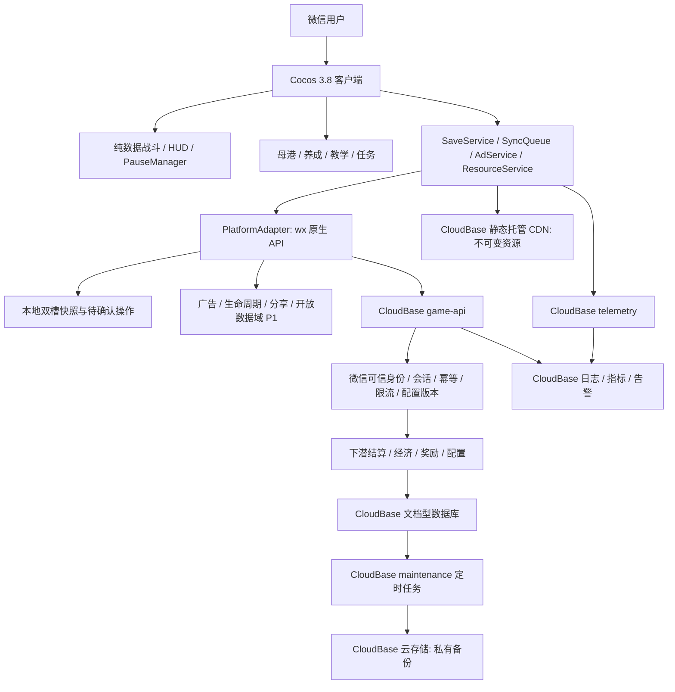
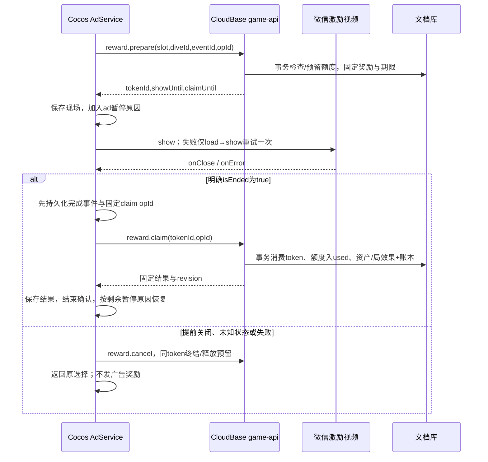

# 《潜渊猎手》微信小游戏技术方案

版本：v1.1｜日期：2026-11-10｜关联：LOO-46「技术方案」｜状态：交叉评审修订稿（待复核）

## 一、项目概述与输入边界

本方案把已有产品、选型和原型文档转为 **1 名程序可执行的 M1 起步方案**。正式产品为竖屏 2D 幸存者like 微信小游戏：下潜割草、氧气与舱容双压力、返航卸货、死亡清舱、三条局外养成、纯 IAA。局内战斗在客户端运行；持久资产、次数、抽箱和结算由 CloudBase 管理。

### 1.1 输入与技术决策继承

本次通读 `docs/` 已有的七个文件，以下文件共同构成输入，不另写一份引擎选型论证：

| 输入 | 本方案使用方式 |
|---|---|
| [PRD v1.0](潜渊猎手-PRD.md) | 第四至七节玩法/经济/广告，第十至十三节埋点/异常/MVP/性能作为需求来源 |
| [技术选型报告 v1.0](潜渊猎手-技术选型报告.md) | 第一、四、五节为技术决策；第六至十节为资源、权威存档和验证约束 |
| [原型设计与交互说明 v1](潜渊猎手-原型设计与交互说明.md) | 七入口母港、补给整合、页面四态、安全区、死亡冻结快照及 Cocos 节点映射 |
| [原型实施计划](潜渊猎手-原型实施计划.md) | 确认 Canvas/WXML 壳只用于交互评审；已有检查不等于正式小游戏验证 |
| [素材制作交接 v1](潜渊猎手-素材制作交接.md) | 独立透明素材、图集、命名、动画、压缩与主包预算 |
| [完整素材清单 CSV](潜渊猎手-完整素材清单.csv) | 185 文件（MVP 167 / P1 18），36 敌人与 8 共生体的资源键、海层与 Bundle 归属 |
| [竞品分析报告](撞鬼了-竞品分析报告.md) | 复用已观察的风险回报与可选广告加速结构；不推断竞品实现、性能或收入 |

直接沿用选型报告第一节结论：

> 采用 Cocos Creator 3.8 LTS + TypeScript + Cocos 内置 UI；微信小游戏原生 API 接入广告、生命周期与社交；本地快照配合 CloudBase 云函数、文档型数据库管理持久进度。

引擎差异与后端对比直接见选型报告第三节、第五节，不在此重述。编辑器验证基线为 **3.8.8**，通过首次 release 真机门槛后锁定完整版本。小游戏客户端用 `wx.cloud`；云函数用 `wx-server-sdk` 获取身份，`@cloudbase/node-sdk` 执行文档库事务；函数运行时与两个 SDK 的准确版本在 M1-01 按目标环境支持情况锁定，不套用未经核实的运行时名称。

本方案将云函数、文档数据库、远程配置、静态资源托管、备份和监控统一收敛在 **CloudBase**。选型报告提到的 COS/CDN 资源职责在这里由 CloudBase 静态网站托管及其 CDN 承担；私有备份放 CloudBase 云存储。不新增独立 COS、自建 API、MySQL、Redis 或战斗服务器。微信广告、开放数据域和审核发布仍是平台原生能力。

### 1.2 范围与待评审决策

下表为沿用选型/原型的**架构建议默认值**，不是已修改或已获批准的 PRD。产品决策由子任务 **LOO-47** 汇总，本轮文档修订不等待其结论。各项须在最早受影响模块**实现前**冻结配置；未确认可做契约/灰盒，不得以默认建议上线。M1-01～04可先做不依赖经济取值的工作，不能笼统认为M1-05也不依赖产品决定。

| 分歧 | 本方案估算与实现口径 | 决策截止 |
|---|---|---|
| PRD“三海层至1600m”与正文2400m不一致 | 三海层 0–800 / 800–1600 / 1600–2400m；第四渊主为深渊同层额外内容，不新增海层 | M1-09 前 |
| 战令系统为 Should，广告加领又为 Must；M1六类与PRD七类范围偏差 | 建议P0六类，白银/黄金分别配置为七个具体入口；“战令加领”随P1开放，**类别少一类仍属待批准偏差**，不能用入口计数替代确认 | M1-07a实现前；若M1需七类，新增战令工作包并重估 |
| PRD 广告失败直接发奖、存档余额取高 | 沿用选型修正：默认失败不发广告奖励；资产以服务端事务为准，不做余额 max 合并；补偿策略与文案由产品确认 | 权威资产契约在M1-04前；失败补偿在M1-07a前 |
| 断网与新手首玩 | 首潜可先教学体验；正式局在线开始、重连后确认结算；断网不扣掉已确认资产 | M1-05实现前 |
| 未成年/平台限制的降级 | 无可用广告时保留正常玩法；不臆造通用年龄接口，不把无填充当年龄结论；如需补偿，独立服务端策略且默认关闭 | M1-07a实现前 |
| 玩家等级的来源未定义 | 建议采用不可消费的累计经验+等级阈值表；经验由服务器接受的击杀/任务事件产生，具体经验权重和曲线由策划确认，不用六属性强化等级代替玩家等级 | M1-06a实现前；影响8级装备、40级第四槽与等级任务 |
| 死亡材料口径 | PRD仅明确荧晶清空；暂建议未卸货材料也损失，最终由 `deathLossMask` 明列各资源。无论采用哪一口径，接管/超期不得让死亡状态免除已确认的死亡惩罚 | **M1-05实现前**；先于结算/死亡模块，未确认不启用真实经济 |
| 黄金箱保底 | PRD只明确黄金十连保底；建议广告抽与珍珠抽共享累计计数，须确认单抽累计、十连保证、两渠道是否共用及计数重置条件 | M1-06a算法、M1-06b服务端实现前 |
| 三合一等级限制/继承 | 建议同模板、同品质、同等级，且未穿戴/未锁定；需确认是否允许混等级及等级/材料继承与返还 | M1-06a算法实现前 |
| 其他数值取值 | 氧耗系数公式与2500m示例有歧义；馈赠5次/日、声呐6次/日/剩余≤1分钟续领及祝福刷新不叠加均为建议 | 氧耗在M1-03前；广告/增益在M1-06a、07a/07b前 |

本文 **P0 = PRD Must/MVP**，P1 = PRD Should/第一迭代；PRD 原文未统一使用 P0，映射仅为执行编号。当前仓库有设计原型及素材产物，尚无本方案所述 Cocos/云函数工程。本次交付是方案文档，不代表包体、真机或生产部署已验收。

## 二、整体架构与模块划分



### 2.1 模块职责与依赖

| 模块/优先级 | 职责与输出 | 依赖约束 |
|---|---|---|
| `battle` P0 | 输入、移动、刷怪、索敌、四武器、碰撞、掉落、氧气、深度、死亡状态机；输出局摘要 | 不引用 `wx`、数据库或 UI 节点；逻辑固定30Hz，渲染30/60fps |
| `presentation/ui` P0 | Dive/Harbor 场景、HUD、面板、七入口导航、四态、警示与安全区 | 只读 ViewModel、发业务命令；不直接扣余额 |
| `meta` P0 | 六属性强化、五系科技、四槽装备、三合一、珍珠箱、轮换任务和教学 | 显示预估成本；服务端复算并返回真实结果 |
| `services` P0 | 资源引用计数、快照、串行同步队列、广告编排、配置缓存、埋点 | 调平台接口；统一处理重试和“确认中” |
| `platform` P0/P1 | 云调用、存储、网络、前后台、视频、音频、设备信息；P1榜单/分享 | 微信实现与浏览器模拟实现分开；模拟不可进入 release |
| `shared` P0 | 协议 DTO、schema、定点/大数、纯数值计算、错误码 | 双端构建产物；禁止引用 Cocos、SDK、服务端密钥 |
| `server/domain` P0/P1 | 可信身份、资产/额度、局结算、奖励、版本兼容与P1扩展 | 每次写资产均有事务与操作账本；日志不能触发发奖 |

建议目录与选型保持一致：

```text
game/
  assets/scenes/{Boot,Dive,Harbor}.scene
  assets/scripts/{battle,meta,ui,platform,services}/
  assets/bundles/{meta,sunlight,twilight,abyss,social,symbiont}/
  build-configs/wechat-release.json
server/
  functions/{game-api,telemetry,maintenance}/
  domain/{dive,economy,reward,config,migration}/
shared/{protocol,config-schema,numeric}/
tools/{export-config,check-assets,check-package,upload-wechat}/
docs/
```

目录是后续工程约定，文中工具/脚本路径均为待实现任务，不声称已经存在。现有 `output/abyss-hunter-prototype/` 不移入正式首包；只迁移状态规则、设计令牌与节点映射。

### 2.2 战斗与状态边界

- 集中 `Spawn → Movement → Targeting → Weapon → Hit → Loot → Oxygen → EndCheck` 更新；渲染插值与逻辑解耦。每帧最多追赶3步，前后台恢复丢弃暂停间隔，不补算伤害或掉落。
- 空间网格筛选邻居；圆形/线段精检；鱼雷扫掠检测、链电限制跳数与命中集合、声波限制每目标命中频次、浮雷限制数量与寿命。普通怪不挂刚体，不做80怪全量两两碰撞。索敌/远处决策5–10Hz。
- 怪物、子弹、掉落、飘字与效果池化；回收清理事件/命中集合/资源引用。池满时延后刷怪、合并掉落和飘字；危险预警与真实命中不可被装饰特效挤占。
- `DiveSession`：`Running → RescuePending → Running / Returning → PendingSettlement → Settled`。死亡先冻结舱内快照；拒绝救援或最终放弃才清舱。救援沿原 `diveId` 继续，回港不创建第二次卸货。
- `PauseManager` 用原因集合 `{modal, ad, background, reconnect, countdown}`；只有集合为空才推进有效时间。低氧常驻提示不暂停，玩家主动打开选择弹窗才暂停。广告结束仅移除 `ad`，不能解除后台/来电暂停。
- 氧气依有效时间和深度配置消耗，归零每有效秒掉2%最大生命；舱容封顶停止装载荧晶。PRD公式存在“2500m系数1.8”与每500m增加0.2的算术歧义；配置基线暂用 `1 + 0.2 * floor(depth/500)`，由策划在 M1-09 校准，双端用同版函数。

### 2.3 养成、任务与界面

六属性等级/科技前置/装备解锁均读配置；独立的 `progression.totalXp/playerLevel` 与属性强化等级分离。建议由 `dive.settle/task.claim` 对已接受事件累积不可消费经验，按不可变 `levelThresholds` 表计算等级，连升多级一次事务处理；经验权重/曲线待M1-06a前确认，未确认时只实现契约和灰盒配置。玩家8级解锁装备，四槽为两主武器两辅件，第4槽40级解锁。三合一返一个下一品质实例，但同等级限制、等级继承/材料返还尚属建议；黄金箱广告/珍珠抽共享累计保底也尚属建议，均受1.2节决策截止条件约束。实现按锁定配置计算，不由程序默默拍板；随机结果由服务器产生并固定进账本，不由客户端抽签。

轮换任务以已接受的下潜/经济事件累计，服务端 `task.claim` 事务领奖；教学步骤可本地先行，首次奖励用固定领取键只导入一次。不得把“每次攻击自动索敌”放到声呐授权后：基础自动攻击常开，声呐只增加自动寻路/索敌移动便利，手动摇杆即时接管。

港口按原型七入口布局，补给整合馈赠、祝福、协击、珍珠箱；档案P1未开放时明确标记。Widget适配胶囊/安全区，主要触区≥44逻辑像素；基准375宽，覆盖667/750/812高度。数字BMFont，中文系统字体；海层色调、危险提示与无文字素材契约沿用交接文档。

## 三、微信分包与远程 Bundle 策略

### 3.1 包体与资源归属

以下都是**工程预算，非实测**。平台门槛暂按任务主包4MB、项目总本地包20MiB内控；最终以目标AppID当前微信编译校验结果为准。不能通过扩大总包或只显示加载页来宣称首玩通过。

| 归属 | 内容 | 预算/加载点 |
|---|---|---|
| 主包 | 裁剪引擎、核心战斗/广告/云适配代码、Boot/Dive最小内容、基础HUD、少量普通怪、最小结算反馈 | ≤3.5MiB：引擎适配2.0、业务0.6、资源0.7、配置0.2；启动可移动/攻击 |
| `meta` 普通分包 | Harbor与养成/补给面板、装备图标、本地审核内脚本 | ≤3MiB；首潜开始预取，卸货时可等资源但不丢现场 |
| `social` 普通分包 P1 | 档案/好友榜入口、开放数据域相关审核内代码 | ≤1MiB；打开前加载；开放数据域不天然免计包 |
| `sunlight` 远程Bundle | 完整日光层背景、其余怪、武器挂载/音效 | 首次增量目标≤2MiB；首潜进行中预取 |
| `twilight` / `abyss` 远程Bundle | 对应海层场景/图集/渊主与音频 | 各≤4MiB下载目标；预计抵达边界前至少100m开始预取 |
| `symbiont`及P1资源 | 八共生体、图鉴复用图、战令/海报资源 | 解锁前按需；不纳入首包 |

CSV是制作源稿清单，不是最终压缩发布量。工程导入生成 `assetId → bundle/path/hash/size/qualityVariant` 索引，静态检查文件、alpha、锚点、四帧格数、最长边≤2048与重复图。日光最小敌人从日光清单挑选并生成首包衍生版本，单独登记重映射，避免把同一整图集同时放 main/sunlight。其他海层与meta不得被首场景Prefab硬引用拉回主包。

### 3.2 加载、版本与回退

Creator Bundle包含配置、资源与可能的脚本输出；微信平台远程Bundle的脚本仍需留在审核本地包。构建检查 `src/bundle-scripts`、公共chunk和实际 `game.json` 分包配置；远程托管禁止新增JS、动态脚本或绕审核替换逻辑。[Cocos Asset Bundle说明](https://docs.cocos.com/creator/3.8/manual/zh/asset/bundle.html)

1. 资源放 CloudBase 静态托管 `/<clientVersion>/<resourceVersion>/<hash>/...`；客户端安装包内含可信清单与默认版本，云配置只在兼容清单中切换。远程JSON仅承载既有schema允许的数据。
2. 发布先上传全部资源并校验hash/可达性，再激活清单。禁止覆盖旧路径；旧客户端继续读旧路径。按工程版本选择正确Bundle配置，不把散图目录直接当Bundle根。
3. `ResourceService` 合并同资源并发请求，按优先级下载，失败退避1s/3s至多重试2次，再显示重试/返航。下载、解析、纹理上传、实例化分别计时，战斗低峰分帧预热。
4. 到海层边界仍未加载完成：停留已加载安全区，暂停战斗与氧气，提供等待/安全返航；不跨入缺图区域、不扣损失。网络故障按第五节进入待结算。
5. 文件/hash缓存命中可复用，失败按文件重试；不承诺字节级断点续传。缓存淘汰只影响下载，不影响云资产。收到内存警告先清非当前海层/关闭面板的独占资源。
6. 退出海层先销毁/回收所属节点与池，解除事件和引用，再释放独占资产；共享HUD/公共图集仍保留。`removeBundle`不等于释放纹理；不得用全局 `releaseAll` 清掉还在用的共享素材。

普通怪以烘焙边光、共享材质、序列帧实现；不启用全屏Bloom或3D物理。高/低档选择压缩纹理与PNG回退之一，不同时加载全部变体。2048² RGBA8单层16MiB，磁盘PNG压缩率不能代表运行内存。

## 四、CloudBase 云函数、数据模型与权限

### 4.1 环境与云函数清单

划分 dev/test/prod 三个 CloudBase 环境与对应广告配置；AppID关联、云环境权限和函数运行时在M1-01核验。函数TS编译JS，业务域源码共用，首版仅三个部署单元，便于单人维护：

| 云函数 | 入口/职责 | 权限、初始预算与部署 |
|---|---|---|
| `game-api` P0 | `bootstrap/session.takeover/config.get/op.get`；`dive.begin/checkpoint/settle`；`economy.execute/task.claim`；`reward.prepare/claim/cancel` | 仅微信可信云调用；每命令schema校验。初始256MB、超时10s为待压测值；不开放无鉴权HTTP |
| `telemetry` P0 | 批量接收白名单事件，服务端补匿名用户标识/时间；去重与结构化日志 | 微信调用身份；≤20条/批、≤32KiB；不接受资产写入 |
| `maintenance` P0 | 过期局/令牌整理、账本归档、备份/恢复校验任务、聚合告警；P1周期结转 | 仅可信定时触发与运维身份；玩家调用一律拒绝；分批游标执行避免超时 |

`game-api`每用户初始限额60命令/分钟，广告prepare≤10次/分钟且全用户仅一个有效展示意图；阈值均为配置初值。额度/意图预留在用户聚合文档事务检查；仅靠函数进程内Map不能跨实例限流。定时入口应校验受信触发来源；不能只相信请求体 `isAdmin=true`。部署维护身份与玩家命令严格隔离。

微信身份从 `cloud.getWXContext()` 取 `OPENID/APPID`，与环境允许AppID比对；忽略请求体uid/openid。玩家uid由服务端稳定映射生成，不向其他用户暴露OPENID。头像昵称为可选资料，不阻塞登录。初始化与调用封装在平台层，不把小程序的 `App/Page` 模式搬入Cocos小游戏。

### 4.2 集合结构、索引与保留

全部为 CloudBase **文档型数据库**。创建环境时核对实际模式与SDK事务支持，按本方案的传统文档库/安全规则路径验证；不能静默换成PG模式或MySQL而继续套用同一权限语法。以下字段/保留期是本项目设计值，时间存服务端UTC日期，业务日按Asia/Shanghai计算。

| 集合 | 文档主键与核心结构 | 索引、约束与保留 |
|---|---|---|
| `players` | `_id=uid`；`schemaVersion/revision/sessionEpoch/deviceHash/activeDiveId`；`wallet{crystal,pearl,marrow,coreCyan,coreRed,ticket}`；`progression{totalXp,playerLevel}`；`upgrade{6项等级}/tech{nodeIds}/inventory[]/loadout{4槽}/pity{gold}`；`records/tutorial/tasks/dailyByDay/buffs/rateWindow` | 主键唯一；聚合档目标≤100KiB；背包初始上限200件，满时拒绝开启抽取、不扣费不吞奖；P1字段默认空 |
| `dives` | `_id=diveId`；`uid/sessionEpoch/startRev/configVersion/startAt/expiresAt/startSnapshot`；`state/stateVersion/checkpointSeq/checkpointHash/checkpoint/lastCheckpointReceipt`；`nextEventSeq/events/currentDeathEventId/currentOxygenEventId/rewardEffects`；`finalizationKey/settlementOpId/result` | `(uid,state)`、`(state,expiresAt)`；一个用户只允许 `players.activeDiveId` 指向一局；事件结构与转移见5.3a/5.3b。检查点原位覆盖，不为每次检查点建永久账本；终态详情90天后压成终态墓碑，活动局不被清理 |
| `reward_intents` | `_id=tokenId`；`uid/sessionEpoch/slot/diveId/eventId/eventSeq/businessKey/choiceId/configVersion/rewardSpec/dayKey/issuedAt/showUntil/claimUntil/status/result` | `(uid,status)`、`(status,claimUntil)`；情境位必须引用服务器签发的eventId，业务键为 `diveId+slot+eventId`；事务复核事件activeTokenId/appliedTokenId；同用户一个有效意图；终态详情90天后可压缩，不能重开已消费事件 |
| `operations` | `_id=hash(uid,opId)`；`uid/opId/kind/requestHash/sessionEpoch/beforeRev/afterRev/receipt/serverAt` | `(uid,serverAt)`；只收经济/会话/奖励/终结类命令，**不收周期检查点**；主键承担请求幂等唯一性；详情90天后保留紧凑墓碑，墓碑命中返回已处理并要求拉当前档，不重新执行 |
| `configs` | `_id=version`不可变配置；含数值/掉落/点位/资源映射/schema/minClientVersion；`_id=active`指向生效/回退版本和急停开关 | 管理身份写；活动局引用版本必须保留；指针切换有审核记录，敏感风控字段不下发 |

`players` 示例仅展示关键字段；金额统一为非负十进制整数字符串，计数/等级/米数使用经范围校验的安全整数。PRD1000级指数曲线会超过JS安全整数，禁止 `Number` 保存钱包/价格、禁止K/M展示串回传入账；采用共享BigInt/大数算法，JSON前转字符串。费用以配置导出的整数字表为准，明确向上取整，双端不各自浮点幂运算。

```json
{
  "_id": "uid_opaque",
  "schemaVersion": 1,
  "revision": 42,
  "sessionEpoch": 3,
  "activeDiveId": null,
  "wallet": {"crystal":"1280","pearl":"128","marrow":"17","coreCyan":"3","coreRed":"0","ticket":"0"},
  "progression": {"totalXp":"0","playerLevel":1},
  "upgrade": {"hp":1,"attack":1,"speed":0,"move":0,"cargo":0,"oxygen":0},
  "loadout": {"weapon1":"eq_1","weapon2":null,"aux1":null,"aux2":null},
  "pity": {"gold":0},
  "dailyByDay": {"2026-11-10":{"used":{},"reserved":{}}},
  "records": {"maxDepth":260,"tutorialRewardClaimed":true}
}
```

### 4.3 权限策略

本方案所有集合对客户端SDK**直接读写均拒绝**，统一经函数返回裁剪DTO，避免钱包、令牌、风控字段和配置后台被旁路访问。传统文档库逐集合部署规则：

```json
{"read": false, "write": false}
```

规则保护客户端访问；服务端SDK的授权访问仍必须在业务函数检查身份、所有权、会话和目标状态。不得以“已设安全规则”省略函数校验；生产控制台/部署账户同样按最小权限管理。CloudBase不同数据库模式的权限机制不同，须验证目标环境规则实际生效。[CloudBase安全规则](https://docs.cloudbase.net/database/security-rules)

公开Bundle只含公开美术/音频及允许公开的配置，禁止把存档、OPENID、令牌、日志或备份放静态托管。CloudBase云存储备份仅运维服务身份可读写；游戏客户端无上传备份/覆盖资产权限。安全验收分别尝试匿名、玩家本人、另一玩家直接读写，以及伪造请求uid调用函数，均应被拒绝或忽略伪造身份。

## 五、服务端权威、幂等与防丢档

### 5.1 API契约

经济、会话和终结类命令使用统一信封；只读命令不要求 `expectedRev`。检查点是无资产变更的专用协议，使用 `checkpointSeq+baseStateVersion`，不复用玩家资产revision和永久operations账本（见5.2）。经济动作串行发送，战斗帧不等待云响应。

```typescript
type Command<T> = {
  command: string; protocolVersion: 1; clientVersion: string;
  opId: string; sessionEpoch: number; expectedRev: number; payload: T;
};
type Reply<T> = {
  ok: boolean; code: string; requestId: string; serverTime: string;
  receipt?: { opId: string; appliedRevision: number; result: T };
  snapshot?: { revision: number; sessionEpoch: number; state: unknown };
  retryable: boolean;
};
```

| 命令 | payload | 成功结果与关键限制 |
|---|---|---|
| `bootstrap` | `deviceId,schemaVersion,lastKnownRev` | 身份初始化、云快照、时间/配置、当前局/未领意图摘要；重复启动不增发初始资产、不自动抢占另一设备 |
| `session.takeover` | `observedEpoch` | 玩家确认后CAS递增epoch；同事务调用5.3a统一终结判定，取消未申领令牌/释放预留；死亡待救援不得安全兑付。提示先在旧设备完成待确认领奖，同设备重启保持原epoch |
| `config.get` | `knownVersion` | 兼容配置/急停开关及版本etag；无更新返回轻量结果 |
| `op.get` | `targetOpId` | 仅本人的已提交结果；未知不等于失败，客户端可重发原命令 |
| `dive.begin` | `loadoutId` | 服务端创建diveId、种子、属性/配置/增益快照与有效期；只允许一个活动局 |
| `dive.checkpoint` | `diveId,checkpointSeq,baseStateVersion,activeMs,depthSegments,killCounts,damageSummary,lootSummary,transition` | 验证累计摘要、服务端推导HP/氧气及状态；返回 `ackSeq/stateVersion/state/eventId?`。客户端的hp/低氧标签只能作为提示，事件序号不由客户端指定 |
| `dive.settle` | `diveId,endReason,checkpointSeq,summary` | 校验最新摘要后调用5.3a统一判定；endReason不能覆盖服务端死亡状态；一次终结只记一笔资产 |
| `economy.execute` | `action,targetIds,optionId,count` | 强化/科技/装配/升级/合成/抽箱；服务器定价、抽签、扣款和产出 |
| `task.claim` | `taskId,periodKey` | 检查完成进度、固定领取键并入账；客户端计数不能作为完成凭证 |
| `reward.prepare` | `slot,diveId?,eventId?,choiceId?` | 情境位必须带服务器签发eventId，服务器读出eventSeq，不接受自造contextSeq；绑定业务键、预留额度；祝福选择提前指定 |
| `reward.claim` | `tokenId,clientCompletionState` | 返回固定操作回执及可选当前快照；事务消费事件与令牌，旧回执不覆盖新档；观看状态不是可信凭证 |
| `reward.cancel` | `tokenId,reason` | 关闭/失败终结令牌、释放预留额度；已领不得取消；未知观看状态不擅自取消已提交领取 |

错误码：`REV_CONFLICT / STATE_CONFLICT / STALE_CHECKPOINT / EVENT_INVALID / EVENT_CONSUMED / SESSION_REPLACED / QUOTA_EXCEEDED / TOKEN_EXPIRED / DIVE_EXPIRED / ALREADY_PROCESSED / INVALID_STATE / INVENTORY_FULL / CONFIG_MISMATCH / CLIENT_TOO_OLD / RISK_REJECTED / RETRYABLE`。客户端显示操作号与可恢复动作，不显示内部SDK异常或敏感字段。

### 5.2 资产事务与业务唯一性

CloudBase事务在服务端执行，适合将资产更新与账本提交置于同一原子边界。[CloudBase事务操作](https://docs.cloudbase.net/database/transaction)

每次经济/会话/终结操作按以下顺序实现，**幂等结果检查早于revision检查**，否则“服务器成功、客户端超时”的重试会误报冲突：

1. 验可信微信身份、协议/schema、请求长度、字段白名单，计算规范化请求摘要（含原payload/expectedRev/sessionEpoch）。
2. 开事务，读 `operations[uid,opId]`。存在且摘要一致返回原操作回执；同opId改payload拒绝。回执和当前快照分开，前者不表示当前余额（见5.4）。已压缩墓碑只返回ALREADY_PROCESSED并拉当前档，不再发奖；只向原uid返回历史结果，不授予旧会话继续操作的能力。
3. 无请求账本时读取玩家与必要目标文档，先复核归属/epoch及业务唯一键；若同事件已有相同选择的有效意图，或同token/同局已有终态，只返回已存在的token/回执，不新写、不因旧expectedRev另发一笔。需要新变更时再检查revision、服务端业务日、余额/配置/目标状态。配置不可变，事务内核对使用版本与急停；改变slot/choice引用旧业务键不能绕过检查。
4. 按规则生成结果；抽箱随机结果在一次请求中预生成并在事务重试时复用，不在事务回调内发网络请求、埋点或创建新的随机结果。
5. 同事务更新玩家资产、revision+1、局/令牌/任务状态和账本。终结局以 `finalizationKey=diveId:final` 及终态保障不同opId/入口也无法二次结算；情境广告同时消费event与token，任务以 `period+taskId` 保障业务唯一性。
6. 提交后再发观测事件。响应丢失时同opId返回相同资产变更；若出现事务竞争，有限重试至多3次，仍失败返回可重试错误，不先成功提示。

`REV_CONFLICT`：拉取权威快照/查询原opId，禁止把同一扣费动作自动改新opId重做。确认尚未提交且玩家仍要操作，才以新revision创建新命令。按钮防抖只是体验优化，最终由事务防重。

**周期检查点例外**：事务读 `players` 的epoch/activeDiveId与 `dives`，只写 `dives`，不改玩家资产revision、不建operations文档。先判序号/hash重放，再为新检查点校验 `baseStateVersion`：同序号同hash返回保存的ack，改内容拒绝；更旧序号返回STALE_CHECKPOINT及最新ack，不重放旧状态；新序号必须为已接受序号+1且baseStateVersion匹配，否则拉局状态。这样响应丢失可重取ack，救援后的旧检查点又不能把状态改回死亡。关键事件/最终结算与该局文档串行竞争，接管同时修改players以使旧会话检查点失效。只保留最后检查点/ack及有业务意义的事件，不无限保存每15秒历史。终态或不存在的diveId一律拒绝检查点，不会通过检查点自动创建局。

### 5.3 下潜合理性校验与经济规则

`dive.begin` 锁定起始装备/属性、增益、种子、配置、可进入海层、舱容、氧气与有效期（初始24小时恢复窗口；不是允许24小时持续产出）。战斗期间禁止强化、换装或抽箱改变当前局属性；港口经济动作需无活动局。广告效果作为服务端已授权事件追加到局，客户端应用相应效果后继续同局。

正式局每15秒有效时间产生一次累计检查点，关键点（进入海层、渊主击败、死亡、广告前后、返航）补交；断网时只保留本地，重连按序补交有限累计摘要，不能逐秒/逐击杀上报。校验包括：

- `activeMs`单调、不得超过服务端起止墙钟时差；暂停时间不能增加收益。单局有效时长初始上限10分钟，超限停产安全返航；具体曲线由配置测试确定。
- 深度变化不超过起始移动能力×有效时间的上界，Boss解锁前置/海层顺序有效；普通/精英/渊主击杀数不超过锁定刷怪与伤害上界。
- 荧晶不超过舱容与该局掉落上界；稀有掉落由服务器按种子、允许的击杀摘要和配置计算，一次结算，不接受客户端直接指定材料/装备。
- `endReason=deposit/manual/oxygen_exit/network_exit`仅表达客户端请求，是否入账由5.3a的服务端状态决定；`death/abandon`按锁定配置 `deathLossMask` 清除未卸货资源，已确认母港资产不扣。荧晶清空继承PRD，其他材料是否损失须在M1-05实现前经LOO-47确认；不把“全部材料清空”写成已批准规则。
- 救援待选期间局未终结，拒绝才提交死亡结算；已确认救援允许从冻结摘要继续。供氧/救援次数与作用序号不得重复使用；恢复时重放已授权局事件，不凭本地布尔值再发一次。

这是成本可控的**摘要校验与资产权威**，不是战斗重演：不能证明每一击杀或客户端有效时间都真实。风险账户限制产出/冻结新奖励并保留操作号人工核查，不自动扣空已确认钱包。若引入IAP、排名派奖或现金竞争，必须重新评估战斗验证强度，不能沿用此安全承诺。

### 5.3a 服务端局状态与统一终结判定（B1）

`dives.state`持久化为 `RUNNING / RESCUE_PENDING / RETURN_PENDING / SETTLED`；`stateVersion`每次接受检查点、应用情境效果或终结时递增。客户端 `DiveSession` 的动画/网络等待状态不覆盖服务端状态。已接受死亡时同事务设置 `RESCUE_PENDING`、`currentDeathEventId`并冻结舱与HP；必须在广告prepare前确认死亡检查点。单凭切回港口、网络退出或客户端endReason不能恢复为RUNNING。

`dive.settle`、`session.takeover`、`maintenance.expireDive`三个入口共用同一个纯领域判定 `finalizeDive(state, events, acceptedSnapshot, reason, config)`，并在同一事务范围更新玩家、局终态、令牌/额度和终结账本。玩家入口校验epoch；维护入口用受信系统身份和固定系统操作键，不能伪装玩家。接管在该事务里结旧局并递增epoch；最终资产revision只递增一次。

| 持久状态 / 事件 | 接管或局超期 | 主动结算/放弃 | 令牌取消/过期 |
|---|---|---|---|
| `RUNNING`，最后接受快照仍存活 | 以最后接受检查点做一次安全返航，校验后入账；本地未送达增量不兑付 | 接受返航摘要后入账；显式abandon按已确认放弃规则处理 | 只结束该意图、释放预留，不自动改变存活状态或发替代奖励 |
| `RETURN_PENDING`，有效返航摘要已冻结 | 复用同一终结键入账，不再增长本局收益 | 返回同一结果 | 不产生额外结算 |
| `RESCUE_PENDING`，死亡事件未APPLIED | **按死亡结算，荧晶清空，其他材料依deathLossMask；不能安全兑付被冻结荧晶** | 拒绝/放弃按死亡结算；将endReason伪造为network_exit也不改变结果 | 仍在有效局内可保留原救援选择；若因此执行返航/局到期，则走同一死亡终结规则 |
| 已在事务中应用救援，局转回`RUNNING` | 以救援重设的50%生命和保留货物快照为新基线，可安全返航 | 新的有效战斗摘要按正常规则结算；以后再次死亡需新事件 | 旧token/event已APPLIED，取消/过期返回已有回执，不撤销救援、不再加效果 |
| `SETTLED`或终态墓碑 | 返回已处理状态与既有结算引用，不入第二笔 | 同左 | 不复活终结局，不把未应用效果折算为货币 |

救援claim与接管/清理竞争同一局和token事务：claim先提交且未过期限，局已回RUNNING，终结按新状态；终结先提交，token同事务取消、未消费预留释放，迟到claim拒绝。`claimUntil`不得晚于局 `expiresAt`；过期令牌没有“自动救援”效果。取消或失败只释放广告预留，**不是放弃死亡事件**；玩家仍可在有效窗口重试同一个未消费事件或明确放弃。

复核用例（文档契约，后续在M1-05/07a/10b/11b实现测试）：

| ID | 输入序列 | 必须结果 |
|---|---|---|
| B1-01 | 死亡检查点已接受→未claim→另一设备接管 | 旧局按死亡终结；荧晶入账0、其余按mask；epoch更新，旧设备无权续写 |
| B1-02 | 死亡检查点已接受→不领奖→局超期/令牌到期后返航 | 同死亡规则，维护重跑不再扣/发；不能因“安全返航”保荧晶 |
| B1-03 | 同死亡事件救援已提交→响应丢失→接管/超期 | 先读取APPLIED与RUNNING基线，再安全结算一次；不重复救援 |
| B1-04 | 正常存活检查点→接管/超期，或返航与维护同时提交 | 仅最后接受收益一次入账，所有入口共享finalizationKey |

服务端从未接收到的死亡仍无法被摘要方案证明，可能按先前存活检查点安全结算；这属于明确保留的客户端战斗残余风险，不能用它解释**已接受死亡**后仍错误兑付。

### 5.3b 情境事件签发与业务幂等（B2）

事件不是调用方自增的 `contextSeq`。客户端只提交战斗摘要/转换请求，服务器接受后从 `dives.nextEventSeq` 分配序号，生成不可复用 `eventId=服务端生成ID`；`eventSeq`只在该事务递增。`dives.events[eventId]`存 `kind/eventSeq/openCheckpointSeq/openStateVersion/openActiveMs/frozenSnapshot/status/activeTokenId/appliedTokenId/effectBaseline`，并以 `currentDeathEventId/currentOxygenEventId`指向当前资格。事件历史在单局内有界（初始上限32，超限停止新情境奖励并返航），与终态局详情一起保留/压缩。

| 事件 | 服务器接受资格 | 下一事件与防重放 |
|---|---|---|
| `death` | 从RUNNING接受新的有效摘要，基于上次HP/已授权治疗及范围内damageSummary推导HP≤0；校验伤害/击杀/时间上界。冻结死亡快照并进入RESCUE_PENDING；拒绝单独的 `isDead=true` 标签 | 待救援时不接受新战斗时长/新死亡事件。仅一次成功救援才将原事件置APPLIED、HP重设50%、建立新的伤害基线并回RUNNING；下一死亡必须在此基线后有新增有效时间和新接受伤害，不能重交旧累计损伤 |
| `oxygen_low` | RUNNING且服务器计算的氧气从≥15%跨到<15%；用按深度带的有效时长段、锁定氧耗/增益/已授权供氧计算，不直接信任客户端oxygen数值。一个低氧区间仅一事件 | 无新供氧时一直低氧不会产生第二事件；供氧claim事务回满并将原事件置APPLIED，之后须有新增有效耗氧再次跨阈值才签发新事件。死亡检查点将未消费低氧事件置SUSPENDED，旧意图资格失效；先cancel释放预留再prepare救援，不在检查点中写额度。救援成功且仍低氧时恢复**同一未消费eventId**为OPEN，不重签序号；此前旧token必须已取消 |

伤害摘要仍不能证明每次受击真实，属于5.3节的合理性校验边界；但序号、状态转换、HP/氧气基线和效果消费由服务器决定，不能仅改客户端编号就创造资格。客户端离线的死亡/低氧先本地冻结，联网按序提交检查点拿到事件身份后才能prepare；重启bootstrap返回当前事件，不能自行重新编号。

情境prepare事务检查 `eventId`归属/epoch/当前指针、允许局状态、OPEN状态、尚未APPLIED、剩余额度，创建意图时将 `businessKey=diveId+slot+eventId`、eventId与eventSeq持久绑定，并把事件设为RESERVED/activeTokenId。**同事件换opId申请仍返回同一有效token，不再占一份额度**；不接受用新token绕过事件指针。claim事务同时检查token、事件activeTokenId与状态，原子写入APPLIED/appliedTokenId、局效果、玩家额度与操作回执。已消费事件换token、换opId不得重生效。

cancel/到期只在token仍是该事件activeTokenId时释放其预留；若事件仍有效，可回到OPEN供用户重新观看，此时可换新token但businessKey不变；若已SUSPENDED则保留暂停资格，不因取消恢复OPEN。旧token已取消，迟到claim不得作用；事件已APPLIED则只返回原回执。终结/接管把未消费事件置CLOSED；传旧eventId也不能重新prepare。死亡暂停的低氧事件仅能随该次成功救援恢复原身份，不能制造新告警次数。所有路径事务比较事件指针和状态，不能“先发新token再查事件”。

| ID | 请求/恢复场景 | 必须结果 |
|---|---|---|
| B2-01 | 同一死亡或低氧事件、并发换opId prepare | 一份预留、同一有效token；已消费后返回EVENT_CONSUMED |
| B2-02 | 同事件换token claim（含伪造或旧取消token） | 必须匹配activeTokenId；拒绝伪造/已取消token；原已成功token重放只返回回执 |
| B2-03 | 修改contextSeq、自造eventId或引用别人的事件 | 请求schema拒绝contextSeq/不存在或不归属事件，额度和效果均不变 |
| B2-04 | 已救援/供氧→客户端重启→重放prepare/claim/旧检查点 | 恢复原事件APPLIED；不重复效果/次数；旧stateVersion/序号不能重开事件 |
| B2-05 | 没有新增告警、仍低氧，或刚供氧未有效耗氧→连续prepare | 不签发新事件；只能重试原未消费事件或拒绝资格 |
| B2-06 | 失败取消后重试同事件；同时死亡/过期/接管 | 仍有效才可绑定新token，最多一次效果；若已CLOSED/SETTLED则拒绝并释放未消费预留 |

### 5.4 快照、恢复与多设备冲突

本地存 `schemaVersion/cloudRev/sessionEpoch/deviceId/snapshot/pendingOps/localDive/checksum`，双槽A/B：写新槽、回读校验、再切活动指针；启动挑最高完整序号，损坏则回退另一槽再拉云档。校验和只防损坏，不防作弊。每10秒低频保存，卸货/广告/前后台等关键转换立即保存；待确认经济操作先落盘再请求，收到成功按下述快照/回执规则处理后清队列。检查点只持久化最新待送摘要与必要事件转换，不累积成永久经济队列。

**回执与快照应用规则（S2）**：`receipt.appliedRevision`是该操作曾经提交时的版本，receipt.result用于确认操作完成/显示结果，不是“现在的余额”。同uid/环境/兼容schema下，正常同步只接受 `snapshot.revision >= cloudRev` 的快照；相同版本不重复应用delta，更低版本只确认对应队列完成，不覆写钱包/装备/保底。未附当前快照的历史回执触发轻量bootstrap，不把历史增量再加一遍。局快照另以 `stateVersion` 单调应用，避免旧广告响应倒退局状态。若检测本地档损坏或revision凭空领先，先隔离坏缓存再以bootstrap重建，不拿损坏版本永久挡住服务器恢复。

| 场景 | 恢复/冲突规则 |
|---|---|
| 服务端提交成功、客户端超时或被杀 | 启动先bootstrap，再按原opId查/重放；回执只消队列，快照按revision门槛应用；不重复增发 |
| bootstrap快照rev43→旧操作rev42回执迟到 | 保留rev43全部资产，确认rev42操作已完成，不覆盖、不叠加历史delta；已压缩回执则查询当前状态 |
| 本地revision落后 | 云快照覆盖已确认资产，保留待确认操作供查询；不max余额/装备/保底 |
| 本地revision领先或结构损坏 | 不把本地值上传覆盖；拉云端并保留诊断副本/操作号 |
| 两设备同时进入 | 展示已有会话；显式“接管”才epoch+1并终结旧局。旧设备新写返回SESSION_REPLACED，停止结算、展示云状态 |
| 最深纪录/图鉴计数 | 只对服务器接受过的单调摘要合并；纪录可max，击杀用diveId去重累计，不能max或相加任意本地值 |
| 云存档迁移 | 服务端按schemaVersion幂等迁移，先备份再升版；加字段与默认值优先，至少兼容前一审核客户端，不做不可逆覆盖 |
| 清缓存/换机 | 云已确认资产可恢复；未送达云端的局内现场可能丢失；不承诺本地缓存被清理后仍能恢复未确认收益 |

正常重启可在有效期内恢复原局并等待3秒倒计时；死亡待救援局恢复救援选择而非直接运行。超过恢复窗按5.3a统一终结：存活局安全结算，死亡未救援局按死亡惩罚，只有本地超期增量不自动兑付。活动局/意图引用的配置、事件和幂等记录在恢复窗内不得删除；终态压缩/去重保留见9.2。

### 5.5 断网与打断矩阵

| 时刻 | 行为 |
|---|---|
| 首次启动未联网 | 可用内置最小资源体验教学；不加载陌生人的档、不进入正式奖励链路；联网后服务器仅一次导入上限内教学奖励 |
| 老用户离线启动 | 展示缓存标注未同步；可练习，正式出发、消费、广告领奖等待联网 |
| 正式局断网≤30秒 | 检测到失联即暂停战斗/氧气并保存现场，提供重连；网络状态提示需结合实际云请求结果，不能只相信Wi-Fi图标 |
| 断网超过30秒 | 本地回港并冻结待结算摘要；不把待确认货加入可消费余额。服务端已接受死亡时保留死亡惩罚，不能改成安全兑付；未确认期间禁止新正式局/资产消费 |
| 重连 | 同epoch、有效期和配置下校验原diveId/opId，只结算一次；异常/过期给明确错误与服务端已接受检查点结果 |
| 来电/切后台 | 立即冻结所有有效计时、保存；不依赖最后一刻请求完成。回前台仍有广告/重连原因则继续暂停，否则3秒倒计时 |
| 广告加载/播放中断网 | 停留原选择；没有明确完成事件不申领奖励。完成但领取断网则按第六节待确认 |
| 应用在广告中被杀 | bootstrap先查服务器终态：已领取应用原结果；未领取且本地有完成记录则同token/opId续领；仅prepare且无完成记录则立即发cancel对账释放预留，成功后才允许下一条广告，不等待24小时 |

这里采用“断网即暂停、超30秒安全回港”的确定策略，避免继续断网产出与暂停氧气混在一起。若网络变化事件漏报，已发生的少量有效时间由恢复后的上界校验处理。

## 六、激励视频与其他平台链路

### 6.1 点位配置

广告不进入逐帧逻辑；`AdService`按广告单元复用实例，监听器注册一次且销毁时解绑，全局仅一个展示流程。基础自动攻击免费常开，所有视频必须由玩家主动选择。

| 业务slot | 作用 | 额度/状态 |
|---|---|---|
| `gift` P0 | 随机荧晶/珍珠/材料 | PRD未定每日上限；首测建议5次/日，待策划确认，服务端配置控制 |
| `blessing` P0 | 三选一20分钟：收益+10% / 氧气+20% / 舱容+20% | 2次/日，同类刷新有效期、不乘算叠加；港口领取后带入下局 |
| `sonar` P0 | 自动寻路/协击便利15分钟 | PRD未定每日上限；首测建议6次/日、剩余≤1分钟才续领，待确认 |
| `silver_chest` / `gold_chest` P0 | 各一次免费抽 | 白银3次/日、黄金2次/日；服务器随机，保底渠道/累计规则待1.2节确认 |
| `rescue` P0 | 原地50%生命恢复并保舱 | 3次/日，绑定diveId+服务器death eventId；同一死亡只能恢复一次 |
| `oxygen` P0 | <15%告警时回满 | 3次/日，绑定diveId+服务器oxygen_low eventId；不强制视频，不重复回满同事件 |
| `pass_extra` P1 | 战令某级奖励加领 | 固定赛季+等级领取键；战令未开放则slot不可用 |

祝福和声呐时长采用服务端绝对 `expiresAt`，后台/广告期间照常流逝；氧气/伤害采用有效时间。客户端用服务端时间偏移展示剩余时长，不信任手机改时钟。局内在增益到期tick停用效果，服务端按领取/到期窗口校验，不把“开局有效”解释为整局永久有效。

### 6.2 发奖时序与中断



`prepare`绑定用户/epoch/点位/局/服务器事件身份/选择/业务日/配置，建议 `showUntil=签发后10分钟`、`claimUntil=签发后24小时`；情境位二者均不得晚于局expiresAt。有效展示与延迟申领分开，不将短展示期限当领奖丢失期限。跨日申领仍占签发业务日额度。`players.dailyByDay[dayKey]`保存分日的used/reserved，至少保留今日、昨日及仍有未终结令牌的日期；不能跨零点直接覆盖昨日预留。预留仅在claim/cancel/到期时转已用或释放，新日的额度独立；过期清理由定时任务和下次请求惰性执行。全局最多一个待展示/待领取意图，未确认奖励解决前不再播放新视频。

只有客户端明确 `isEnded===true` 才提交领取；缺省/未知状态不按完成处理。微信API定义提供广告加载、展示与关闭事件，关闭回调是客户端观测，不能证明服务器验证了真实观看。[微信官方小游戏API类型](https://raw.githubusercontent.com/wechat-miniprogram/minigame-api-typings/master/types/wx/lib.wx.api.d.ts)

完成后网络超时：显示“奖励确认中”，救援/供氧保持现场暂停，重连用同token与同opId申领/查询。若玩家选择先回港，则先解决该意图再终结局；不得边终结局边给迟到救援另发货币。claimUntil内可恢复确认；超窗返回TOKEN_EXPIRED，是否继续原选择或终结局由5.3a决定：已死亡未获救援则按死亡规则，存活局才安全返航，不能统一“保舱”。服务器结果已提交但响应丢失时，查询优先返回终态，即便当前已过期限也不重新拒绝已成功结果；旧回执按5.4只确认队列，不倒退当前档。

重启时无本地完成记录的未领取意图立即取消，不等待展示或申领期限；若客户端永久未恢复，才由定时清理兜底。`cancel/claim/maintenance`均事务竞争同一token及情境event状态：已领取则取消返回原回执，已取消则领取拒绝；不得先删意图再改额度。有效的未消费事件在取消后仍可重新选择救援/供氧，旧意图失效；事件已消费不能再领。跨设备接管前提示旧设备先完成待确认奖励；接管按5.3a统一终结旧局，不把另一设备尚未提交的观看事件视为已确认资产。旧设备迟到写返回会话已替换，不能继续作用于新局。

广告加载失败重试一次仍失败、提前关闭、无填充：恢复原选择，不发视频奖励；免费常规玩法继续。若产品批准容错，单独开启服务端 `fallback` 配置、全局每日额度和独立领取键，奖励减量且不消耗/冒充视频完成额度，不计广告收入。默认关闭，不按假年龄接口自动半奖。插屏、Banner首版不接入；以后新增需独立评审遮挡/中断和频次，不复用激励发奖协议。

**安全残余**：token+事务+额度防重领/越权，无法阻止改内存伪造客户端完成事件。首发以准备到领取耗时、频率/收益上界、设备会话异常监测降低风险；若目标广告产品实际提供服务端验证能力，先核实官方契约再接入，不虚构验签回调或承诺彻底防作弊。

### 6.3 埋点与P1扩展

沿用PRD `dive_start/dive_end/deposit_done/death_occurred/equip_change/equip_synthesize/tech_unlock/depth_record/tutorial_step/session_end`，补齐 `ad_request/ad_loaded/ad_impression/ad_complete/ad_skip/ad_error/reward_granted/reward_fallback`。每事件含匿名uid、session/dive/op关联、客户端/资源/配置版本、设备档位；击杀不逐条上报。`deposit_done/reward_granted`以服务端账本提交为准，去重键由opId派生。PRD `ad_show`的完成语义保留映射说明，不能拿按钮点击算完成率。

P1图鉴按已接受局摘要累计，奖励以生物+档位唯一键发放；共生体概率由服务器在结算时固定，一次性入收藏，不信任客户端掉落；首发8只使用配置驱动被动效果。战令积分来自已接受事件，赛季+等级分别标基础/加领奖励。好友榜通过开放数据域读取同玩好友数据，主域只同步已校验最深纪录/周周期摘要；该KV用于展示，不是资产存档或排名派奖依据。海报程序叠字与合法小游戏码，不以分享成功回调作为领奖条件；订阅消息不纳入M1关键路径。

## 七、性能预算与真机验证

### 7.1 初始预算

| 维度 | 初值与验收口径 |
|---|---|
| 帧率 | 中端安卓30fps底线，60fps目标；30fps档帧耗时p95≤33.3ms、p99≤50ms；60fps档另按16.7ms测，不能用平均帧率掩盖长卡顿 |
| CPU拆分 | 30fps档战斗逻辑≤8ms、脚本渲染准备≤8ms的初始分配；GPU耗时单列，不机械相加CPU/GPU |
| 活跃对象 | 敌人80（含精英/Boss配额）、弹体200、掉落逻辑160/合并显示100、飘字30组、装饰FX40；运行池上限与压力夹具统一200弹体/100合并掉落，恢复选型报告门槛，不再以160/80的较小负载验收；命中/掉落逻辑不因显示合并丢收益 |
| 渲染 | 初始战斗draw call目标≤80，DPR上限2、渲染长边目标≤1600；低档依次减装饰/光晕/飘字、降分辨率；危险提示和80怪逻辑不删减 |
| 内存 | 工作集≤250MiB、峰值≤350MiB工程目标；30分钟切层/广告无持续上涨、无异常退出。并非微信公布的通用内存阈值 |
| 首玩 | 点击启动至可移动、自动攻击、HUD生效；中端真机冷缓存20Mbps/RTT50ms无丢包，30次p90<3秒；5Mbps/RTT100ms另报，不承诺所有网络3秒 |
| 云请求 | 常规game-api压测p95≤1秒、冷调用p95≤3秒为初始体验目标；战斗不等待，确认超时可恢复；预算实测后调整 |

### 7.2 代表机、场景与证据

M1-01登记实际可用机，至少覆盖：低档Android 8+且3–4GB内存、中档6–8GB安卓（记录准确SoC型号）、较老iPhone和当前常用iPhone各一台。iOS13+/Android8+/微信8.0+沿用PRD目标；不能仅凭模拟器证明可兼容所有最低系统。无法借到对应最低版本设备时列兼容缺口，发布前补测或由产品调整支持范围。

| 测试组 | 操作与验收 | 证据 |
|---|---|---|
| G1 包体/首玩 | 全业务release构建；冷/热缓存各30次；断CDN仍可最小首潜；云延迟不阻塞教学 | 微信编译每包大小、首玩时间分位、网络参数与录屏 |
| G2 战斗 | 固定seed、40/80怪（80总数含Boss/精英），四类武器同场+渊主弹幕，共200弹体/100合并掉落、标准透明效果，标准/低画质各10分钟；另测正常两主武器的六种异类组合 | 四类同场用测试专用发射器：两个正常主槽+两个附加压力发射器，覆盖声波/鱼雷/电弧/浮雷，不改变正式四槽装备规则。记录profiler/对象/内存；不得只测两类或降低80怪/200弹体/100掉落冒充通过 |
| G3 热稳定 | 连续30分钟往返三层/母港/装备与广告，低电/发热观察；内存告警注入 | 峰值/稳态内存、资源引用、温度/降频现象及退出日志 |
| G4 广告 | 真实已授权AppID广告完成/关闭/无填充/展示失败/重复回调；广告中来电/后台；完成后断网、杀进程、跨日、claim超时 | 每token只入账一次、原因集合/氧气正确、账本opId和录像；模拟广告仅补故障覆盖 |
| G5 存档/安全 | 提交成功响应丢失、两设备接管、局双结算、清缓存/坏槽/迁移；B1-01～04、B2-01～06；新快照rev43后收到rev42回执；检查点重放/终态清理后重放 | DB前后快照/脱敏请求、错误码与余额守恒记录；已接受死亡不安全兑付、事件最多一次、当前快照不回退 |
| G6 资源/兼容 | CDN404/断网/缓存清空/旧清单、边界未就绪；短屏/异形屏/胶囊、音频恢复 | 不进缺图海层、不丢已确认资产、触区截图与资源释放记录 |

每份报告记录机型/SoC/RAM、OS、微信/基础库、Creator版本、commit、配置/资源版本、画质与温控条件。数据放后续 `docs/validation/<buildId>/` 或交付附件，不能把网页截图和已有WXML局部编译当作Cocos真机通过。崩溃率<0.5%是灰度会话目标，20–50人内测只用于暴露问题；必须同时报告样本数。

## 八、Cocos到微信构建与发布链路

### 8.1 可复现构建

1. **锁版本**：提交Cocos项目设置、所有资源`.meta`、编辑器导出的微信release构建配置、SDK/Node/依赖锁、目标基础库和测试机记录。忽略Library/Temp/build缓存、上传私钥与云凭据。配置导出需schema校验和数值范围校验。
2. **本地检查**：TS编译、配置/素材/依赖检查；经济守恒、抽箱保底、事务幂等、跨日额度、存档迁移做必要自动化检查；UI布局与性能用真机验证。
3. **Creator release构建**：从编辑器配置导出再交CLI，平台为`wechatgame`、关闭debug，裁剪3D/物理等未用模块，审计Boot硬依赖。命令示例中的路径为工程建立后的约定，CLI准确参数随锁定版本验证。[Creator命令行构建](https://docs.cocos.com/creator/3.8/manual/zh/editor/publish/publish-in-command-line.html)

```bash
"$CREATOR_EXECUTABLE" --project ./game --build "configPath=./game/build-configs/wechat-release.json"
```

4. **核验产物**：`game.js/game.json/project.config.json`、`subpackages`、远程Bundle与本地脚本；构建脚本发现远程JS、超预算、缺hash、模拟广告或生产指向test即失败。`project.config.json`应为小游戏项目，AppID不得使用原型游客值。
5. **先备兼容后端**：用CloudBase管理工具部署规则/索引、兼容函数和不可变配置；验证老版本API及规则拒绝直接写入。资源上传CloudBase静态托管，核对HTTPS与目标AppID下载/请求域名配置后再激活版本清单。执行部署时先读取工具schema，不在此文档轮创建实际云资源。
6. **微信编译与上传**：导入Creator构建目录，通过实际微信编译检查包体/分包；`miniprogram-ci`明确 `type:'miniGame'`，用于preview/upload，代码上传密钥只在密钥库/本机安全配置，IP白名单按后台核对；上传不代表自动审核或发布。[微信官方miniprogram-ci](https://github.com/wechat-miniprogram/miniprogram-ci-dist)
7. **体验版与发布**：完成G1–G6门槛、20–50人定向体验，核对实名/防沉迷、隐私告知、资质备案、流量主与广告权限的目标AppID实际要求；不要沿用PRD的绝对化政策结论。由有权限的负责人按当时公众平台流程提审、灰度、全量。API/政策核验在上线时完成，本方案不作法律资质结论。

### 8.2 版本矩阵与回滚

每个构建归档 `buildId/commit/clientVersion/resourceVersion/configVersion/schemaVersion/protocolVersion/CreatorVersion`。服务端按客户端版本返回兼容配置，一局和一次广告绑定原配置，急停开关可覆写是否继续发新奖励但不能改已提交账本。

- 客户端异常：停止扩量，按微信后台实际可用能力回退至已审核兼容版本；不承诺所有AppID都能即时回退。
- 资源异常：指针回到已校验旧清单；新旧路径都保留，不覆盖hash路径。客户端已有局继续锁旧版本，不强切图集。
- 经济异常：先关受影响命令/点位、保留读取与已提交结果查询，再修复前滚；不直接回档整库抹掉正常消费和广告奖励。
- schema异常：先备份并定位用户范围；兼容层读取前一schema，演练单用户恢复/迁移重放后再放量。恢复账本与资产必须在同一恢复点，不能只恢复钱包导致重复领奖。

## 九、安全、部署运维与容量

### 9.1 运行安全与观测

客户端参数不携带可用的AppSecret/数据库密钥/后台权限；云函数验证白名单动作、字符串长度、数组数量、金额格式、整数边界、所属关系及配置版本，禁止把任意客户端对象展开更新数据库。日志脱敏OPENID/deviceId/token与完整存档；错误回包只含可追踪requestId。分享不强制领奖，广告关闭不阻断普通玩法。

开发/测试/生产数据与广告单元分离。维护角色只授予所需环境/集合/存储权限；生产配置改动保留版本、操作者、原因与回退值。客户端配置至少启动/回前台/港口60秒拉取一次，服务端每次prepare/claim/经济请求重查急停；离线客户端不能保证秒级收到关停。

初始告警规则（首测后按基线调整）：函数5分钟错误率>1%且请求≥100、结算/发奖待确认超过60秒的比例>1%、事务冲突>5%、异常重复领取突增、资源404>0.5%、云费用达到日预算80%。无填充、视频提前关闭、云领奖故障分别统计，不混成一个“广告失败率”。CloudBase日志关联opId/diveId/匿名uid与各版本，避免每次击杀写库。

备份：启用目标环境可用的数据库备份/回档能力；每日加密私有导出至CloudBase云存储、保留7日（日备份不是实时容灾）。设初始灾难恢复目标RPO≤24小时、RTO≤4小时，M3恢复演练验证后方可承诺；单次调用故障由事务/重试保证不重复，不能用备份RPO解释日常丢单。经济账本/终态局去重墓碑在账户存续期保留，**周期检查点不产生永久账本或墓碑**；敏感日志保留30日、经济详细流水90日后按合规策略归档/清理，容量与索引见9.2。

### 9.2 请求量与成本模型

沿用选型10,000DAU、每日6潜/4次视频/10次其他操作假设，基础调用约30万次/日；15秒检查点另增加每2–5分钟一潜约8–20次，即 **48–120万次/日**，合计 **78–150万业务调用/日**。关键事件检查点、取消/重试、telemetry和维护另算，不能继续拿原30万调用估算套餐。以下是成功路径的**逻辑文档读写**预算，不等同平台账单资源点；规则/配置读取、冲突重试、索引扫描和SDK实际计量须在M1压测取证。

| 命令组 | 日调用量 | 单次主要读写（不含配置缓存未命中） | 日逻辑文档操作 |
|---|---|---|---|
| `dive.begin/settle` | 12万 | 读operations/players/dives + 写三者，约6次；涉及未领情境意图终结时另加读写 | 约72万+ |
| `reward.prepare/claim` | 8万 | 常驻位读写operations/players/intent约6次；情境位再读写dives约8次 | 48–64万 |
| 启动/配置/养成/任务等 | 10万 | 只读与消费混合，暂按4–6次/调用预留；后续按实际命令占比分解 | 40–60万 |
| `dive.checkpoint` | 48–120万 | 读players、dives，写dives，约3次；原位替换最后摘要，不写operations、不改资产revision | 144–360万 |

合计约 **304–556万次逻辑文档操作/日，9120万–1.668亿/月（30日）**，未含前述附加项。原稿“所有调用平均3次”不能表达经济事务的成本，已取消。检查点若仍与经济操作一样读写三文档，会单独产生至少288–720万次操作/日和每90日4320万–1.08亿条详细流水，因此改为5.2的局内高水位去重协议。

| 存储项 | 数量与原始正文体积示例 | 生命周期/额外预算 |
|---|---|---|
| players | 10万账户×100KiB，约9.5GiB | 聚合档有界；索引另计 |
| operations | 保守以基础30万调用全部记账作上限，90日2700万条；均值1KiB约25.7GiB | 实际只写变更命令会较小；长期128B墓碑按此上限每年约13.1GiB。索引、请求摘要和数据库文档开销另测 |
| dives（含事件/最后检查点） | 6万局/日×90日=540万条；均值4KiB约20.6GiB | 90日后终态墓碑128B约2.6GiB/年；事件32条上限是保护值，4KiB需实测分布，不能当硬保证 |
| reward_intents | 正常4万意图/日×90日=360万条；均值1KiB约3.4GiB | 失败/取消重看会增加；终态压缩后仍保留消费引用，直到对应去重载体足够拒绝重放 |

索引至少覆盖4.2节列出的查询，按实际平均索引项字节×记录数单独计，不先假设比例为零；备份另按全量/增量与7日保留计算。这里的KiB/128B均为序列化正文估值，不含索引/引擎开销或冗余。每月10万次冷下载×8MiB约781GiB资源流量，同样不是报价。

**清理安全边界**：只原位覆盖活动局的普通检查点；保留当前有效事件和最终终结键。维护先执行5.3a终结和令牌对账，再按90日游标压缩终态详情。终态墓碑拒绝所有迟到检查点/新token；不存在的diveId也不允许重建。经济opId墓碑不删除后重新执行，缺少详细回执时只返回已处理+拉当前档；不能用“超过90日”作为重新发奖理由。备份应可恢复账本与终态标记，单独回退钱包不安全。

M1-10b测维护扫描/压缩与存储尺寸，M1-11b测幂等/清理后的拒绝重放；M1小流量记录命令占比、实际读写、日志/索引/墓碑增量、函数耗时和静态CDN流量，核算1000/10000DAU两档。初始峰值按10倍日均吞吐压测，记录冲突重试倍增；超预算先调检查点/批上报/资源再评估环境规格。减少检查点会增大故障未确认窗口，需与防丢档一并验收。

## 十、单程序任务拆解与里程碑

### 10.1 起步条件与排期假设

承接PRD M0灰盒目标，但现有Canvas原型不代表M0 Cocos已完成。当前基线没有正式Cocos场景/云函数工程或可复用底座证据，因此按**从零、1名程序串行30–46.5工作日**编制下表区间，包含各模块测试、集中验证及2–3日缺陷缓冲，不包含权限/素材/产品决策的外部等待、学习新引擎和重大换引擎返工。这是文档阶段重估，仍须由实际验证校准，不是交付日期承诺。

**20工作日仅保留为带前提的目标**：M1-01证明有可复用且通过相同验收的正式M0战斗/状态、同步/事务模块、通用面板等，程序有相应Cocos/CloudBase经验；目标AppID/真实广告权限、测试环境、代表设备、1.2节到期配置和验收素材按时就绪。逐项记录“复用产物/已通过用例/免做工时/仍需集成回归”，不能拿Canvas原型、接口文档或未测模板抵扣工时。只有复用后**剩余实现+全部验证+缓冲≤20日**才确认该目标；相对30日下界至少需有10日净复用抵扣证据，不能简单压缩每行工时。

M1-01输出初次重估表，M1-05跑通真实事务/重启切片后再校准吞吐、缺陷和设备矩阵；每行下列“重估依据”规定发现什么便重排。不等待正式程序到位才交本文；人员熟练度未知时保持区间，不把假定经验记成事实。产品决定由LOO-47并行确认，未到截止点不阻塞文档修订；实现触及该点前未确认则明确暂停对应工作包。M2/M3从实际M1完成点顺延，不能仍承诺PRD原11周日历。

### 10.2 M1任务表（依赖、交付、验收）

| ID / 从零工时区间 | 模块与交付（含本项测试） | 逻辑前置/产品输入 | PRD对应 | 重估依据与完成条件 |
|---|---|---|---|---|
| M1-01 / 1–2日 | 建最小Creator工程、锁工具链，实际wx.cloud/广告返回、80怪/200弹体/100掉落release风险样例；盘点复用证据 | 权限/设备/允许的测试素材 | P0 §8/13 | 初次重估：包体/首玩/帧耗时与SDK往返；无可验复用则按从零区间，Cocos阻塞走第十一节 |
| M1-02 / 2–3日 | battle基础：输入/网格/30Hz/对象池/四武器基础算法；命中、池复用、40/80怪检查 | 01 | P0 §4.4/5.2 | 未有正式M0底座需全做；固定seed可复现，不能以风险样例替代完整战斗 |
| M1-03 / 1.5–2日 | 状态/HUD：深度/氧气/舱容/死亡冻结/暂停集合/安全区，时间与状态转换检查 | 02；氧耗配置确认 | P0 §4/11 | 低氧、来电、叠加暂停正确；屏幕适配超出基准时增加工时 |
| M1-04 / 2.5–3.5日 | server/shared：集合/规则/索引、身份/会话、经济账本、op查询、schema/大数/配置工具；越权/并发/数值测试 | 01；权威资产契约 | P0 §8/13 | 真实环境安全规则与事务通过；锁定SDK差异/冷启动作为重估输入 |
| M1-05 / 2–3日 | Sync/Save/局：begin/checkpoint/统一finalize、服务端事件签发、双槽/断网/重启/接管/教学导入；B1、B2状态和旧回执测试 | 03/04；**死亡材料mask、联网边界实现前确认** | P0 §6/11/12 | 第二次重估：真实云端一条完整切片与故障恢复；检查点不造永久流水，死亡接管不绕惩罚 |
| M1-06a / 1.5–2日 | 纯算法/配置：等级、六属性、科技前置、装备升级/合成/抽箱保底；范围与守恒测试 | 04；等级/合成/保底/增益配置冻结 | P0 §5.3/6 | 无策划完整表仅做schema/灰盒；新增合成/保底规则需重估算法分支 |
| M1-06b / 1.5–2日 | 经济服务端：强化/科技/装配/升级/合成/抽箱命令，随机结果/扣费/库存满/重复请求测试 | 05/06a | P0 §5.3/6 | 全命令真实事务通过；复用纯算法不能抵扣本项集成测试 |
| M1-06c / 2.5–4日 | 母港七入口及各养成/补给面板，通用四态/虚拟列表/安全区；UI与服务端联调 | 06b/08；验收素材 | P0 §5.4；原型映射 | 以实际通用组件复用和Prefab数量重估；不得把算法、服务端、全UI合计压成3日 |
| M1-07a / 2–3日 | AdService与reward事务：event业务键、prepare/claim/cancel、预留/跨日/急停、六类点位；B2重放/超时/失败、真实视频局部验证 | **03/05/06b/06c/07b**；广告权限、六/七类范围/补偿配置 | P0 §7/11；战令待确认 | 箱子依赖06b抽取、面板依赖06c，声呐依赖07b；次数/环境权限差异计入重估，未过真实链路不抵扣 |
| M1-07b / 1–2日 | 声呐自动移动：局部避障/寻敌移动、拾取与危险区退让、手动摇杆接管、15分钟到期恢复；计时/障碍/低氧行为检查 | 03/06b；声呐行为和增益配置 | P0 §7.2 声呐协击 | 用轻量局部转向，不引入复杂导航网格；若需跨地图规划、自动返航策略升级须新增工时 |
| M1-08 / 1.5–2.5日 | ResourceService/发布工具：分包、CloudBase托管、hash/依赖/包体检查、预取/释放；404/清缓存/跨层故障检查 | 01/03；Bundle样本 | P0 §8/13 | 真实资源导入/图集/域名问题影响区间；为06c提供可用资源与构建入口 |
| M1-09 / 1.5–2.5日 | 三海层及四武器集成、代表普通/精英/Boss，36物种配置键；内容循环/相邻层回归 | 02/03/06b/08；海层口径与素材确认 | P0 §5.2；PRD M2补36种 | 0–2400m为未批准默认范围；美术迟交记外部等待，不计作程序已完成 |
| M1-10a / 1.5–2.5日 | 首潜教学、轮换任务、telemetry/服务端领奖、漏斗去重；首潜至再潜链路检查 | 05/06c/07a/09；任务/经验配置 | P0 §4.5/10/11 | 真实任务来源与等级吻合；设备事件差异、文案反复纳入重估 |
| M1-10b / 1–2日 | **maintenance**：过期局/令牌统一对账、批次游标/重跑、90日压缩/墓碑、告警与备份接线；终态拒绝重放及权限测试 | 04/05/07a；环境备份能力 | P0 §8/13；5.3a/9.2 | 确认清理前先终结，死亡局不过度兑付；测单批时长/读写/文档大小，不能遗漏本项后让G5兜底 |
| M1-11a / 2–3日 | G1/G2/G3/G6：代表设备冷/热缓存30次、四武器满载、30分钟热稳定、资源/安全区矩阵；性能证据 | 06c/07a/08/09/10a | P0 §12/13 | 已包含测试执行/报告；机型不足或超预算需补测，不能只用1日扫完所有G组 |
| M1-11b / 2–3日 | G4/G5：真实广告中断、B1/B2全案例、多端/跨日/旧回执/迁移/清理故障，含容量采样 | 05/06b/07a/10b | P0 §11/13 | 已包含自动化故障用例和真机联调；内部模块测试不能替代本项跨链路回归 |
| M1-11c / 1–1.5日 | 兼容后端/资源发布演练、体验包与证据归档、旧配置/版本回退演练 | 11a/11b | P0 §12/14 | 不含公众平台审核等待或完整M3灾难恢复演练；发版失败/兼容问题追加修复 |
| M1-12 / 2–3日 | 阻塞缺陷修复、受影响链路复测缓冲 | 11c | P0 | 只覆盖已测出的常规缺陷，不用缓冲吞掉缺失工作包或学习成本 |

18项合计 **30–46.5工作日**，均为单人串行工时；产品/素材等待另列日历影响。一个合法执行顺序是 `01→02→03→04→05→06a→06b→08→06c→07b→07a→09→10a→10b→11a→11b→11c→12`；表中前置为必须满足的逻辑依赖，07a已补齐箱子/面板/自动移动的前置。可用最小面板先跑真实事务/广告切片，但不能省掉06c或集中验证。M1-01/05重估后记录每行剩余工时，不直接宣称20日已被证明可行。

### 10.3 后续里程碑与发布准入

| 里程碑 | 任务级范围 | 准入/产物 |
|---|---|---|
| M1 可玩版 | 上表P0；三层核心内容、六类广告、云权威存档、可复现体验包；从零30–46.5日，20日须满足10.1全部复用/权限前提 | G1–G6无阻塞；20–50人体验测首潜完成率目标≥85%，报告样本与区间，不伪称已达标 |
| M2 内容留存（原第7–9周） | M2-01补36怪与图集/数值回归3日；M2-02图鉴/领奖2日；M2-03八共生体/服务端掉落与被动3日；M2-04开放数据域双榜/授权降级2日；M2-05战令/加领3日；M2-06海报/分享与回归2日 | P1对照PRD §4.3/5.5/12；15日串行估算。每项不突破首包/性能预算；云存档不在此阶段补建 |
| M3 调优上线（原第10–11周） | M3-01数值/性能修复3日；M3-02安全/恢复演练2日；M3-03兼容矩阵与材料核验2日；M3-04提审/灰度观测及修复3日程序工时 | P0非功能与发布门槛；平台审核等待不等于3日必过。留存/收入按PRD观测，是否放量由产品决定 |

M1从零区间已长于PRD原4周目标，M2/M3原“第7–9周/第10–11周”只作产品阶段标识，日期须按M1实际重排；推迟P1不能证明M1本身能压到20日。不砍幂等、云档、安全边界与真机门槛。内容可先用代表物种形成可玩版，但正式数量交付仍需M2清单逐项验收；P2每日挑战/洋流事件/第四层、IAP、公会、多人实时、App版不在本排期。

## 十一、风险与回退

| 风险 / 触发 | 处理与回退 | 决策证据 |
|---|---|---|
| Cocos主包超4MB或同条件80怪达不到30fps底线 | 先裁剪模块、首场景依赖、图集/热分配/透明叠加/分辨率；保留相同对象与画质基线复测。仍有阻塞才做LayaAir3.x对照样例 | **仅当Cocos优化后仍失败，且Laya同设备/素材/武器/资源/真实广告/云调用全部过相同G1/G2/G4门槛，迁移工期可接受，经技术/产品评审才切换**；不凭空工程跑分决定 |
| 换引擎推迟进度 | shared协议/数值/后端与PNG/配置保留；重做Cocos场景/Prefab/资源管线/渲染适配；对照样例预算1–2日，全面迁移单独估算 | 必须在M1-01风险门槛尽早发现；M1之后不得无证据整体重写 |
| 广告权限/填充不可用 | 暂停经济广告验收，保留普通玩法，测试环境模拟覆盖异常但不宣称真实流量主通过；默认不送等额视频奖励 | 目标AppID权限及G4实测；必要时延期商业化上线 |
| 本地作弊/摘要伪造 | 服务端额度、产出上界、幂等、异常账户风控；保留明确安全残余 | 不承诺完全防改内存；经济竞争升级时重新设计权威方案 |
| 资源404/缓存/内存上涨 | 清单回退、边界暂停/返航，释放非当前资源并降装饰画质；保留旧路径 | G3/G6证据，禁止回退时删旧资源 |
| 经济配置事故 | 立即服务端停发受影响奖励、保留查询；冻结新增而非全库回档，修复与人工核对后前滚 | 含opId的账本、受影响范围与差额；恢复演练 |
| 云冷启动/配额/账单超预期 | 客户端先教学、确认可恢复、有限退避；测峰值/并发，调检查点与批上报频率/环境规格 | 真实计费/延迟与待确认率，不假定免费足够 |
| 单人20日目标缺乏复用/权限前提 | 维持从零30–46.5日预算；01/05以实测切片、可验复用抵扣和剩余验证工时重排，不用延后P1或2日缓冲替代依据 | 重估表逐项列证据；当前仓库尚未满足20日条件，不将Canvas当Cocos交付 |

## 附：资料核验与交付检查

核验日期：2026-11-10。官方事实按正文链接引用；工程预算、期限、保留期、接口和任务工时均是本方案设计值。Cocos微信构建选项另见[官方发布手册](https://docs.cocos.com/creator/3.8/manual/zh/editor/publish/publish-wechatgame.html)。CloudBase小游戏快速入门页本次读取超时，因此不将其当作新增已核实事实；原生云调用路径继承选型决策，并列入M1-01实际AppID验证。平台包体、权限、计费、资质与API能力在实施时再次核对。

- [x] 技术选型直接继承现有报告，未重复引擎比较。
- [x] 整体架构/模块、分包/远程资源、构建发布与CloudBase部署职责明确。
- [x] 云函数、集合/索引/权限、服务端权威、幂等、冲突、防丢档和残余风险明确。
- [x] 广告点位、断网/打断/迟到领取、未成年能力边界与补偿区分明确。
- [x] 性能预算、真实设备验证、运维/恢复与LayaAir备用触发条件明确。
- [x] M1起步任务逐项列模块、依赖、工时、P0/P1映射及完成条件。
- [ ] 产品子任务LOO-47在第1.2节所列最早受影响模块实现前确认范围与经济规则；本轮修订不等待结论。
- [ ] 按实际工程执行构建、云部署、真实广告和真机验收；本次文档交付未执行这些运行验证。

### v1.1 交叉评审对照

以下“已修订/采纳”只表示文档响应完毕，是否关闭问题由交叉评审复核；不是工程或真机测试通过声明。

| 评审项 | 处理 | 修订证据 |
|---|---|---|
| B1 死亡与安全结算冲突 | 已修订，待复核 | 5.3a服务端状态、三入口统一终结与claim竞争表；B1-01～04覆盖已接受死亡后接管/超期 |
| B2 情境奖励业务幂等 | 已修订，待复核 | 4.2局/意图字段、5.1检查点/事件契约、5.3b服务器签发与消费事件；B2-01～06覆盖换opId/token/序号、重启与无新告警 |
| B3 M1覆盖/20日依据 | 已修订，待复核 | 10.1条件式20日目标、从零30–46.5日与复用抵扣门槛；10.2拆18项，补maintenance/自动移动/箱子前置和各模块测试，11a～c分开验证与发布 |
| S1 产品偏差 | 采纳 | 1.2登记死亡材料/保底/合成/广告类别等决策及最早实现前截止点；LOO-47并行确认，不把建议当批准 |
| S2 旧回执倒退云档 | 采纳 | 5.1回执与快照分离、5.4单调应用与rev43→rev42案例；局状态另以stateVersion防回退 |
| S3 检查点成本/保留 | 采纳 | 5.2局内高水位去重，不入永久经济账本；9.2按命令读写及90日详情/长期墓碑/索引拆算，明确终态拒绝重放 |
| S4 压力场景偏差 | 采纳 | 7.1/7.2统一80怪、200弹体、100合并掉落、30组飘字；四类武器并发夹具不改变正式两主武器槽 |
