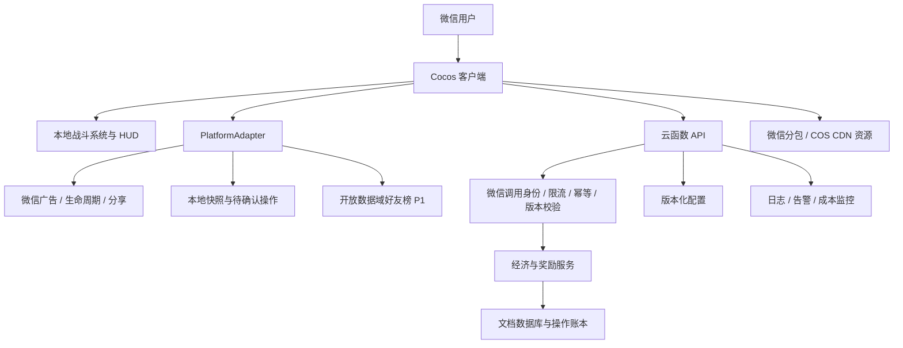

# 《潜渊猎手》微信小游戏技术选型报告

版本：v1.0｜日期：2026-11-09｜关联：LOO-44「技术方案选型」

## 一、结论与项目概述

**拍板：采用 Cocos Creator 3.8 LTS + TypeScript + Cocos 内置 UI；微信小游戏原生 API 接入广告、生命周期与社交；本地快照配合 CloudBase 云函数、文档型数据库管理持久进度。资源采用微信分包与远程 Asset Bundle，战斗在客户端运行，不做实时战斗服务器。**

编辑器建议从 **3.8.8** 建立验证基线：官方版本接口可查到该版本，3.8 手册标注为 LTS；这里选的是可锁定的维护分支，不宣称它是全系列最新版本。首次构建与真机验证通过后，记录编辑器完整版本、构建配置、基础库和依赖锁文件，M1 期间不自动升级。[官方版本列表](https://creator-api.cocos.com/api/cocoshub/editor_version_list?lang=zh&ver=2.3.2)、[3.8 LTS 手册](https://docs.cocos.com/creator/3.8/manual/zh/)

**LayaAir 3.x 是唯一需要保留的引擎替代方案**：仅当 Cocos 在相同素材和优化条件下未通过主包或真机门槛，且 LayaAir 对照样例通过时切换。Unity/团结、Egret、自研原生渲染均不作为本项目首发方案。

### 输入与适用范围

- PRD：`docs/潜渊猎手-PRD.md` v1.0，当前仓库提交 `c02ec17`；并读取 LOO-43 的 PRD 交付与概念图评论。触发评论称 PRD 未提交，但读取时它已经入库，以实际文件为准。
- 竞品：`docs/撞鬼了-竞品分析报告.md` v1.0，提交 `170b130`。采用其已观察到的玩法、广告与养成结构；竞品引擎、性能、真实经营数据没有证据，不能据此推断我们的引擎。
- 产品：竖屏 2D 幸存者类；40–80 只同屏怪物；氧气与舱容双压力；单局 2–5 分钟；三条局外养成线；纯 IAA；P1 好友榜与共生体。
- 团队与节奏：按 PRD 的 2–3 人团队、1 名程序、约 11 周首发评估。仓库当前没有游戏工程，未提供可复用的 Unity/Cocos/Laya 代码或团队熟练度证明，按新项目处理。

本报告完成的是**文档研究与架构决策**。包体分配、对象上限、帧耗时、成本模型是工程预算，均非现有游戏实测；不会据此声称已满足 4MB、80 怪或 3 秒首玩。

## 二、决定选型的约束

| 需求 | 技术含义 | 优先级 |
|---|---|---|
| 主包 ≤4MB、尽快进入首潜 | 引擎裁剪、最小可玩素材、代码与资源依赖审计优先；下载体积和解压/初始化都影响首玩 | 硬约束 |
| 40–80 怪 + 四类武器 + 发光/弹幕 | 同时约束逻辑、碰撞、绘制与透明像素覆盖；怪物数不能代表总负载 | 硬约束 |
| 中端安卓 30fps 底线、60fps 目标 | 必须用真实微信环境测量，并为低端设备降画质 | 硬约束 |
| 七类激励点位、死亡救援/供氧 | 广告加载、打断/恢复、幂等奖励和观测能力是核心产品链路 | 硬约束 |
| 首屏开场即战斗、局外多面板 | 需要编辑器、Prefab、图集、UI 布局工作流；手写基础引擎挤占玩法时间 | 高 |
| 无多人实时、无 App、无 IAP | 不需要原生移动包、3D 渲染或长连接服务器，避免为不存在的需求付出成本 | 高 |
| 本地与云端防丢档 | 必须定义服务端权威状态、冲突规则和断网边界，不能只写“双写” | 高 |

取舍顺序：**包体与微信链路 → 真机战斗性能 → 单程序团队的迭代成本 → 未来跨端能力**。没有用未经测量的引擎跑分作排序依据。

## 三、游戏引擎逐项对比

### 3.1 候选对比表

表中“适合/成本”是结合本产品的工程判断；“支持”以所列官方资料为依据。所有候选都不因名称天然保证 ≤4MB 或 80 怪流畅。

| 候选 | 2D 战斗与 UI 制作 | 4MB 与首玩路径 | 微信/IAA 链路 | 40–80 怪的主要成本 | 本项目决定 |
|---|---|---|---|---|---|
| **Cocos Creator 3.8 LTS** | 场景、Prefab、2D 动画、内置 UI 与 TypeScript 在同一工作流；适合外包美术交付 | 支持功能裁剪、分包、远程资源；仍须控制引擎和首场景依赖 | 官方微信构建、资源缓存、开放数据域接入文档完整；广告仍需封装原生 API | JS 更新/碰撞分配、节点数、材质切换、透明叠加；本项目可主动控制 | **首选**：工具链与资源治理覆盖需求，避免自行拼装核心工具 |
| **Unity → WebGL → 微信转换 SDK；含团结专用小游戏平台** | C#、成熟 2D/UI 与资产生产工具；已有 Unity 工程时复用价值高 | 分包/CDN/代码裁剪可缩主包；WASM、运行时、首资源的总下载与初始化仍需评估，不能把 4MB 主包等同总首玩成本 | 微信官方组织有 Unity/团结 SDK；团结提供专用目标平台与优化，不能定性为“不支持微信” | 额外关注 WASM 编译与堆、运行时内存、JS 桥接和广告返回；不是算力不足 | **不选**：本仓库无 Unity 存量，2D 需求不足以抵偿转换、内存和包体治理成本 |
| **LayaAir 3.x** | TypeScript、2D/UI 编辑器、资源管理和多端发布均可承载产品 | 官方已有微信分包与远程加载方案，不能沿用早期“无分包”印象 | 官方适配微信并有发布指引；广告同样依赖微信 API | 与 Cocos 类似，需要对象池、合批和低透明覆盖；无本项目数据证明谁更快 | **第二选择**：能力足够；在无团队偏好证据时，Cocos 的 Bundle/Prefab/UI 统一方案更符合本次落地路径 |
| **Egret / EUI** | TS、显示列表和 EUI 对 2D 界面适用；已有成熟项目可以维护复用 | 轻量 2D 和资源分组有潜力，但主包依然要量；新基础库适配需要自行确认 | 官方仓库/文档保留小游戏入口，但本次未获得可用于本项目的持续兼容承诺 | 除战斗优化外，需要承担工具链与平台适配验证；不能把“老”直接等同“慢” | **不选新项目**：没有现成团队/资产收益，兼容维护的不确定性不值得引入 |
| **原生 wx Canvas 2D / WebGL，自研循环和 UI** | 可直接控制渲染；场景、动画、图集、编辑器、布局和调试工具要自行实现或组装 | 框架体积最可控；素材体积不因此消失 | 直接调用微信 API；资源缓存、恢复、构建和社交仍需自建 | Canvas 2D 需验证逐对象绘制；WebGL 需自己管理批次、纹理与兼容 | **不选**：一名程序的主要时间会转向基础设施；适合极小玩法或已有自研底座的团队 |

候选依据：[Cocos 微信发布](https://docs.cocos.com/creator/3.8/manual/zh/editor/publish/publish-wechatgame.html)、[LayaAir 微信发布](https://layaair.com/3.3/doc/released/miniGame/wechat/readme.html)、[LayaAir 功能与发布概述](https://www.layaair.com/3.x/doc/basics/)、[微信 Unity/团结 SDK](https://github.com/wechat-miniprogram/minigame-tuanjie-transform-sdk)、[团结小游戏平台](https://docs.unity.cn/cn/tuanjiemanual/1.1/Manual/intro.html)、[Egret 官方仓库](https://github.com/egret-labs/egret-core)。

### 3.2 为什么明确选 Cocos

1. **本项目是带大量局外面板的 2D 游戏。** Cocos 的编辑器、UI、Prefab、图集和资源加载能覆盖核心工作量；生物发光以烘焙贴图、少量叠加效果实现，不依赖 3D 光照优势。
2. **对首包有可实施的控制手段。** 只保留使用中的引擎模块，首场景最小化，内容按海层划分 Bundle；即使后来需要换引擎，这些素材预算也不会白做。
3. **微信适配已有明确官方路径。** 发布、缓存、分包、开放数据域与 iOS 内存优化都有资料可查。成熟的是工具支持，不代表广告业务逻辑自动完成。
4. **客户端、配置工具、云函数可共用 TS 类型与纯计算逻辑。** 单程序团队能减少语言切换，但服务端校验规则不因代码共用而信任客户端。

相较 LayaAir，这是**针对当前团队假设的交付判断**，不是“Cocos 帧率更高”的事实结论。此次将首潜、港口与后续海层直接映射到 Cocos 的 Bundle 工作流，并选择有明确 LTS 标识的维护分支，因此优先统一这条路径。若后续证实唯一程序有多个已上线的 Laya 项目和可复用底座，这会构成重新评估的充分理由；当前没有该输入，先按 Cocos 推进。

Egret 官方仓库的 `package.json` 当前仍声明版本 5.4.1、`typeScriptVersion: 1.8`。这不证明游戏无法运行，但意味着新项目需要单独验证编译器、构建工具与现代微信 API 的适配，本团队没有存量收益可抵消这项工作。[Egret 工具链声明](https://github.com/egret-labs/egret-core/blob/master/package.json)

### 3.3 不采用 Unity 的准确理由

微信 SDK 的更新日志已包含 2026 年更新，团结也明确提供微信目标平台、代码裁剪和运行时优化。因此否决的是本项目的投入产出，不是平台可行性。[SDK 更新日志](https://github.com/wechat-miniprogram/minigame-tuanjie-transform-sdk/blob/main/CHANGELOG.md)

Unity WebGL/团结路径需额外衡量 WASM 加载编译、堆与文件系统的内存开销；官方手册有专门说明。本项目没有待迁移工程，且不做 App/3D，新增这条治理链路的收益有限。可以把主包压小，不等于冷启动更快。[团结平台内存说明](https://docs.unity.cn/cn/tuanjiemanual/1.1/Manual/WebGLPlatform.html)

本次打开旧 `minigame-unity-webgl-transform` 仓库时，GitHub 页面显示访问受限；另一个官方 `minigame-tuanjie-transform-sdk` 仓库可访问并有更新。这是文档依赖的当前访问风险，**不能据此推断 Unity 微信方案停服**。[旧仓库当前页面](https://github.com/wechat-miniprogram/minigame-unity-webgl-transform)

不另起 Cocos 2.4 新项目：虽可用于成熟 2D 项目，但本项目没有 2.4 资产要复用，不同时维护两套 API、编辑器与插件方案。

## 四、对 PRD 技术假设的独立审查

| PRD 假设 | 审查结论 | 本报告采用的替代或限定 |
|---|---|---|
| Cocos Creator 3.x 适合 | **同意，收窄到 3.8 LTS** | 依据是功能/工具链匹配；不把“3.x”作为可复现版本，基线建议 3.8.8 |
| “主包压到 4MB 内无压力” | **不同意此保证** | 引擎裁剪与首屏资产做预算，每次 release 构建检查微信编译包；主包先按 ≤3.5MiB 分配，实际余量按微信计量口径确认 |
| 整包 ≤20MB | **不能直接认定为最新平台统一值** | Cocos 3.8 分包文档写 30M，LayaAir 3.3 仍写 20M；微信原站正文本次未能读取。项目暂按主包 4MB、总包 20MiB 内控，以目标 AppID 最新后台/工具校验为准，不靠放宽总包解题 |
| 开放数据域“独立包” | **表述不精确** | 它是隔离执行/数据环境，不自动等同微信“独立分包”，更不代表不计包体。必须审计输出文件和实际计包结果 |
| 微信云开发适合存档 | **同意** | 原生 `wx.cloud` 可直接用于小游戏，适合无实时多人、低频经济操作的 Serverless 后端 |
| “免费额度足够单产品” | **不同意** | 套餐、调用、计算、数据库、存储和 CDN 都要测算；按实际环境计费，不承诺免费 |
| 一键登录 | **调整表达** | 默认后台获得云调用身份，无需弹出注册/登录页；需要昵称/头像时才走相应用户授权。不要把读取公开资料当作登录条件 |
| 存档冲突“取高进度” | **不同意通用合并** | 纪录可对已校验值取最大；货币、装备、抽箱保底、消耗必须用服务器 revision、事务与操作流水处理 |
| 广告拉取失败重试后直接发奖 | **不采纳无限等价发奖** | 默认不发广告奖励；如产品保留容错补偿，使用独立、服务端限额的补偿策略，不能计为广告完成 |
| 云函数“校验广告奖励”即可防作弊 | **只能部分成立** | 服务端控制额度和幂等；客户端 `isEnded` 不是服务端观看凭证，不承诺证明真实观看或彻底防改内存 |
| “分包热更断点续传” | **不同意作为现成保证** | 代码随审核版本更新；远程资源按文件/内容哈希缓存和失败重试，不承诺字节级断点续传，不远程执行新 JS |
| 断网 >30s 安全回城保留舱内收益 | **需要补结算边界** | 游戏不因断网继续耗氧；本地保留待结算快照。回城不能直接把客户端自报金额变成已确认资产；重连后校验并幂等结算 |

分包差异依据：[Cocos 分包限制](https://docs.cocos.com/creator/3.8/manual/zh/editor/publish/subpackage.html)、[LayaAir 微信分包说明](https://layaair.com/3.3/doc/released/miniGame/wechat/readme.html)。小游戏原生云开发接入：[CloudBase 小游戏快速开始](https://docs.cloudbase.net/quick-start/frameworks/wechat-minigame-native)。计费不能沿用免费假设：[资源点计费说明](https://docs.cloudbase.net/quick-start/resource-point)。

PRD 还存在两处影响实施的范围不一致：正文三海层到 2400m，MVP 写“三海层至 1600m”；战令广告列为 Must，但战令系统又列入 Should。建议以 **三层到 2400m、战令及其广告一起放 P1** 作为估算口径，待产品评审确认；这不影响当前引擎决策，也未修改原 PRD。

## 五、完整技术栈与系统架构

### 5.1 技术栈拍板

| 层次 | 选择 | 理由与边界 |
|---|---|---|
| 客户端 | Cocos Creator 3.8 LTS、TS 严格类型；编译器跟随编辑器 | 避免另装最新版 TS 破坏装饰器/构建兼容；业务接口显式建模 |
| 渲染与动画 | 2D Sprite、静态图集、序列帧/简单节点动画 | 普通怪不引入 Spine/DragonBones；不启用 3D 物理、PBR、全屏实时 Bloom |
| UI | 内置 Canvas/UITransform/Widget/Layout/Button/ScrollView + Prefab | HUD 和港口面板共用引擎；数字用 BMFont/字图，正文优先系统字体；不额外引入 FairyGUI，也不将战斗做成 WXML 页面 |
| 逻辑 | 独立的战斗系统与轻量数据模型；集中调度 | 80 怪规模不先上大型 ECS、Redux 或 Rx；避免每个节点一个完整行为树 |
| 平台层 | `PlatformAdapter` 封装原生 `wx.*` | 广告、存储、前后台、分享、安全区、网络与开放数据域集中处理；浏览器预览用明确的模拟实现 |
| 网络 | `wx.cloud.callFunction`；原生 `wx.cloud.init` | 游戏不装 Web 端 `@cloudbase/js-sdk`；不引入 WebSocket/帧同步 |
| 云端 | Node.js 云函数，TS 编译 JS；`wx-server-sdk` 取微信身份，`@cloudbase/node-sdk` 做数据库事务 | 函数创建前锁定目标环境实际支持的 Node.js 运行时与兼容依赖版本；仅受信云调用入口处理经济请求 |
| 数据库 | CloudBase 文档型数据库 | 用户聚合状态 + 幂等账本适合 JSON 文档；MVP 不引入 MySQL、Redis、消息队列 |
| 资源 | 微信普通分包 + 远程 Asset Bundle；公开静态资源用 COS/CDN | 大素材不经云函数转发；私有数据不放公开资源桶；CloudBase 云存储可用于备份等私有文件 |
| 配置 | 表格/JSON → schema 校验 → 构建时生成类型；云端版本化配置 | 客户端读缓存，服务器按锁定版本计算，禁止任意远程脚本 |
| 观测与构建 | 微信数据分析/性能能力 + 云端结构化日志；Creator CLI + `miniprogram-ci` | 避免首包塞入多个统计 SDK；客户端事件与服务器入账事件分开统计 |

### 5.2 系统架构



战斗帧循环不依赖后端。启动时先加载本地最小可玩场景，异步读取云存档和配置；云端未就绪时可进入教学体验，首笔持久资产结算前必须完成身份与存档同步。首次体验产生的进度只能导入一次，并受服务端新手奖励上限约束。

### 5.3 CloudBase 与自建后端比较

| 方案 | 本产品收益 | 主要代价 | 决策 |
|---|---|---|---|
| **CloudBase 云函数 + 文档库** | 微信身份衔接、低频请求、弹性、少运维；可按用户聚合保存 | 有冷启动、配额与供应商耦合，必须看账单 | **采用**；不让冷启动进入战斗帧或首屏必经路径 |
| 自建 Node.js 服务 + MySQL/Redis | 复杂联机/全局排名/跨平台账号及高稳定负载可控 | 自行处理微信登录会话、部署、安全、备份、扩缩容和长驻成本 | 首发不采用；未来实时多人、复杂经济查询或实测成本倒挂再评估 |
| 仅本地存档 | 可离线、最少后端工作量 | 清缓存/换机丢档，奖励次数与多端冲突无法可靠控制 | 仅用于灰盒原型，不用于正式 IAA 版本 |
| 微信托管 KV 当全量存档 | 好友榜可复用 | 不是通用经济数据库、权限与容量模型不适合完整背包/流水 | 只存排行摘要，不作主存档 |

云开发是因业务低频、微信单端与人手约束被选中。数据库事务官方支持服务端执行，可承担资产与账本的原子更新。[CloudBase 事务操作](https://docs.cloudbase.net/database/transaction)

## 六、分包、资源加载与首玩预算

### 6.1 包结构与预算

以下是分配额度，不是测得的 Cocos 文件大小。**平台上限沿用任务的 4MB；工程预算用 MiB，最终按微信编译结果和计量口径验收，不能只看源目录或 zip 大小。**

| 包/资源 | 内容 | 工程预算 | 加载时机 |
|---|---|---|---|
| 主包：启动 + 最小首潜 | 裁剪引擎、平台适配、核心战斗代码、基础 HUD、简版日光层、首批普通怪 | **≤3.5MiB**：引擎/适配 2.0，业务 0.6，资源 0.7，启动配置等 0.2；各项可重分配 | 必需 |
| `meta` 微信普通分包 | 港口养成 UI、装备/科技面板及审核内脚本 | ≤3MiB | 首次卸货前加载，等待时保留结算现场 |
| `social` 微信普通分包，P1 | 榜单入口、开放数据域所需文件；具体输出按构建配置归属审计 | ≤1MiB | 打开好友榜前 |
| 日光层扩展 Bundle | 后续怪物、完整版背景、音效 | 目标 ≤2MiB 首次增量 | 首潜开始后分批预取 |
| 暮光/深渊 Bundle | 各海层图集、Boss、场景与音频 | 每层目标 ≤4MiB 下载体积 | 距海层边界尚有余量时预取 |
| 共生体/活动 Bundle，P1+ | 后续内容与稀有美术 | 按功能单独预算 | 解锁前后按需 |

主包不打入 36 种怪、所有港口面板、完整中文 TTF、完整 BGM 或概念图原图。基础素材不足时应优先减素材/代码依赖；不能把只够启动的空白加载页称作“首玩达标”。总本地包暂设 **≤20MiB 内控**，CDN 资源另计流量与运行内存。

### 6.2 加载与依赖规则

1. **代码与资源分别处理。** 微信分包是审核内代码包；远程 Bundle 仅承载允许远程加载的资源/配置。Creator 文档明确微信不允许远程脚本，构建会把相应脚本保留到本地目录，必须检查 `src/bundle-scripts` 与公共 chunk。[Asset Bundle 脚本规则](https://docs.cocos.com/creator/3.8/manual/zh/asset/bundle.html)
2. **首场景只硬引用首屏资源。** 大图、装备和 Boss 通过资源键延迟加载。公共 HUD 图集单独规划；检查 Bundle 依赖图和重复图集，防止远程素材因 Prefab 硬引用回流主包。
3. **预加载不等于已经能显示。** 下载之后仍有反序列化、纹理上传和实例化，安排到非战斗高峰分帧完成；不能在 Boss 刷出当帧才同步加载全套效果。
4. **失败可恢复。** 下载失败有限重试、显示进度；新海层未就绪就留在已加载区域或安全返回港口，不把无资源区域当正常战场。缓存清理后允许重新下载，已确认存档不受影响。
5. **版本不可覆盖。** CDN 路径含 `clientVersion/resourceVersion/hash`，先上传资源再激活清单；旧客户端锁定旧资源。配置带 `minClientVersion`、有效期、默认值和回退版本。
6. **释放要跟随引用生命周期。** 离开海层后先清理节点池/引用，再释放该 Bundle 独占资产，共享图集常驻。仅移除 Bundle 索引不等于释放纹理；不能盲目 `releaseAll` 破坏仍在用的共享资源。

Creator 官方提供首场景 Bundle、远程地址、模块裁剪及 WASM 分包选项；首场景 Bundle 本身不自动等同微信分包。[微信构建选项](https://docs.cocos.com/creator/3.8/manual/zh/editor/publish/publish-wechatgame.html)

**不把引擎插件当 4MB 豁免。** 官方说明插件只适用于匹配版本的内置引擎、非调试构建，并明确引擎代码仍计入首包。是否启用只由真机冷/暖启动对照决定，不假设用户已有插件缓存。[Cocos 引擎插件说明](https://docs.cocos.com/creator/3.8/manual/zh/editor/publish/wechatgame-plugin.html)

## 七、核心模块、安全与性能方案

### 7.1 战斗、氧气与死亡结算

- **集中更新**：`SpawnSystem / MovementSystem / TargetingSystem / WeaponSystem / HitSystem / LootSystem / OxygenSystem` 操作逻辑数据，视图组件只同步位置/表现。逻辑固定 30Hz，渲染 30/60fps；每帧限制追赶步数，后台返回不补算数分钟伤害。
- **索敌/碰撞**：空间哈希网格或固定网格做宽相筛选，再做圆形/线段检测；鱼雷使用扫掠检测避免穿透漏判。普通怪不启用刚体，不做全怪两两物理碰撞；局部避让按邻格计算。
- **调度降频**：索敌/远处怪决策可 5–10Hz、移动保持逻辑频率；不为每怪建独立计时器。上限 80 是活跃怪预算，刷怪器溢出推迟，Boss/精英留配额，不能以减少为 40 怪来冒充 80 怪验收。
- **对象池**：怪、子弹、掉落、飘字和特效预热复用；池满有确定退化策略。复用时重置事件、命中集合和引用；热点不反复 `new Vec3`、数组过滤、创建闭包或销毁节点。
- **双压力**：氧气使用游戏有效时间和深度系数，前后台/广告都进入统一暂停管理器；用暂停原因集合处理多重暂停，避免广告结束时误解除来电暂停。
- **死亡状态机**：`Running → RescuePending → Running / Finalized`。进入救援选择时冻结舱内快照，暂不永久清空；拒绝、放弃或超限后再最终清舱。复活成功沿原 `diveId` 继续，不能重复卸货。这补足 PRD 流程图“先清空再保留”的实现歧义。

### 7.2 深海发光与 UI

- 普通怪使用烘焙发光边缘和共享材质，少量独立光晕；低档关闭大范围叠加和背景悬浮粒子。优先用美术贴图形成亮暗层次，MVP 不上全屏 Bloom/实时多光源。
- 按海层/用途拆静态图集；按共享材质、纹理与层级排列绘制，限制 Mask 与逐怪自定义 uniform。官方合批规则要求材质、纹理等一致，不能仅“放进图集”就保证一个 draw call。[2D 合批规则](https://docs.cocos.com/creator/3.8/manual/zh/ui-system/components/engine/ui-batch.html)
- 飘字合并同一目标短时间内的伤害，以字图而非大量动态文本 Canvas 绘制；装备列表只渲染可见项，面板关闭解除事件并按预算释放。
- 初版贴图以单张 ≤2048 为预算，依据设备能力选择压缩纹理与 PNG 回退；不要同时把所有纹理变体加载进内存。2048² RGBA8 未压缩单层即 16MiB，磁盘小图不等于低显存。
- 保守限制渲染分辨率/DPR，持续帧耗时超限时先减粒子、飘字、背景效果，再降低渲染分辨率；玩法碰撞、氧气与奖励不因画质档位改变。iOS 也必须测，纹理、字体、音频与 Canvas 都占内存。[Cocos iOS 优化指南](https://docs.cocos.com/creator/3.8/manual/zh/editor/publish/wechat-ios-optimize.html)

### 7.3 纯 IAA 接入

`AdService` 统一实现 `Idle → Loading → Ready → Showing → Completed/Skipped/Failed → Claiming → Done`。按点位映射广告单元，限制同时展示一个广告，监听器只注册一次并正确解除。

官方类型定义提供 `load/show/onError/onClose`，`isEnded` 表示完整观看；这些是客户端事件。[微信小游戏官方 API 定义](https://raw.githubusercontent.com/wechat-miniprogram/minigame-api-typings/master/types/wx/lib.wx.api.d.ts)

实现决策：

1. 点广告前取得绑定用户、点位、当天次数、`diveId` 的短期 `rewardToken`，并固定本次奖励配置；取令牌失败时不播放会承诺经济奖励的广告。
2. 展示前保存现场并暂停；`show` 失败可执行一次 `load → show` 重试。关闭但未完成不发奖；未知/缺失完成状态不当作观看完成。
3. 完成后携带 token 请求云函数；服务器检查令牌、次数、有效期与状态，在事务中发放一次。网络超时显示“奖励确认中”，同 token 重试返回原结果；不能重新生成 token 再领一份。
4. 失败重试仍失败时默认保留原选择；如要给补偿，由云端独立计算限额，记录 `source=fallback`，不计广告完成、收入或真实观看。未成年/广告限制等状态按平台实际能力处理，**未验证存在通用“实名年龄查询接口”，不写一个假接口，也不把无填充推断为未成年**。
5. **明确安全边界**：token、云函数与限额能防重领和越权，无法独立证明客户端没伪造 `isEnded`。若实际流量主产品提供可用的服务端验证能力，再按该能力接入；本版不虚构验签回调。单人 IAA MVP 接受此残余风险，配合频率、时长异常和账户风险上限治理。

事件拆为 `ad_request/ad_loaded/ad_impression/ad_complete/ad_skip/ad_error/reward_granted/reward_fallback`。`reward_granted` 用服务器账本做准，`ad_complete` 仅为客户端观测，不将“广告按钮点击”算作完成。

### 7.4 好友榜与分享（P1）

主域只把已校验的纪录摘要写入微信托管 KV；开放数据域读取同玩好友数据，绘制到共享 Canvas，主域显示榜单纹理。好友数据接口受授权与开放数据域边界限制，不能假设主域能拿到全量好友关系。[微信好友数据接口定义](https://raw.githubusercontent.com/wechat-miniprogram/minigame-api-typings/master/types/wx/lib.wx.api.d.ts)、[Cocos 开放数据域](https://docs.cocos.com/creator/3.8/manual/zh/editor/publish/build-open-data-context.html)

最深纪录和周榜使用不同键/周期标识；离线或授权失败显示本人成绩和重试。托管数据只是显示摘要，客户端写榜仍有作弊面，不用于发放有价值的排名奖励。MVP 不做全服榜；P1 深度海报使用程序绘制数字与角色剪影，不在运行时调用 AI 生图。

## 八、存档、数据模型与接口契约

### 8.1 权威状态与断网处理

**本地快照是容错缓存，云端是已确认经济状态。** 本地记录 `schemaVersion / cloudRev / deviceId / sessionEpoch / snapshot / pendingOps`；校验和用于识别损坏，不声称能防篡改。快照做双槽写入，正常玩法定期低频保存，卸货与切后台补保存；不能只依赖 `onHide` 最后一刻网络请求。

- 云端为每个用户维护单调递增 `revision` 和有效会话代次。经济操作携带 `expectedRev + opId`，事务内更新状态、日次数和幂等账本；同 `opId` 重试返回已提交结果。
- 第二设备接管时更新 `sessionEpoch`，旧设备不能再结算资产；恢复时拉取权威快照，不能拼接两台设备的装备或分别取最大余额。
- 本地与云端只对**无消耗、已验证的单调量**（例如历史最深纪录）考虑 max 合并；货币余额、持有装备、保底计数与领取状态都按事务结果恢复。
- 建议正式局需在线开始与卸货；局内断网可继续并保留现场/待结算数据，但不产生已确认入账；重连后补交同一操作。完全离线启动只提供已缓存体验，不给新广告经济奖励。该联网边界是本报告的产品建议，需在 PRD 评审中确认。
- 服务端按开始时装备/配置、有效时长、可达深度、产出上限做低成本合理性校验。**这不是完整战斗重演，不能证明每次击杀真实发生**；如未来有现金竞争、排名派奖或 IAP，再提高权威计算强度。
- 断网超时的“安全回城”只结束本地战斗，不跳过结算校验；不因断网清掉已确认资产。待确认收益在 UI 单独标识，云端拒绝异常增量时有错误码与可追查操作号。

默认身份使用云函数可信调用上下文，不信任请求体传来的 openid；定时任务、HTTP 入口与后台管理不能直接复用玩家入口的身份假设。[CloudBase 微信身份示例](https://docs.cloudbase.net/recipes/add-cloud-function-wechat-miniprogram)

### 8.2 核心数据模型

| 集合 | 关键字段 | 索引/约束与用途 |
|---|---|---|
| `players` | `_id=uid`，`schemaVersion/revision/sessionEpoch`，钱包、强化等级、科技、装备与保底、纪录、当日额度、当前局摘要 | uid 为主键；资产小规模聚合便于原子更新，限制背包容量；不无限追加历史数组 |
| `dives` | `diveId/uid/sessionEpoch/startRev/configVersion/startAt`，开始属性、检查摘要、状态、`settlementOpId` | 主键固定；按 uid/状态查询当前局；一局只允许一次最终结算 |
| `reward_intents` | `tokenId/uid/slot/diveId/rewardVersion/issuedAt/expiresAt/status` | tokenId 唯一文档；绑定用户；短期有效；不在公开日志写完整令牌 |
| `operations` | `_id=uid+opId`，操作类型、请求摘要、前后 revision、结果、`serverAt/source` | 文档主键承担唯一幂等键；请求摘要不一致拒绝；按时间做保留清理，不依赖临时缓存防重复 |
| `configs` | 配置版本、客户端最低版本、曲线、点位限额、实验分桶、回滚目标 | 仅管理端写；一局/一次奖励固定对应版本 |

金额、材料与次数不用浮点数存小数；对 PRD 1000 级与指数消耗先做范围分析。超出 JS 安全整数时，持久层使用十进制字符串，双方共用明确的大数运算规则，禁止 JSON 直接传 BigInt 或用展示用的 K/M/B 字符串结算。

### 8.3 API 设计

通过少量云函数路由以下业务命令，不是每个表直接暴露 CRUD。金额、升级费用、掉落与装备抽取结果由服务器规则决定，客户端提交意图/受约束摘要。

| 命令 | 请求关键字段 | 响应/规则 |
|---|---|---|
| `bootstrap` | `clientVersion/schemaVersion/deviceId` | 用户快照、revision、会话代次、服务端时间、配置版本；新用户初始化幂等 |
| `dive.begin` | `expectedRev/opId/sessionEpoch/loadoutId` | `diveId/configVersion/startSnapshot/revision`；同用户一个有效局 |
| `dive.settle` | `diveId/opId/expectedRev/endReason/summary` | 校验后按死亡/卸货等规则入账，返回权威钱包/装备/revision；不可重复领取 |
| `economy.execute` | `opId/expectedRev/action/targetIds` | 强化、科技、合成、抽箱；服务端扣除与产生，返回资产变化；禁止客户端指定中奖装备 |
| `reward.prepare` | `opId/slot/diveId?` | token、固定奖励版本和剩余次数；无额度则拒绝 |
| `reward.claim` | `opId/token/clientCompletionState` | 幂等奖励结果、最新 revision；客户端完成状态作为风险信号，不视为不可伪造凭证 |
| `config.get` | 当前配置版本、客户端版本 | 有兼容范围的只读配置/无更新；默认配置内置 |
| `telemetry.batch` | 批次 ID、允许字段的事件列表 | 限流、批量接收；日志不能驱动发奖 |

统一错误：`REV_CONFLICT / SESSION_REPLACED / QUOTA_EXCEEDED / TOKEN_EXPIRED / INVALID_STATE / CLIENT_TOO_OLD / RETRYABLE`。响应含 `requestId/serverTime`；重试保持同 `opId`。服务端日界线统一按 Asia/Shanghai 计算，不使用手机日期判每日次数。

### 8.4 权限与运维安全

客户端禁止直接写钱包、装备、奖励、配置和账本；全部走鉴权云函数，读也优先按 API 裁剪返回。函数内复核身份、会话、目标归属、整数范围与限额，数据库规则不能代替服务端校验。开发/测试/生产环境与广告单元隔离；AppSecret、上传私钥和云凭据不进入客户端或仓库。

## 九、构建、发布与部署运维

### 9.1 建议代码结构

```text
game/
  assets/scripts/{battle,meta,ui,platform,services}/
  assets/bundles/{boot,meta,sunlight,twilight,abyss,social}/
  build-configs/
server/
  functions/{game-api,telemetry}/
shared/                 # 纯 TS 类型、配置 schema、经济计算
tools/                  # 配置导出、包体与依赖检查
docs/
```

这是后续工程布局建议，本次未创建这些目录或脚手架。公共 TS 模块通过构建流程分别产出客户端/云端版本，不能令客户端引用服务器 SDK、密钥或数据库访问代码。

### 9.2 发布链路

1. **固定工具链**：Creator 完整版本、Node.js 与依赖锁、微信开发者工具稳定版、测试基础库版本。提交 `assets` 与 `.meta`、项目设置、构建配置；排除 Library/Temp、私钥和大体积构建缓存。
2. **静态与逻辑验证**：TS 检查、配置 schema、数值边界；有实现后重点验证经济守恒、合成扣费、幂等重试、每日重置、存档迁移与多设备冲突，而不是给每个 UI 写同构单测。
3. **Creator release 构建**：CLI 读取编辑器导出的微信配置，关闭调试、裁剪不用的模块，生成 `game.json/project.config.json`；构建后检查脚本与资源落点。官方 CLI 支持导出配置，运行环境仍需满足编辑器要求，不假设任意无图形 Linux 容器都能直接构建。[Creator 命令行发布](https://docs.cocos.com/creator/3.8/manual/zh/editor/publish/publish-in-command-line.html)
4. **包体与资源检查**：生成每包大小和依赖报告，审计隐式主包引用、重复素材、缺失远程文件与域名；以微信编译/预览结果作为最终包体证据。保存本次资源清单和 hash。
5. **先部署兼容后端与不可变资源**：配置数据库权限、索引、函数、配置回退与 CDN 域名；验证旧客户端仍可用，随后再启用新客户端资源清单。云函数不参与大纹理下载。
6. **微信预览/体验版**：`miniprogram-ci` 明确使用 `type: miniGame`。代码上传密钥在 CI 密钥库，配置上传 IP 白名单。它提供预览/上传能力，不等同自动审核发布。[官方 miniprogram-ci](https://github.com/wechat-miniprogram/miniprogram-ci-dist)
7. **真机与发布**：完成第十节门槛后，体验版验证真实广告与生命周期，按公众平台当时的流程提审、灰度、观察，再全量。首发资质与广告权限使用该 AppID 的实际后台核对结果，不把 PRD 中绝对化表述当技术证明。

### 9.3 运维与成本

- 记录 `clientVersion/resourceVersion/configVersion/schemaVersion/requestId`，性能按设备档位与微信版本分组。日志脱敏，限制高频上报，避免逐击杀发请求。
- 监控启动成功率、首玩时间、崩溃/内存警告、广告填充与完成、发奖失败、待确认结算积压、函数错误/耗时、事务冲突、数据库/资源流量成本。无填充与奖励服务故障分别告警。
- 配置急停可在下次拉取或领取校验时生效；战斗外周期拉取，服务端每次领取重校开关。离线客户端无法承诺“秒级收到”；不为急停给每个玩家建长连接。
- 回滚同时覆盖审核版本、兼容 API、配置和资源清单；保留旧资源直到旧客户端退出。存档使用加字段/可向后读的演进方式，不能回退客户端却留下无法读取的新档；上线前做备份恢复演练。

**容量估算例（非报价）**：10,000 DAU、每人每天 6 潜，`begin+settle` 为 12 次；4 次广告的 `prepare+claim` 为 8 次；启动/养成等假设 10 次，共约 **30 万业务调用/日、900 万/月**。若每调用平均 3 次数据库操作，则约 2700 万数据库操作/月；100KB 聚合档 × 10 万用户约 10GB，另加账本/索引/备份；每月 10 万次冷下载、平均 8MiB 增量资源约 781GiB CDN 流量。

实际费用应按目标环境当前套餐、资源点、函数计算时长、数据库操作与 CDN 计费项核算，日志/备份另计；不把上述请求量当数据库套餐已够用的证明。先测 1000/10000 DAU 两档与峰值并发，设置预算告警，再决定预热或扩容。当前选 CloudBase 不附带“零成本”结论。[CloudBase 计费模式](https://docs.cloudbase.net/quick-start/resource-point)

## 十、验证门槛与执行顺序

### 10.1 必须通过的代表性场景

以下是后续 M0/M1 的验收计划，本次没有执行真机测试。

| 维度 | 测试内容 | 工程验收口径 |
|---|---|---|
| 包体 | release、实际 AppID、全部七类广告业务代码和云调用适配纳入构建 | 主包工程目标 ≤3.5MiB，微信校验 ≤4MB；总本地包 ≤20MiB 内控；保存编译报告 |
| 满载战斗 | 40/80 怪两档；80 怪中含精英，四类武器并发；起始预算 200 子弹、100 个合并掉落、30 组飘字；Boss 与透明光晕一起测 | 数量是压力配置而非性能结论；中端安卓 10 分钟稳态目标 30fps，考虑调度抖动以帧间隔 p95 ≤35ms、>50ms 帧占比 <1% 作为初始门槛；加载/广告阶段单列；保留 80 怪验收 |
| 帧预算定位 | 30fps 档先分配逻辑 ≤8ms、脚本侧渲染准备 ≤8ms；GPU 帧耗时单独测，不与 CPU 简单相加 | 用 profiler 找瓶颈；60fps 档按 16.7ms 总帧约束重新测；不以平均 fps 掩盖卡顿 |
| 首玩 | 从点击启动到可移动、可攻击、HUD 生效；冷缓存/热缓存、Wi-Fi/限定网络分组 | 建议冷缓存 20Mbps、RTT 50ms、无丢包，中端机 30 次 p90 <3s；另测 5Mbps/100ms，单列结果，不宣称全网 <3s |
| 内存与热稳定 | 30 分钟多次进出海层/港口；连续广告返回；iOS 较老设备与 Android 低/中档 | 初始工作集预算 ≤250MiB、峰值 ≤350MiB，非微信平台硬阈值；无持续上涨、异常退出，收到内存告警主动释放非当前内容 |
| 广告 | 加载失败、未完成关闭、重复回调、完成后断网、领奖超时、广告中切后台 | 每令牌只入账一次；现场和氧气正确恢复；补偿与完成区分统计 |
| 存档与结算 | 云端已提交但客户端超时、二次卸货、跨日、两设备、清缓存、旧版档迁移 | 不重复发奖/扣费，不按 max 恢复消费；确认资产可恢复，未确认收益有状态 |
| 兼容 | 明确记录具体机型、SoC、RAM、OS、微信/基础库、画质档 | 覆盖 PRD Android 8+/iOS 13+ 的可获得代表机与当前常用机；“骁龙 6 系”不足以替代机型记录；不可用 API 有降级 |

崩溃率 <0.5% 沿用 PRD 作为灰度运营目标，需要足够真实会话样本；几次内部测试不能证明达标。首潜完成率、留存与人均广告数是产品实验指标，不是引擎对比的已知性能。

### 10.2 执行顺序与切换条件

1. **M0 前段，先用 1–2 个工作日验证最大风险**：Cocos 最小 release 包、真实 `wx.cloud` 往返、广告暂停/返回、80 怪灰盒。先得到包体、冷启动和帧耗时证据，再批量制作 36 怪与全部面板。
2. Cocos 未过门槛时，先检查未裁剪模块、首场景硬依赖、热分配、材质/透明叠加与分辨率。以相同画面、武器、对象数和设备复测，不能只比较空工程。
3. **仍有不可消除的阻塞，才做 LayaAir 对照样例**。Laya 必须通过相同微信编译包、资源加载、广告和真机测试，且有明确迁移成本，方替换；没有结果就不声称某引擎能兜底。
4. M1 完成服务端经济、幂等、存档迁移、资源版本与观测闭环；P1 再扩共生体、好友榜和战令。云存档应在 M1 首次小流量体验前完成，不延后至 PRD M2 才补。

**最终决策保持：按 Cocos Creator 3.8 LTS 开展原型与正式技术准备。** 需要产品评审确认的是海层/战令范围、联网结算边界和广告失败补偿策略；包体、3 秒首玩与 80 怪性能属于实施后的实测准入项，不把它们包装成研究阶段已经通过的结果。

## 资料核验说明

检索日期：2026-11-09。技术事实优先使用 Cocos、LayaAir、Unity/团结、CloudBase 官方文档及微信官方 GitHub；引擎取舍、预算与接口是本报告的架构建议。微信开发者文档部分页面本次无法读取，相关 API 用官方组织维护的类型定义交叉核验；未读取成功的页面未作为已验证事实的依据。分包总量资料冲突已在第四节明确保留，不将旧资料悄然当作最新规则。
